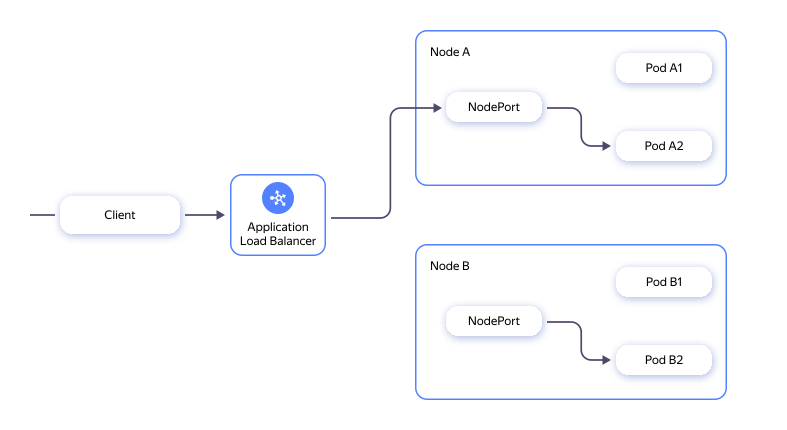
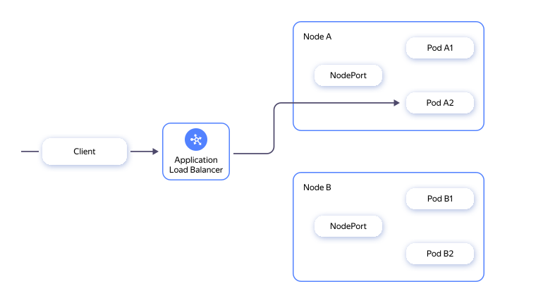

When routing directly into the pods, Gwin registers the IP addresses of the pods in the {{ alb-name }} target group and the balancer sends the request directly to the pod:



This removes the intermediate node hop, reduces latency, offloads nodes, and allows {{ alb-name }} to balance requests between pods directly.

## Comparison of routing to pods and to NodePort {#routing-compare}

| Scenario | Routing to pods | NodePort |
| --- | --- | --- |
| Load balancing | {{ alb-name }} evenly distributes requests among all ready pods. | {{ alb-name }} reuses connections with nodes, and `kube-proxy` selects a pod only when opening a connection. Some replicas may not receive traffic. |
| Scaling and [canary deployment](https://martinfowler.com/bliki/CanaryRelease.html) | New ready-to-use replicas are immediately included in load balancing. Scaling offloads the running pods, while the canary version receives its share of the traffic. | New pods do not necessarily receive traffic as long as {{ alb-name }} holds old connections to nodes. |
| Health check and normal termination | After configuring a health check, {{ alb-name }} stops sending requests to the unready pod. During termination, Gwin removes the pod from the target group before the application stops. | `kube-proxy` does not route new connections to an unready pod, but it does not terminate existing ones. The pod may continue to receive requests after entering the `NotReady` state and during termination. |
| Traffic path | `{{ alb-name }} -> Pod` | `{{ alb-name }} -> Node:NodePort -> Pod` |
| Latency and node load | There is no intermediate node, its network stack, and `kube-proxy`. | An extra hop increases latency and consumes the node’s network resources. |



The benefits of direct pod routing directly depend on the correct configuration of readiness conditions (`readinessGate`), the `preStop` hook, pod termination time, and health checks.



If a pod crashes or a node becomes unavailable while using direct pod routing, {{ alb-name }} may still route some traffic to that target. Until health check marks the target as unhealthy, 5xx errors or timeouts may occur. 

With NodePort routing, the connection to the crashed pod is terminated, and {{ k8s }} routes new connections to the remaining pods. If the app tends to crash often and cannot handle that window, consider NodePort routing or implementing retry logic on the client side to smooth out short-lived failures.

## Specifics of working with Cilium in tunnel mode {#cilium-features}

In {{ managed-k8s-name }}, in clusters with the [Cilium](../../managed-kubernetes/concepts/network-policy.md#cilium) network controller in [tunnel mode](https://docs.cilium.io/en/v1.14/network/concepts/routing/#encapsulation), pod IP addresses are not directly accessible from the network. Pod CIDR ranges live only in a logical network and are not routed by [{{ vpc-name }}](../../vpc/). Therefore, {{ alb-name }} cannot directly access pod IP addresses.

To link routes to pod networks through cluster nodes and the {{ alb-name }} subnet, Gwin creates a route table. Each owner gets one table, marked with the `gwin-owner: <owner>` label: 

* If the {{ alb-name }} subnet already contains this owner’s table, it is taken under management.
* If no {{ alb-name }} subnet contains the table, a new one is created and attached to all subnets.
* If the {{ alb-name }} subnet contains a table without the owner label, Gwin stops with the `PodRouteSubnetConflict` event.
* A table that you no longer need is automatically detached and deleted. This occurs, for example, when the last service that uses pods as a target is deleted.



The route table is managed exclusively by Gwin. Do not add routes to it or link it to other subnets: Gwin replaces the full list of routes every time you sync.



For proper routing to the pods in a cluster with Cilium, the following conditions must be met: 

* For {{ alb-name }}, the subnet is separated from cluster nodes. Do not create {{ alb-name }} in cluster node subnets.
* The Gwin [service account](*sa) is [assigned](../../iam/operations/sa/assign-role-for-sa.md) the following roles: 
   * `vpc.privateAdmin`: For managing route tables and subnet associations.  
   * `k8s.viewer`: For finding a cluster.
* There are [quotas](*quotas) for creating static routes (`vpc.staticRoutes.count`). Each node has its own pod-CIDR, so you need one static route per node. The default quota is 256 routes per cloud.
* The pod CIDR does not overlap with subnet ranges. Two conflicting routes will appear for the same IP address.

Even if all conditions are met, Gwin does not begin to manage the routes until it is satisfied that:

1. The Gateway API or Ingress resources have a link to a service that uses pods as its target.
1. The cluster does need internal routes. Gwin checks that Cilium is in tunnel mode. In clusters with initially routable CIDR ranges of pods, such as Calico or Cilium with `routing_mode=direct`, Gwin remains on hold.
1. Each {{ alb-name }} subnet is dedicated to the load balancer and not used by any cluster node group. If the subnet is shared, Gwin generates the `PodRouteSubnetConflict` event and does not create or update route tables.

## Configuring routing to pods {#setup}

An HTTP application is used as an example for the minimal routing setup to pods. The endpoint of the `GET /healthz` app returns `200` when the pod is ready to accept traffic.



Pod routing works with Gwin version 1.9.1 and higher.



If you have not installed Gwin yet, follow [this guide](../../application-load-balancer/tools/gwin/quickstart.md). Next, set up the application using the guide provided below. Multiple Gwin installations or clusters that share a network are not supported.

### Create a gateway {#create-gateway}

To determine how {{ alb-name }} will receive incoming traffic, create a `Gateway`:

   ```yaml
   apiVersion: gateway.networking.k8s.io/v1
   kind: Gateway
   metadata:
     name: example-gateway
     annotations:
       gwin.yandex.cloud/subnets: <subnet_ID>
       gwin.yandex.cloud/securityGroups: <security_group_ID>
   spec:
     gatewayClassName: gwin-default
     listeners:
       - name: http
         protocol: HTTP
         port: 80
         allowedRoutes:
           namespaces:
             from: Same
   ```

   Where:

   * `gwin.yandex.cloud/subnets`: Subnet in which you will create {{ alb-name }}. It is important that this subnet is not occupied by cluster nodes. This is especially critical when working with Cilium in tunnel mode.
   * `gwin.yandex.cloud/securityGroups`: [Security group](*sec-group) configured on the network with the load balancer.
   * `gatewayClassName: gwin-default`: Instructing the Gwin controller to process this gateway and create a load balancer for it.
   * `listeners`: Description of exactly how the load balancer will listen for traffic: protocol, port, and allowed routes.

### Set up deployment {#setup-deployment}

`Deployment` manages the lifecycle of pods: their creation, updating, and restarting. Routing to pods critically depends on settings that synchronize the pod’s state in {{ k8s }} with its registration in {{ alb-name }}. 

Configure `Deployment`:

   ```yaml
   apiVersion: apps/v1
   kind: Deployment
   metadata:
     name: example-app
   spec:
     selector:
       matchLabels:
         app: example-app
     template:
       metadata:
         labels:
           app: example-app
       spec:
         readinessGates:
           - conditionType: gwin.yandex.cloud/load-balanced
         terminationGracePeriodSeconds: 30
         containers:
           - name: app
             image: example-app:latest
             ports:
               - containerPort: 8080
             readinessProbe:
               httpGet:
                 path: /healthz
                 port: 8080
             lifecycle:
               preStop:
                 exec:
                   command: ["sh", "-c", "sleep 30"]
   ```

   Where:
   
   * `readinessGates`: Condition for the pod to be considered ready. The pod will not switch to `Ready` until Gwin registers it in the {{ alb-name }} target group. This prevents traffic from being sent to a pod that is not yet visible to the load balancer.
   * `terminationGracePeriodSeconds: 30` and `preStop: sleep 30`: Time for which the pod remains _alive_ after receiving the signal of completion. This is needed so that Gwin can remove the pod from the {{ alb-name }} target group before the application stops. Without this, the pod may continue receiving requests even after completion has started.
   * `readinessProbe`: Checking the application’s readiness to receive traffic. An equivalent health check will be configured separately for {{ alb-name }} to avoid sending requests to unready pods.

### Configure service {#setup-service}

`Service` groups the pods and provides them with a stable network address. Clearly indicate that you want to direct traffic to the pods instead of NodePort:

   ```yaml
   apiVersion: v1
   kind: Service
   metadata:
     name: example-app
     annotations:
       gwin.yandex.cloud/targets.type: Pod
       gwin.yandex.cloud/targets.cidrs: <pod-CIDR>
       gwin.yandex.cloud/targets.albZoneMatch: "false"
   spec:
     type: ClusterIP
     selector:
       app: example-app
     ports:
       - name: http
         port: 80
         targetPort: 8080
   ```

   Where:
   
   * `gwin.yandex.cloud/targets.type: Pod`: Key annotation that instructs Gwin to route traffic directly to the pods.
   * `gwin.yandex.cloud/targets.cidrs`: This annotation ensures that if a cluster has pods with IP addresses from different networks, only pods from the specified CIDR will be included in the {{ alb-name }} target group.
   * `gwin.yandex.cloud/targets.albZoneMatch: "false"`: This annotation allows using pods located in zones where no {{ alb-name }} instances are present. We recommend placing {{ alb-name }} in all zones with pods; however, this setting provides flexibility for special cases.
   * `type: ClusterIP`: Default type of service that does not create external IPs but allows Gwin to extract pod IPs for registration in {{ alb-name }}.

### Create an HTTPRoute {#httproute-create}

HTTPRoute determines routing at the application level. Create an HTTPRoute:

   ```yaml
   apiVersion: gateway.networking.k8s.io/v1
   kind: HTTPRoute
   metadata:
     name: example-route
   spec:
     parentRefs:
       - name: example-gateway
     hostnames:
       - app.example.com
     rules:
       - backendRefs:
           - name: example-app
             port: 80
   ```

   Where:

   * `parentRefs`: Links the route to a specific gateway. Traffic coming to this gateway will be handled in line with the rules of this HTTPRoute.
   * `hostnames`: Defines which domain names this route applies to.
   * `backendRefs`: Indicates where to route the traffic.

### Set up health check {{ alb-name }}

{{ alb-name }} must independently check whether the pod is ready to accept traffic, and exclude from load balancing those pods that do not respond. Gwin does not create these checks automatically, so you need to set them up explicitly. The Health Check must match the application’s `readinessProbe` so that statuses in {{ k8s }} and {{ alb-name }} stay synchronized.

Configure the {{ alb-name }} health check using `RoutePolicy` or annotations on `HTTPRoute`. We recommend to use the first option. 



- RoutePolicy

   ```yaml
   apiVersion: gwin.yandex.cloud/v1
   kind: RoutePolicy
   metadata:
     name: example-app
   spec:
     targetRefs:
       - group: gateway.networking.k8s.io
         kind: HTTPRoute
         name: example-route
     policy:
       rules:
         backends:
           hc:
             interval: 3s
             timeout: 3s
             unhealthyThreshold: 1
             http:
               path: /healthz
   ```

- Annotations

   ```yaml
   metadata:
     annotations:
       gwin.yandex.cloud/rules.backends.hc.interval: "3s"
       gwin.yandex.cloud/rules.backends.hc.timeout: "3s"
       gwin.yandex.cloud/rules.backends.hc.unhealthyThreshold: "1"
       gwin.yandex.cloud/rules.backends.hc.http.path: /healthz
   ```



For gRPC and TCP backends, instead of `http`, configure the appropriate `grpc` or `stream` check in `RoutePolicy`.

## Verification and diagnostics {#inspection-and-diagnostic}

After configuring routing to the pods, ensure that the Gateway, route, and policy have been accepted by the controller:

```bash
kubectl get gateway example-gateway
kubectl get httproute example-route
kubectl get routepolicy example-app
```

The gateway and HTTPRoute must be `Ready`, and the `RoutePolicy` must be applied.

The new pod will not become `Ready` until Gwin registers it in the {{ alb-name }} target group. To check the status of the pod, use this command:

```bash
kubectl describe pod <pod-name>
```

Under `Conditions`, find the condition named `gwin.yandex.cloud/load-balanced` with the `True` value.

If the resource does not switch to `Ready`, check the events:

```bash
kubectl get events --sort-by=.lastTimestamp
```

Description of key events:

| Event | Description |
|--------|----------|
| `PodRouteSubnetConflict` | The {{ alb-name }} subnet is used by a group of cluster nodes, contains a route table belonging to another owner, or has no specified owner. The route for the pods has been stopped. |
| `PodRouteDetectFailed` | The cluster or its routing mode could not be determined because there is no node labels or `k8s.clusters.get` role. |
| `PodRouteSyncFailed` | Route selection or cloud operation failed. For example, ambiguous internal node IP addresses or quota exceeded. |
| `PodRouteSkipped` | The node’s pod CIDR range cannot be routed at the moment. For example, the node does not have a suitable internal IP. |

### Useful metrics {#metrics}

| Metric | Description |
|--------|----------|
| `gwin_pod_routes_managed` | Owner routes in the table. |
| `gwin_pod_routes_table_size` | Total number of routes in the table. Useful for controlling quotas. |
| `gwin_pod_routes_sync_errors_total` | Number of failed sync attempts. |
| `gwin_pod_routes_last_sync_timestamp` | Time of the last successful sync. |


[*sa]: The service account the controller uses to create and manage {{ alb-name }} resources. Learn more about service accounts in [this article](../../iam/concepts/users/service-accounts.md).

[*quotas]: *Quotas* are organizational constraints that can be changed by technical support on request. For more on {{ vpc-name }} quotas, see [this page](../../vpc/concepts/limits.md).

[*sec-group]: 
