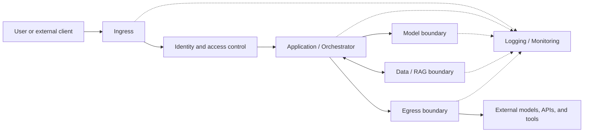

An AI application forms an end-to-end path: user or system input, application logic, API, RAG sources, agent tools, external recipients, and telemetry. `AI-SDLC1` registers where the subject's identity and privileges are established, where data becomes untrusted, where model output turns into action, and where the request crosses the boundary to leave the controlled zone.

The application must be divided into at least the following logical contours:

| Contour | Purpose | Minimum security outcome |
|---|---|---|
| **Ingress** | Receiving user and external requests | Untrusted input is validated, limited in terms of size and frequency, and separated from the application's internal components |
| **Identity** | Authentication and authorization of users, services, and agents | All subjects have a verifiable identity; access is granted based on the principle of least privilege |
| **Application** | Business logic orchestration; assembly of prompts, RAG context, and tool calls | User input, system instructions, retrieved content, and tool results are processed as separate untrusted sources |
| **Model** | Interacting with an LLM or another AI model | Only the minimum required data is provided to the model; secrets, credentials, and uncontrolled system instructions are not included into the prompt |
| **Data/RAG** | Data ingestion, storage, indexing, and retrieval | RAG content has provenance, class labels, and access metadata; search returns only data permitted for the specific subject |
| **Egress** | Accessing external LLMs, APIs, plugins, and tools | Outbound connections are allowed only to approved recipients; data transfer is controlled, minimized, and logged |
| **Logging/Monitoring** | Audit, attack detection and incident investigation | Events allow to reconstruct the request chain, application decisions, data accesses, model and tool calls without logging excessive secrets or personal data |

The presented scheme is a logical model for analysis, not a required physical topology: one component can implement several contours; and one contour can be comprised of several services. For each contour, the following must be defined: owner, allowed data streams, access mechanisms, audit events, and response procedures. A given AI system's architecture may lack any particular branch (e.g., no external calls or agent tools).
