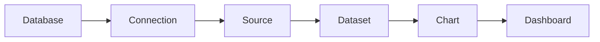
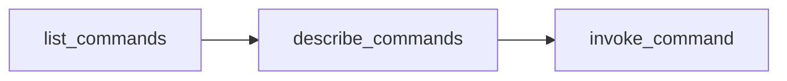

# AI agents in {{ datalens-full-name }}

In {{ datalens-name }}, AI agents [act](../operations/ai-agents.md) as a robust automation tool. They can create and modify connections, datasets, charts, and dashboards, analyze dependencies between objects, and also clone and move content between workbooks.

To this end, {{ datalens-name }} delivers three levels of integration:

| Level | Tool | Why you need it |
| --- | --- | --- |
| Protocol | [`@datalens-tech/mcp` MCP server](https://www.npmjs.com/package/@datalens-tech/mcp) | Direct AI agent access to the [Public API](../operations/api-start.md) via tools during an interactive session |
| Knowledge | [`datalens-skills` skills](https://github.com/datalens-tech/datalens-skills) | Domain knowledge about {{ datalens-name }}: object model, differences between installations, and best practices |
| Code | [Python SDK `datalens-sdk`](https://pypi.org/project/datalens-sdk/) | Typed automation stored as code within a repository |

All three layers are built on top of the Public API and complement each other: skills teach your AI agent *how* to work with {{ datalens-name }}, while the MCP server and SDK provide the *capabilities* to do so.


## How it works {#architecture}

```text
AI agent
  │
  ├── datalens-skills ──── knowledge: object model, installations, practices
  │
  ├── @datalens-tech/mcp MCP server ──┐
  │                                   ├──► Public API (api.datalens.tech)
  └── Python SDK datalens-sdk ────────┘
```

The {{ datalens-name }} Public API is available at `api.datalens.tech`. Described by an OpenAPI specification, it uses the RPC style: you run named commands with JSON parameters. The OpenAPI specification is available at `{{ api-host-datalens }}/json/`. For authentication, you need to provide a {{ yandex-cloud }} [IAM token]({{ link-docs }}/iam/concepts/authorization/iam-token) and the organization ID in the `x-dl-org-id` header. For more information, see [Working with the Public API](../operations/api-start.md).

Here is the {{ datalens-name }} data model the AI agent operates:



Objects, i.e., [connections](./connection/index.md), [datasets](../dataset/index.md), [charts](./chart/index.md), and [dashboards](./dashboard.md), are stored in [workbooks](../workbooks-collections/index.md), while workbooks reside in parent collections. Because objects reference each other by IDs, it is critical for the AI agent to build them from left to right: the agent derives this knowledge from skills.


## MCP server {#mcp}

The `@datalens-tech/mcp` [MCP server](https://github.com/datalens-tech/datalens-mcp) exposes the Public API to AI agents via the [Model Context Protocol](https://modelcontextprotocol.io). Upon startup, the server loads the OpenAPI specification and converts each command into a callable operation. To avoid registering hundreds of individual tools and preclude the model's context overflow, the server provides a compact gateway consisting of three tools:

| Tool | Purpose |
| --- | --- |
| `list_commands` | List of all API commands with short descriptions; the AI agent calls this tool first |
| `describe_commands` | Full descriptions and parameter schemas for the selected commands |
| `invoke_command` | Calling a command by name with provided parameters |

Here is a standard AI agent workflow:



This flow is well suited for interactive tasks, such as navigation, object inspection, or granular edits. However, if you need to create complex objects, e.g., [wizard charts](chart/dataset-based-charts.md), the [Python SDK](#sdk) is a more reliable option: via MCP, the AI agent compiles the object configuration as raw JSON, without client-side validation.


## Python SDK {#sdk}

[datalens-sdk](https://pypi.org/project/datalens-sdk/) is a typed Python SDK for the {{ datalens-name }} API. It works well for any task you want saved as code: migration scripts, dashboard generation, object export and cloning, and CI automation.

The SDK is the recommended tool for creating Wizard charts or any quality-centric automated visualizations. A wizard chart configuration uses a complex nested structure. The SDK gives an AI agent two advantages that direct API calls do not have: typed builders validate the configuration before it is sent to the API, and the `datalens-sdk` skill provides the AI agent with instructions for building visualizations compatible with the installed package version. As a result, the AI agent builds predictably valid charts and dashboards, instead of guessing the JSON structure through trial and error.


### SDK and AI agents {#sdk-agents}

To install the SDK for an AI agent, use the `datalens-sdk` skill from the `datalens-skills` collection.

What the skill does:

* Selects a secure Python environment for the project (venv, uv, or Poetry) and installs or updates the package with user confirmation.
* Loads the SDK usage instructions **from the installed package**, so they always match the actual API version rather than an outdated snapshot.
* Connects layers with details of the specific {{ datalens-name }} installation, if they are available in the environment.

After installing the skill, you just need to describe the task: the AI agent will set up the environment and write the correct code. Here is a task example:

```text
In workbook <workbook_ID>, create a line chart
based on dataset <dataset_ID>:
sales by month broken down by regions.
```


## What to choose: MCP, SDK, or API {#choosing}

| Scenario | Tool |
| --- | --- |
| Interactive one-off tasks within an AI agent session: _find_, _show_, _rename_, and _check dependencies_ | MCP server |
| Repeatable automation stored as code in a repository: migrations, generation, or CI | Python SDK + `datalens-sdk` skill |
| Creating Wizard charts and complex visualizations where quality is paramount | Python SDK + `datalens-sdk` skill |
| Answers to questions about {{ datalens-name }}, choice of approach, or object model awareness | `datalens` skill |
| AI reports as standalone HTML pages | `datalens-html-pages` skill |
| Programmatic access from other languages and environments | Public API directly (Link to the spec: `{{ api-host-datalens }}/json/`) |



We do not recommend using both MCP and SDK for the same task.




## Authorization and environment variables {#auth-env}

By default, the server automatically obtains an IAM token by running the `yc iam create-token` command: the token is requested upon the first API call and automatically renewed before its TTL expires. This requires the `DATALENS_ORG_ID` variable.

The MCP server and SDK support static authentication with a pre-generated IAM token. This enables you to use AI agents when the {{ yandex-cloud }} CLI is unavailable, e.g., in an isolated environment. The IAM token lifetime is 12 hours, so you must refresh it manually in this mode.

Here is an example of static authentication without the {{ yandex-cloud }} CLI:

```json
"env": {
  "DATALENS_ORG_ID": "<organization_ID>",
  "DATALENS_YC_STATIC_AUTH": "1",
  "DATALENS_API_AUTH_HEADER": "Bearer <IAM_token>"
}
```

| Variable | Required | Default | Purpose |
| --- | --- | --- | --- |
| `DATALENS_ORG_ID`             | Yes | — | Organization ID for the `x-dl-org-id` header |
| `DATALENS_API_URL`            | —  | `{{ api-host-datalens }}` | Base API URL |
| `DATALENS_YC_PROFILE`         | —  | Active profile | {{ yandex-cloud }} CLI profile name |
| `DATALENS_YC_BIN`             | —  | `yc` | Path to the `yc` binary |
| `DATALENS_YC_STATIC_AUTH`     | —  | — | `1`: Static authentication instead of the {{ yandex-cloud }} CLI |
| `DATALENS_API_AUTH_HEADER`    | —  | — | `Authorization` header value when using static authentication |
| `DATALENS_SCHEMA_URL`         | —  | `{DATALENS_API_URL}/json/` | OpenAPI specification URL |
| `DATALENS_API_VERSION`        | —  | `latest` | API version for the `x-dl-api-version` header |
| `DATALENS_MAX_RESPONSE_CHARS` | —  | `100000` | Response length limit, beyond which the response is truncated |


## Agent skills {#skills}

The MCP server and SDK provide your AI agent with API access but not domain knowledge, such as the specific {{ datalens-name }} installation being used, how objects relate to one another, what order to create them in, and which mistakes to avoid. This knowledge is supplied by the [datalens-tech/datalens-skills](https://github.com/datalens-tech/datalens-skills) repository, an official collection of skills based on the open [Agent Skills](https://agentskills.io) standard. Each skill consists of a folder containing a `SKILL.md` file, optional scripts, and reference assets. Skills are portable across compatible AI agents.


### Collection contents {#skills-list}

| Skill | Purpose |
| --- | --- |
| `datalens` | The starting point: explains what {{ datalens-name }} is, the object model, and interface selection. Routes the agent to other skills. |
| `datalens-sdk` | Working with {{ datalens-name }} from Python: connections, datasets, charts, and dashboards. Proactively gets the environment ready and pulls instructions matching the installed SDK version. |
| `datalens-html-pages` | Creating, validating, and publishing standalone HTML pages (AI reports) generated by {{ datalens-name }} within an isolated iframe. |
| `datalens-yc-rls-resolve` | Converting {{ yandex-cloud }} users and groups to subject IDs for RLSv2, migrating legacy `rls` configurations. |


## Specifics and limitations {#limitations}

* Requests to the Public API are subject to [limits](limits.md).
* The IAM token lifetime is 12 hours. When authenticating via the {{ yandex-cloud }} CLI, the MCP server and SDK update it automatically. With static authentication, updating the token and restarting the MCP server is the user’s responsibility.
* The AI agent works with {{ datalens-name }} objects but does not interpret the business context of metrics or interact with the web UI. For example, an AI agent cannot take a screenshot or click a button.


## Useful links {#see-also}

* [{#T}](../operations/ai-agents.md)
* [{#T}](../operations/api-start.md)
* [@datalens-tech/mcp MCP server](https://github.com/datalens-tech/datalens-mcp)
* [npm](https://www.npmjs.com/package/@datalens-tech/mcp)
* [datalens-skills collection](https://github.com/datalens-tech/datalens-skills)
* [Python SDK datalens-sdk](https://pypi.org/project/datalens-sdk/)
* [Agent Skills standard](https://agentskills.io)
* [Model Context Protocol](https://modelcontextprotocol.io)