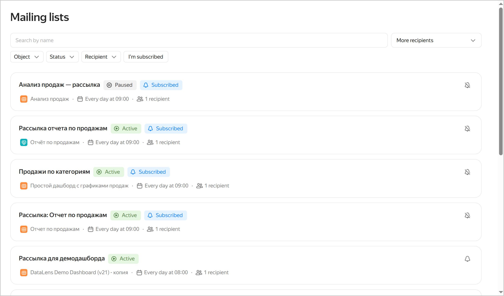

# List of mailing lists in {{ datalens-full-name }}

To view all mailing lists, click  **Mailing lists** in the left-hand panel. If you do not see  in the panel, first select  **More**, then  **Mailing lists**.

You can also view all mailing lists for the current workbook. To do this, click  →  **Mailing lists** at the top of the workbook.

For each item in the list, you can see the following properties:

* Mailing list name.
* Mailing list status:  **Active** or  **Paused**.
* Mailing lists you are subscribed to are labeled with  **Subscribed**.
* Name of the dashboard or report for which the mailing list was created.
* Mailing schedule.
* Number of mailing list recipients.
*  to subscribe to the mailing list or  to unsubscribe from it. The  button is only shown to users who can subscribe to the mailing list: the editor and administrator by default, or any user. You can configure this setting on the **Recipient** tab.

You can use the following filters at the top of the list:

* **Object**: In the list, select the object that contains your mailing list: a collection, workbook, dashboard, or report.
* **Status**: Select a mailing list status, `Active`, `Paused`, or `Error`.
* **Recipient**: Select a mailing list recipient.
* **I'm subscribed**: Click to only show the mailing lists you are subscribed to.
*  **Reset**: Click to clear all filters. This option is available when at least one filter is applied.

When you [open the list of mailing lists](../workbooks-collections/workbooks-operations.md#maillist-list) from a workbook, the **Object** filter for this workbook will automatically be applied.

To the right of the filter, you can choose how to sort the list:

* **More recipients**: By the number of recipients.
* **Newest first**: By creation date.

Clicking the mailing list takes you to the page of the object (dashboard or report) it was created for.

You can subscribe to or unsubscribe from a mailing list directly from the list view:
     
* To subscribe to a mailing list, click  (**Subscribe**) next to it. The  button is only shown to users who can subscribe to the mailing list: the editor and administrator by default, or any user. You can configure this setting on the **Recipients** tab.
* To unsubscribe from a mailing list, click  (**Unsubscribe**).



* The user needs an active seat to receive the mailing list emails.
* You can receive the emails only if you have a role for the mailing list parent workbook.


