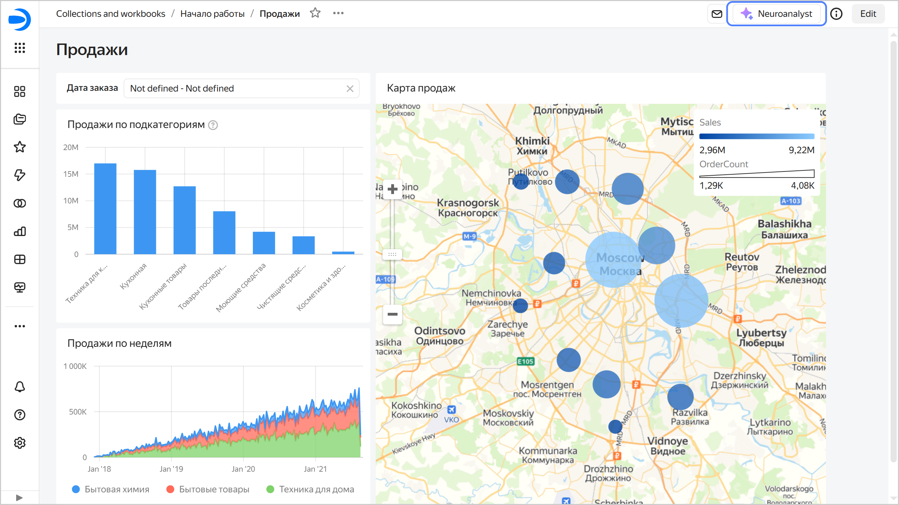
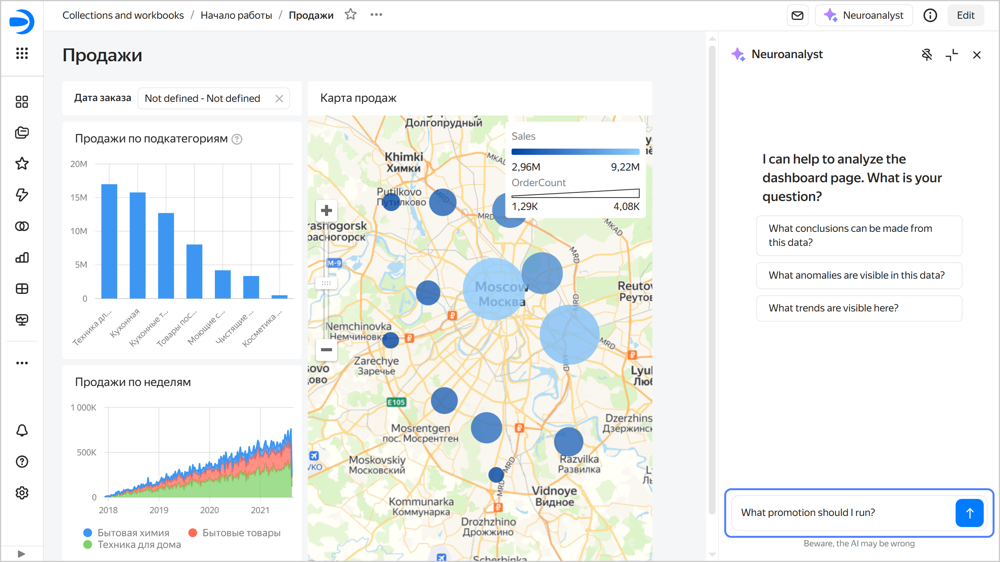
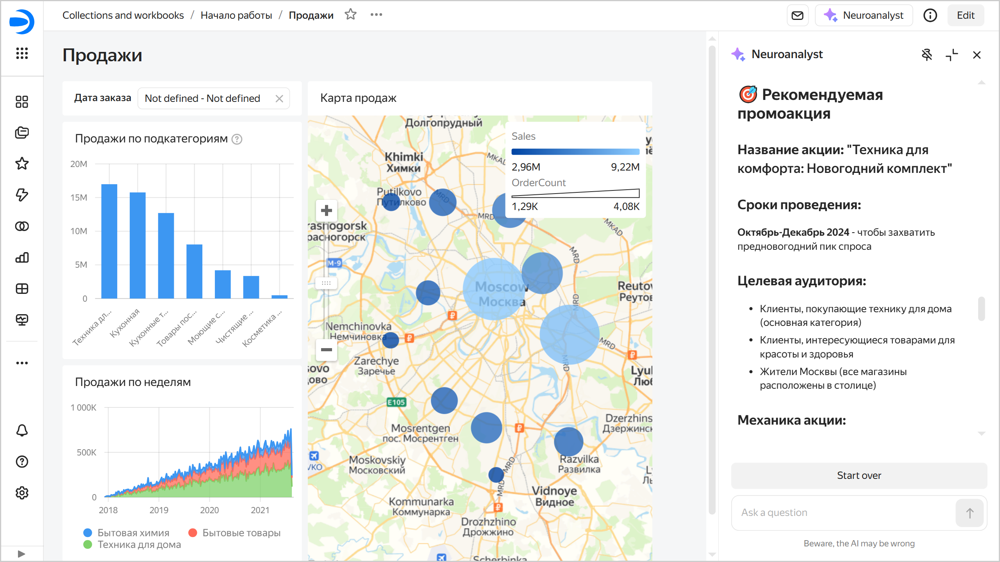
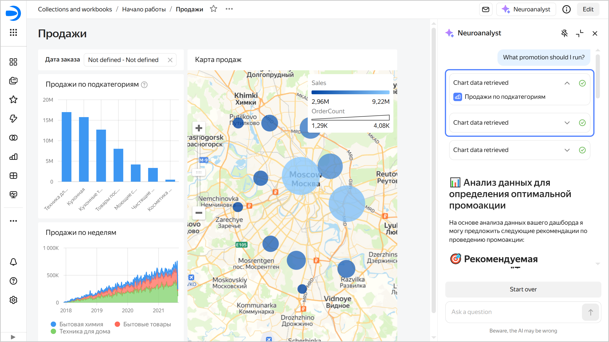
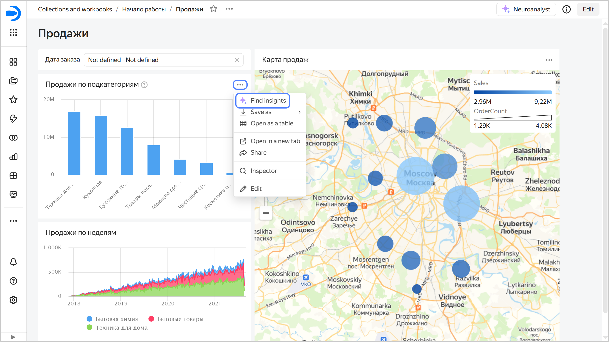
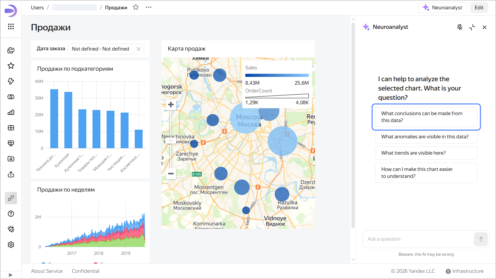
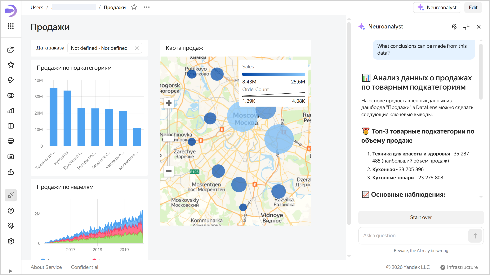
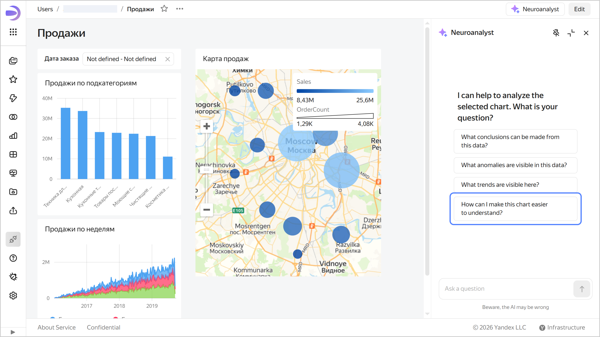
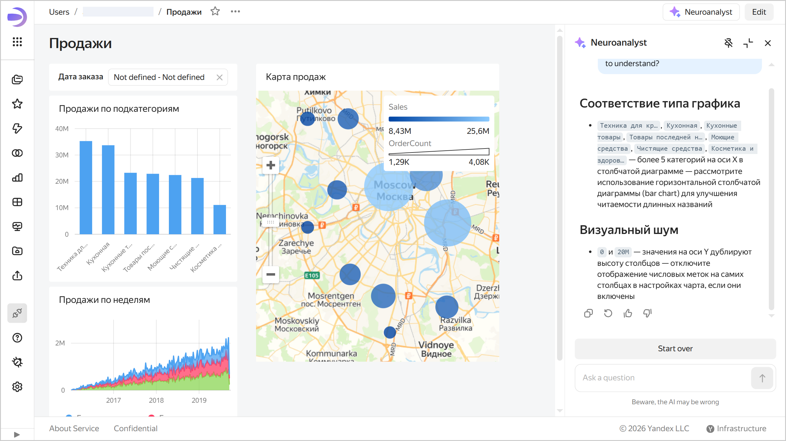

# Neuroanalyst on your dashboard in {{ datalens-full-name }}

[Neuroanalyst](../concepts/neuroanalyst.md) is an AI agent that analyzes the dataset underlying your dashboard and can return an existing chart as a response or build a new chart. To generate charts, Neuroanalyst uses the dataset and charts from the reference tab, which you can select in the [dashboard settings](../operations/dashboard/dashboard-ai-reference-tab.md).

In addition to the dashboard’s source dataset, the agent also considers the following for context:
* [Dashboard information](../operations/dashboard/add-description.md).
* Dashboard chart header.
* [Chart information](../operations/chart/add-description.md).
* Dashboard chart [description and tooltip](../operations/dashboard/add-chart.md) (other than tables).

## Using Neuroanalyst on a dashboard {#how-to}

You can use Neuroanalyst on your dashboard for a dashboard tab or individual charts on the dashboard. To use Neuroanalyst on your dashboard:



- For a dashboard tab

  1. Click **Neuroanalyst** at the top of the dashboard to open the **Neuroanalyst** tab on the right.

     

     

     

  1. Select a question or ask your own one, e.g., "What promotion should I run?".

     

     

     

     Neuroanalyst will analyze the current tab's contents, delve into the charts relevant for the answer, and generate a detailed response.

     

     

     

     At the top of the Neuroanalyst tab, you will see the list of charts used to generate the answer.
     
     

     

     

- For individual charts on the dashboard

  1. In the top right corner of the chart on the dashboard, click  → **Find insights** to open the **Neuroanalyst** tab on the right.

     

     

     

  1. To add another chart to the analysis, locate the chart on the dashboard and click  → **Add to analysis** in its top-right corner.

  1. Select a question or ask your own one, for example:
     
     * What insights can I get from this data?

       

       

       

       Neuroanalyst will give a detailed answer and suggest possible solutions and recommendations.

       

       

       

     * How can I make my chart more viewable?

       

       

       

       Neuroanalyst will analyze the current visualization and give you tips on how to improve it, e.g., by moving axes or removing visual noise.

       

       

       



Charts rendered by Neuroanalyst support the following actions:

* Saving as is: Click **Save** and enter a name for the new chart.
* Editing and saving: In the top-right corner of the chart, click  and select  **Edit**.
* Copying to the dashboard: Click  to save the chart to the clipboard. You can add it to a dashboard within your current workbook: open the dashboard in edit mode and click **Paste** on the widget adding panel.

## Neuroanalyst dashboard configurations {#settings}

You can pin the chat with Neuroanalyst on top or along the side (default) of the dashboard. To change the chat position, click:
  
  * : Chat on top of the dashboard.
  * : Chat alongside the dashboard.

The following settings are also available:
* [Banning](../operations/dashboard/dashboard-neuroanalyst-off.md) the use of Neuroanalyst for this dashboard.
* Selecting a [reference tab](../operations/dashboard/dashboard-ai-reference-tab.md).
* Adding example questions, i.e., those displayed when starting Neuroanalyst. If no custom examples are provided, the default questions are displayed.

## Neuroanalyst restrictions {#restrictions-2}

* It only applies to one dataset, the one underlying your reference tab.
* The titles of the first three charts get into Neuroanalyst's recommendations.
* Neuroanalyst is not available on mobile devices.

