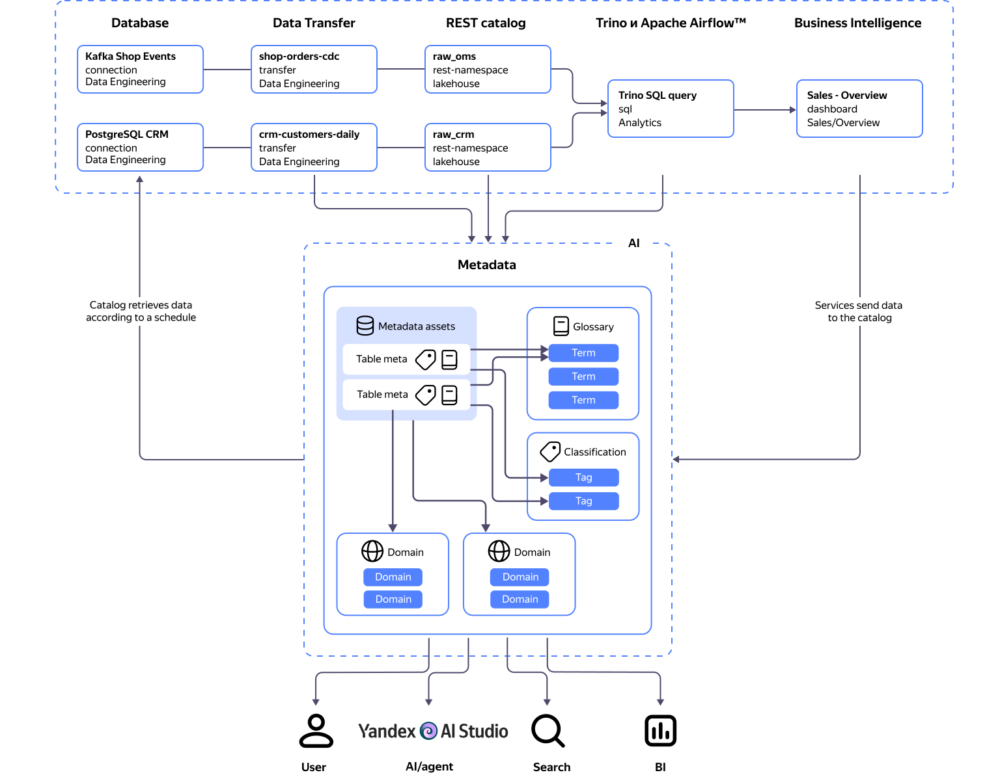

# Metadata in {{ datalens-platform-full-name }}

_Metadata_ is information about {{ datalens-platform-full-name }} data: what tables and dashboards exist, what they contain, where the data comes from, who is responsible for it, and how much it can be trusted. If data answers the question _How many sales were there in March?_, metadata answers _Which table should I look in?_, _Is it up to date?_, and _What does the `revenue_net` field actually mean?_

## Metadata catalog {#metadata-catalog}

Without metadata, data context lives only in employees’ heads and their chat threads. The _metadata catalog_ brings it together in one place to:

* Find data, through unified search across tables, datasets, charts, and dashboards.
* Understand data, through table and field descriptions, business terms, domains by department and area.
* Trust data, through source transparency, transformation lineage, and content statistics.
* Account for data, through identifying its owner, subscribing to changes, and meeting regulatory requirements for data lineage.

Metadata is ingested from sources automatically. The catalog does not copy the data itself, except for samples when profiling is enabled. Only users with data access permissions can view samples.



Depending on the data source type, the metadata ingested may vary.





















The metadata ingested into a catalog constitutes the metadata of datasets, charts, dashboards, reports, workbooks, and collections. The ingested metadata is limited to the pre-selected connections. If no connections are selected, the system will ingest metadata from all available connections.





The metadata ingested into a catalog constitutes the metadata of SQL queries and database objects used in queries. Query results are not ingested. The ingested queries are restricted to databases which have a corresponding source in the catalog.
In the catalog, a user will only see their queries or queries for which they have view permissions.



What’s next:

* [Test the collected metadata](../../operations/data-catalog/work-with-data-catalog.md).
* [Add markup](../../operations/data-catalog/metadata-markup.md).
* [Define relationships between objects](../../operations/data-catalog/metadata-linage.md).
