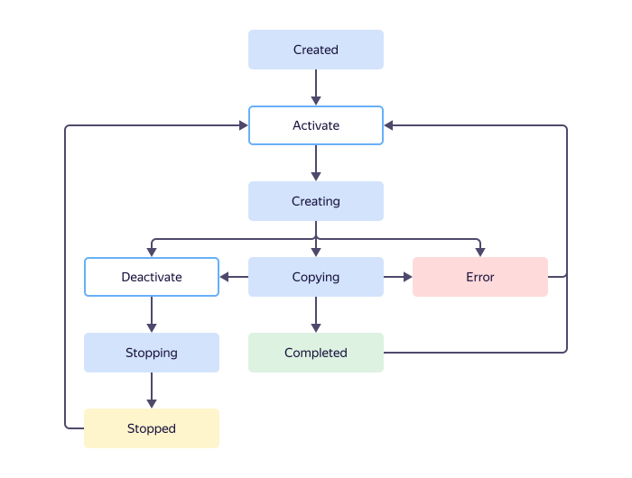

# Data transfers to {{ datalens-platform-full-name }}

A data transfer moves data from an external source connection, e.g., a {{ PG }} database, to a storage backed by a [REST catalog](../../../concepts/connection/index.md). In {{ datalens-platform-full-name }}, you can create different types of data transfers:

* [Regular copy](#regular-copy): Use when data needs to be transferred regularly to keep the destination up to date.
* [One-time copy](#one-time-copy): Use when data only needs to be transferred once, e.g., to set up test environments or load initial data.
* [Change data capture (CDC)](#cdc) `Coming soon`: Use when changes to data need to be tracked in real time.



After creating a transfer, you can [view its statistics, modify its settings, pause it, or delete it](../../operations/data-transfer/manage-transfer.md).

## Transfer lifecycle {#lifecycle}

Once a transfer is ready to run, it automatically enters the {{ dt-status-copy }} status. It stays in this status until all source data has been copied to the target. The transfer is then automatically deactivated and switches its status to {{ dt-status-finished }}. The diagram below illustrates the transitions between statuses:

## Regular copy {#regular-copy}



Read more on how to create a regular copy job [here](../../operations/data-transfer/regular-copy.md).

## One-time copy {#one-time-copy}



Read more on how to create a one-time copy job [here](../../operations/data-transfer/one-time-copy.md).

## Change data capture `Coming soon` {#cdc}


