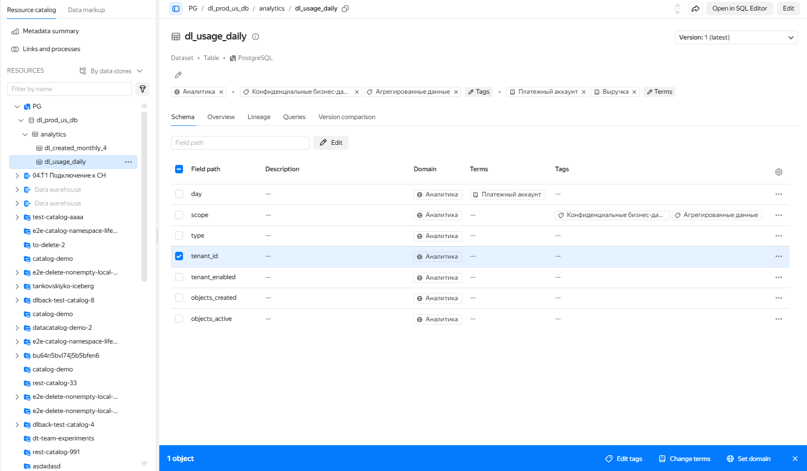

# Metadata markup

At the very basic level, you can use [domains and subdomains](#domains), e.g., to arrange metadata by company departments. For a more complex markup, use these resources:

* [Classifications and tags](#classifications-and-tags)
* [Glossaries and terms](#glossaries-and-terms)

You can mark up an entire dataset, e.g., a {{ PG }} table, or its parts, e.g., a single field.

You need the `Metadata administration` [role](../../security/index.md) to mark up data and create new markup components.

## Domains and subdomains {#domains}



## Classifications and tags {#classifications-and-tags}



## Glossaries and terms {#glossaries-and-terms}



First [create markup components](#create-markup-elements), and then proceed to [bulk](#mass-markup) or [pinpoint](#specific-markup) markup.

## Creating markup components {#create-markup-elements}

Create markup components to describe the nature and structure of your metadata:

* [Creating a domain](#create-domain)
* [Creating a subdomain](#create-subdomain)
* [Creating a glossary](#create-glossary)
* [Creating a term](#create-term)
* [Creating a classification](#create-classification)
* [Creating a tag](#create-tag)

### Creating a domain {#create-domain}

To create a domain:

1. Navigate to the **Data markup** tab in the  **Metadata** section.
1. Open the  **Domains** section in the navigation bar.
1. Click **Create domain** or  next to the **Domains** section in the navigation bar.
1. In the **Domain creation** form, fill out these fields:
   * **Name**: Enter a name for your domain.
   * **Description**: Specify the domain’s purpose. This is an optional field.
   * **Markup rules**: Specify the context and markup rules for this object. This is an optional field. The AI agent will make use of your recommendations.
   * **Add a tag**: Click **Add** to assign tags. This is an optional field.
1. Click **Create**.

### Creating a subdomain {#create-subdomain}

Domains can be multi-level; you can create a subdomain inside another subdomain. To create a subdomain:

1. Navigate to the **Data markup** tab in the  **Metadata** section.
1. In the navigation bar, go to the  **Domains** section and open the domain for which you want to create a subdomain.
1. Click **Add subdomain** or  next to the domain row in the navigation bar.
1. In the subdomain creation form, check the parent domain path, e.g., `Sales > Sales Russia`, and fill out these fields:
   * **Name**: Enter a name for your subdomain.
   * **Description**: Specify the subdomain’s purpose. This is an optional field.
   * **Markup rules**: Specify the context and markup rules for this object. This is an optional field. The AI agent will make use of your recommendations.
   * **Add a tag**: Click **Add** to assign tags. This is an optional field.
1. Click **Create**.

### Creating a glossary {#create-glossary}

A glossary is a subject-specific set of terms. To create a glossary:

1. Navigate to the **Data markup** tab in the  **Metadata** section.
1. Open the  **Glossaries and terms** section in the navigation bar.
1. Click **Create glossary** or  next to the glossary row in the navigation bar. Fill out the fields as follows:
   * **Name**: Enter a name for your glossary.
   * **Description**: Specify the glossary’s purpose. This is an optional field.
   * **Markup rules**: Specify the context and markup rules for this object. This is an optional field. The AI agent will make use of your recommendations.
   * **Add a tag**: Click **Add** to assign tags. This is an optional field.
1. Click **Create**.

### Creating a term {#create-term}

A term is created inside a glossary to describe a specific concept in your subject area. To create a term:

1. Navigate to the **Data markup** tab in the  **Metadata** section.
1. Open the  **Glossaries and terms** section (or a specific glossary to add this term to) in the navigation bar.
1. Click **Create term**. Alternatively, click  next to the glossary row and select **Create term**. Then fill out these fields:
   * **Name**: Enter a name for your term.
   * **Description**: Specify the term’s purpose. This is an optional field.
   * **Markup rules**: Specify the context and markup rules for this object. This is an optional field. The AI agent will make use of your recommendations.
   * **Synonyms**: Click **Add** and specify synonyms for your term. This is an optional field.
   * **Add a tag**: Click **Add** to assign tags. This is an optional field.
   * **Related terms**: Click **Add** and specify the terms with which you need to monitor the relation. This is an optional field.
1. Click **Create**.

### Creating a classification {#create-classification}

A classification comprises tags sharing one concept. To create a classification:

1. Navigate to the **Data markup** tab in the  **Metadata** section.
1. Open the  **Classifications and tags** section in the navigation bar.
1. Click **Create classification** or  next to the classification row in the navigation bar. Fill out the fields as follows:
   * **Name**: Enter a name for your classification.
   * **Description**: Specify the classification’s purpose. This is an optional field.
   * **Markup rules**: Specify the context and markup rules for this object. This is an optional field. The AI agent will make use of your recommendations.
   * **Mutually excluding**: Use the toggle to set whether you can apply multiple tags from this classification to a single object. If the toggle is on, you can only apply a single tag from the classification.
1. Click **Create**.

### Creating a tag {#create-tag}

A tag is created inside a classification. A single classification may contain multiple tags.

To create a tag:

1. Navigate to the **Data markup** tab in the  **Metadata** section.
1. In the navigation bar, open the  **Classifications and tags** section and open the classification you need.
1. Create a tag in one of the following ways:
   * On the **Tags** tab click **Create** in the top-right corner.
   * In the navigation bar, hover over your classification, open the actions menu, and click **Create tag**.
1. Fill out these tag fields:
   * **Name**: Enter a name for your tag.
   * **Description**: Specify the tag’s meaning. This is an optional field.
   * **Markup rules**: Specify the context and markup rules for this object. This is an optional field. The AI agent will make use of your recommendations.
1. Click **Create**.

## Bulk markup {#mass-markup}

You can assign a markup component to multiple metadata sets or segments. To mark up metadata in bulk:

1. Navigate to the **Data markup** tab in the  **Metadata** section.
1. Navigate to **Bulk markup**.
1. Go to the **Metadata** tab and select the metadata sets to assign or change the markup components.
1. In the bottom-right corner, select the required action:  **Change tags**,  **Change terms**, or  **Assign domain**. In the window that opens, select the tags, terms, or domain to assign.
1. Check the changes on the **Classifications and tags**, **Glossaries and terms**, and **Domains**.

For a better view of the glossary and classification hierarchy, click .

To revise bulk markup, click **Edit table**, make changes to a specific metadata set, and click **Save changes**.

## Pinpoint markup {#specific-markup}

To mark up a specific metadata set:

1. Go to the  **Metadata** section, **Resource catalog** tab.
1. In the **RESOURCES** list, select the assets to mark up.
1. In the assets view bar, select one or multiple components in the list, e.g., database fields.
1. In the bottom-right corner, select the required action:  **Change tags**,  **Change terms**, or  **Assign domain**. In the window that opens, select the tags, terms, or domain to assign.
1. To change markup components for the entire assets, e.g., for an entire {{ PG }} database, use  buttons for tags, terms, and description above the data table.

## Setting up AI markup {#ai-markup}

AI markup helps mark up metadata automatically: generate terms, tags, and domains as well as write descriptions. In the AI markup settings, you can set the context of your service and rules for the assistant. To set up AI markup:

1. Navigate to the **Data markup** tab in the  **Metadata** section.
1. Go to the  **AI markup settings** section.
1. Under **Documentation**, add guides for your service. This will help the assistant better comprehend the context. Drag a file to the upload area. The uploaded files are displayed below the upload area.
1. Under **AI markup rules**, set the general rules, i.e., the context that the assistant needs to make use of when marking up and generating terms, tags, and domains. Select the tab with the type of rules you need and enter the rule into the field, e.g., _do not create new glossaries, suggest terms by client type_.
1. Save the setting using either method:
   * **Save and re-mark up**: To apply settings and re-mark up data at once.
   * **Save for future upoloads**: To apply settings only to future uploads.
