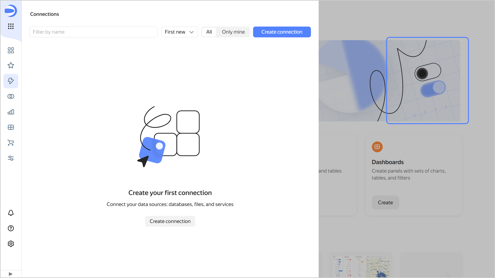

# {{ datalens-full-name }} release notes: April 2025

* [Changes in basic features](#base)
* [Mobile version updates](#mobile-version-changes)
* [Changes available with the _Business_ service plan](#business)

## Changes in basic features {#base}

### UI changes {#interface-changes}

* Added the option to copy an ID for all object types in one of the following ways:
  
  * Click  → **Copy ID** on the navigation page or in the object editing window.
  * In the **Linked objects** window, click  → **Copy ID** next to the object.
  
* Fixed the issue where a new page opened on clicking  **Notifications**. Now the {{ datalens-short-name }} message window opens.
* Updated the appearance of the empty object list that opens from the left navigation sidebar.

  

  

  

### Changes in connections {#connection-changes}

Added the [connection to {{ speechsense-full-name }}](../operations/connection/create-speechsense.md).

### Fixes in datasets {#dataset-changes}

Now when you [create a dataset](../dataset/create-dataset.md#create), the **Sources** tab opens, and when you edit it, the **Fields** tab opens.

### Chart fixes {#charts-fixes}

* You can show a particular area on the [map](../visualization-ref/map-chart.md) using the **Center** and **Scale** [settings](../concepts/chart/settings.md#common-settings).
* Fixed the issue with the sorting failure on a [line chart](../visualization-ref/combined-chart.md) layer in a [combined chart](../visualization-ref/line-chart.md).
* In the [wizard](../concepts/chart/dataset-based-charts.md), fixed the issue where the date format would reset after changing the field type [setting](../concepts/chart/settings.md#field-settings) from `Date` to `Date and time` or back.
* In charts with [hierarchy](../operations/chart/add-hierarchy.md), fixed the invalid behavior of the filter query on clicking a value with quotes.
* Fixed the invalid plotting of [polyline maps](../visualization-ref/polyline-map-chart.md) with empty (`null`) values.
* Optimized rendering time in [pivot tables](../visualization-ref/pivot-table-chart.md) when using [chart cross-filtering](../dashboard/chart-chart-filtration.md).
* Fixed misalignment of text in [table](../visualization-ref/table-chart.md) cells if using [locked columns](../visualization-ref/table-chart.md#additional-settings) without pagination.
* Fixed incorrect display of a [table](../visualization-ref/table-chart.md) with [locked columns](../visualization-ref/table-chart.md#additional-settings) and a scrollbar.
* Added quotes for values when exporting a chart in CSV format.

### Versioning changes {#versioning-changes}

* [Chart](../concepts/chart/versioning.md), [dashboard](../dashboard/versioning.md), and report versioning is only available to users with permissions to edit these objects. The draft alert is also only available to users with the permission to edit the object.
* If there is a draft version of the chart, you can open it right away by adding `unreleased=1` to the URL.

### Tooltip in markup {#tooltip-add}

Added the option to use the [TOOLTIP](../function-ref/TOOLTIP.md) markup function to add a small tooltip to text or the output of other [markup functions](../function-ref/markup-functions.md).

### Dashboard changes {#dashboard-changes}

* Fixed the invalid behavior of the `state` parameter in the URL for [public](../concepts/datalens-public.md) dashboards.
* Changed the appearance of the [widget pinning](../dashboard/settings.md#widget-fixation) area:
  
  * The background of the pinning area and the button to hide/show the bottom area are now more visible.
  * The pinning area is not shown if there are no widgets in it.
  * The top area has the same width as the rest.
  * You can pin widgets of any height in the top area (only single-line widgets used to fit there).

* Fixed the issue where the order of [headers](../dashboard/widget.md#title) in the table of contents would break if you placed a header in the widget pinning area.

### Changes in the {{ datalens-full-name }} settings {#settings-changes}

Hid certain [{{ datalens-full-name }} settings](../settings/index.md) for users without the `datalens.admin` [role](../security/roles.md#datalens-admin):

* Changing your [service plan](../settings/service-plan.md).
* [Customization settings](../settings/appearance.md#ui-customization).
* Adding and editing color palettes.
* [Disabling folder navigation](../settings/navigation.md#disable-folder-navigation).
* Enabling workbooks.
* [Managing the option](../concepts/datalens-public.md#publication-disable) to configure public access.

Any user can view service plans and color palettes without editing.

## Mobile version updates {#mobile-version-changes}

Fixed the issue with failing to scroll the chart [legend](../concepts/chart/settings.md#common-settings) in the mobile version.

## Changes available with the _Business_ service plan {#business}

### Changes in Editor {#editor-changes}

* Fixed the issue with opening a chart for editing in [Editor](../charts/editor/index.md) with the `_embedded` parameter in the URL. Previously, if the URL contained `_embedded=1`, the chart would not display the contents of the tabs.
* Switched Editor to the UTC time zone. This will allow users to get a predictable result from the `new Date()` function.
* In the [Editor.wrapFn](../charts/editor/methods.md#wrap) function, removed the nesting restriction for custom arguments.
* Fixed the error with processing non-string parameters in Editor.

### Changes in reports {#reports-changes}

* In [reports](../reports/index.md), added auto-scrolling of the selectors section when adding a widget.
* For the [Community](../settings/service-plan.md) service plan in the [workbook](../workbooks-collections/index.md) interface, fixed the display of the **Create report** button on the **All objects** tab.

