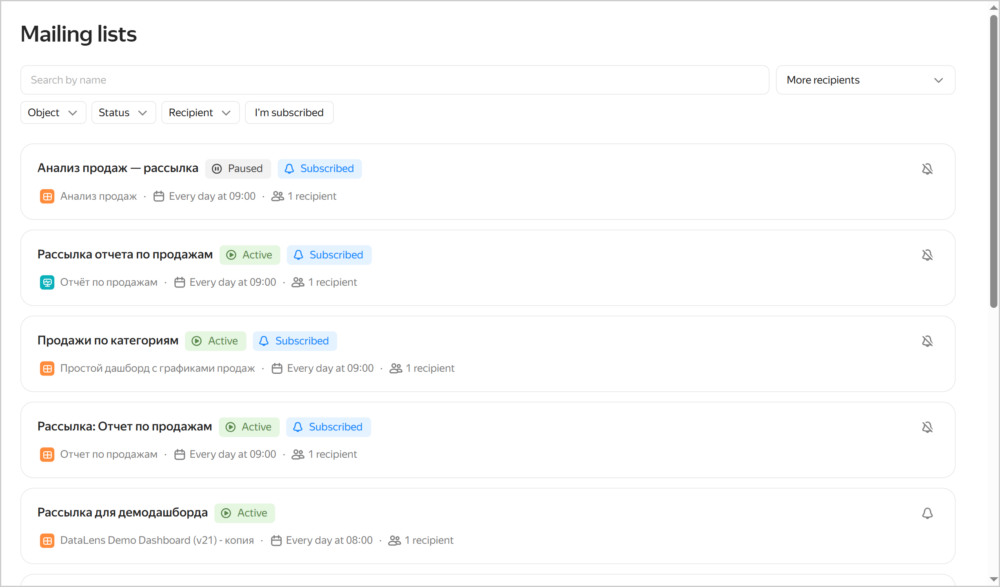

# {{ datalens-full-name }} release notes: September 2026

* [Changes in basic features](#base)
* [Fixes and improvements](#fixes)

## Changes in basic features {#base}

* Added the  **All pages** section to the left-hand panel. Clicking it opens an additional panel on the right with the full list of sections. Here, you can customize the left-hand panel by choosing which sections to show.

* Added the [Mailing lists](../concepts/maillists-list.md) section, where you can view all mailing lists.

  For each item in the list, you can see the mailing details and buttons to subscribe or unsubscribe.

  

  

  

* [Mailing lists for dashboards](../operations/dashboard/add-maillists.md) now support analysis by Neuroanalyst. To enable this, provide your question in the **Prompt** field when setting up the mailing list. Neuroanalyst response will be included in the email.
* The [Gallery](../concepts/gallery.md) now offers several new features:

  * Search by author
  * New sorting options
  * New filters
  * **Dashboard of the month** label
  * **Discuss** button on each card

  Added new dashboards to the [Gallery]({{ link-datalens-main }}/gallery). For more information, see our [{{ datalens-short-name }}](https://telemost.360.yandex.ru/join#01a309da-b9a8-4167-9892-b72f1ec1bff0/1789574497766061) chat in Yandex Telemost.

* Added support for publishing dashboards in workbooks using a [temporary link](../concepts/datalens-temporary-link.md). You can configure the link’s validity period from one hour to 24 hours. As long as the link is active, any user can use it and view the dashboard without logging in.

* Updated navigation in collections and workbooks. To open the navigation window, click **Navigation** in the left-hand panel. You will see the root collection and a tree view of all its collections, workbooks, and objects.
  
  For easier navigation, you can open the left-hand navigation sidebar, which displays a tree of all collections, workbooks, and objects. The sidebar also includes the **Favorites** and **Recent** lists.

* Added [datalens-sdk](https://pypi.org/project/datalens-sdk/), a typed Python SDK for the {{ datalens-name }} API. [Use](../operations/ai-agents.md) a [set of AI agents](../concepts/ai-agents.md) to work with {{ datalens-name }}. They can create and modify connections, datasets, charts, and dashboards, analyze dependencies between objects, and also clone and move content between workbooks.

* Introduced the new [{{ datalens-name }} Platform]({{ link-datalens-main }}/platform).
  
  {{ datalens-name }} is now a comprehensive analytics platform that covers data ingestion, storage, processing, analysis, and visualization in a single environment. It offers the following:
  
  * One product instead of a set of tools and services.
  * Out-of-the-box compatibility between components.
  * Unified workspace for engineers, analysts, and business users.
  * Cloud, on-premises, and hybrid deployment options.

## Fixes and improvements {#fixes}

* Fixed the display of metric names in tooltips for the **Polylines** (geopoints) layer in [maps](../visualization-ref/map-chart.md).
* X-axis labels in [Chart (Gravity UI Charts)](../charts/editor/widgets/gravity-ui.md) now use the selected date format across line, column, and scatter charts.
* Fixed the schemas for the [Activities](../charts/editor/tabs.md#activities) tab in the Public API.
