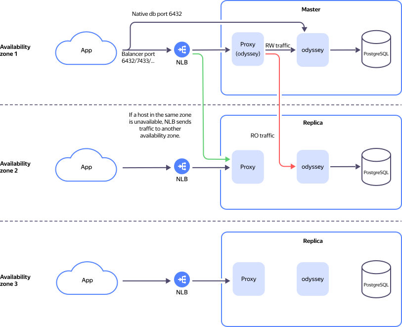

# Load balancer for hosts

{{ mpg-name }} allows you to use an internal network balancer to distribute the load among hosts. This load balancer operates on layer 4 of the OSI network model but uses layer 3 technologies to speed up packet processing.





To get the load balancer’s FQDN, follow [this guide](../operations/load-balancer.md#fqdn).

The network traffic regulation schema for the cluster using a load balancer is shown below:





When using a load balancer, client connections remain controlled by the [Odyssey connection manager](pooling.md).



## Balancing policies {#balancing-policies}


