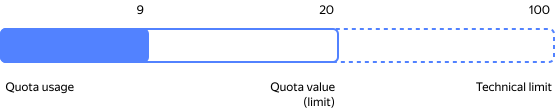

# Concepts {{ quota-manager-name }}





For example, a quota of 12 allows you to provision a maximum of 12 VMs within your cloud. Quota consumption equals the total number of VMs in a cloud. To deploy 25 VMs, you must increase your quota to at least 25.

_Limits_ are technical constraints of the {{ yandex-cloud }} architecture, hardware physical characteristics, or external limitations. For example, the {{ certificate-manager-name }} limits are dictated by the Let's Encrypt certification rules in place.

The diagram below illustrates the relationship between quotas and limits.



Use the {{ quota-manager-name }} API to track quota values and consumption, as well as configure alerts for when thresholds are reached. This allows you to proactively request a quota increase or prevent resource overspending.

## Quota allocation {#quotas-allocation}

When a cloud is created, default quota values are set automatically. You cannot reset a modified quota to its default value.

There are no quotas for some resources. For these resources, the management console displays **{{ ui-key.yacloud.iam.cloud.quotas.label_quota-empty }}**.

Quotas can be increased upon request within the platform's technical limits. Quotas do not guarantee that resources are available.

Quota management via the CLI and API relies on quota ID in `<service_name>.<resource_name>.<unit_of_measurement>` format, e.g., `dns.zones.count`, `serverless.networkPackets.rate`, `mdb.memory.size`. 

For quota IDs and their corresponding default values for supported {{ yandex-cloud }} services, see [{#T}](../all-quotas.md).

You can look up quota usage info in the console on the [{{ quota-manager-name }}]({{ link-console-quotas }}) page or via an [API request](../operations/list-quotas.md).

## Why quotas are needed {#quotas-need}

Quotas help regulate the consumption of cloud services. For example, they prevent new users from allocating excessive resources during testing.

## Resource types {#resources-types}

Quotas in {{ yandex-cloud }} are mapped to specific resources. You will need to specify the resource type in the CLI command or API request:

* `resource-manager.cloud`: [Cloud](../../resource-manager/concepts/resources-hierarchy.md#cloud).
* `organization-manager.organization`: [Organization](../../organization/concepts/organization.md).
* `billing.account`: [Billing account](../../billing/concepts/billing-account.md).
