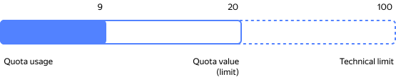

# Getting started with {{ quota-manager-full-name }}



{{ quota-manager-name }} allows you to manage quotas using different interfaces. Some services, e.g., {{ speechkit-name }}, are not available in {{ quota-manager-name }}.

**Quotas**: Resource usage limits in the cloud or organization. They help manage resource usage, avoid overspending, and plan budgets.

Quotas have two indicators:

* **Quota limit** or just **quota**: Current limit in place for a resource for a cloud or organization.

* **Quota usage**: Amount of the actually used resource.

Quotas can be increased upon request within the _limits_.

**Limits** are technical constraints of the {{ yandex-cloud }} architecture, hardware physical characteristics, or external limitations.





To manage resource quotas through the CLI and API, use their IDs from the [{#T}](all-quotas.md) section.

## Getting started {#before-you-begin}

This guide assumes that you already have {{ yandex-cloud }} resources in the cloud or organization.

Make sure the user or service account has the following [roles](../iam/concepts/access-control/roles.md):





- Management console {#console}

  Log in to the [management console]({{ link-console-main }}) and select a cloud.

- {{ cloud-center }} UI {#cloud-center}

  Log in to [{{ cloud-center }}]({{ cloud-center-link }}) and select an organization.

- CLI {#cli}

  

  

- REST API {#api}

    1. Install [cURL](https://curl.haxx.se).
    1. [Create a service account](../iam/operations/sa/create.md) and [assign](../iam/operations/sa/assign-role-for-sa.md) it one of the roles listed above.
    1. 

- gRPC API {#grpc-api}

    1. Install the [gRPCurl](https://github.com/fullstorydev/grpcurl) utility.
    1. [Create a service account](../iam/operations/sa/create.md) and [assign](../iam/operations/sa/assign-role-for-sa.md) it one of the roles listed above.
    1. 



## Getting quota info {#get-quota-info}



- Management console {#console}

  To get information about quotas in the cloud:

  


- CLI {#cli}

  1. See the list of services with quotas.

     ```bash
     yc quota-manager quota-limit list-services \
       --resource-type <resource_type>
     ```

     Where `--resource-type` is the [resource type](concepts/index.md#resources-types):

     * `resource-manager.cloud`: [Cloud](../resource-manager/concepts/resources-hierarchy.md#cloud).
     * `organization-manager.organization`: [Organization](../organization/concepts/organization.md).
     * `billing.account`: [Billing account](../billing/concepts/billing-account.md).

     Command example:

     ```bash
     yc quota-manager quota-limit list-services \
       --resource-type resource-manager.cloud
     ```

     This will output a list of services with cloud-level quotas.

  1. View the values and usage of all quotas in a service.

     ```bash
     yc quota-manager quota-limit list \
       --service <service_name> \
       --resource-type <resource_type> \
       --resource-id <resource_ID>
     ```

     Where:

     * `--service`: Service ID you got in the previous step.
     * `--resource-id`: [Resource](../resource-manager/concepts/resources-hierarchy.md) ID, i.e., organization, cloud, or billing account ID.
     * `--resource-type`: Resource type, `resource-manager.cloud`, `organization-manager.organization`, or `billing.account`.

     Command example:

     

     

  1. View the value and usage of a given quota.

     ```bash
     yc quota-manager quota-limit get \
       --quota-id <quota_ID> \
       --resource-id <resource_ID> \
       --resource-type <resource_type>
     ```

     Where:

     * `--quota-id`: Quota ID. You can look up the ID in [{#T}](all-quotas.md).
     * `--resource-id`: ID of the resource (organization, cloud, or billing account).
     * `--resource-type`: Resource type, `resource-manager.cloud`, `organization-manager.organization`, or `billing.account`.

     Command example:

     

     

- REST API {#api}

  1. View the list of services with quotas.

     Use the [listServices](api-ref/QuotaLimit/listServices.md) REST API method for the [QuotaLimit](api-ref/QuotaLimit/index.md) resource:

     ```bash
     curl \
       --request GET \
       --header "Authorization: Bearer <IAM_token>" \
       "https://{{ api-host-quota-manager }}/quota-manager/v1/quotaLimits/services?resourceType=<resource_type>"
     ```

     Where:

     * `<IAM_token>`: Service account IAM token or the environment variable containing the token.
     * `<resource_type>`: [Resource type](concepts/index.md#resources-types), either `resource-manager.cloud`, `organization-manager.organization`, or `billing.account`.

     Request example:

     ```bash
     curl \
       --request GET \
       --header "Authorization: Bearer ${IAM_TOKEN?}" \
       'https://{{ api-host-quota-manager }}/quota-manager/v1/quotaLimits/services?resourceType=resource-manager.cloud'
     ```

     Response example:

     ```json
     {
       "services": [
         {
           "id": "alb",
           "name": "Application Load Balancer"
         },
         {
           "id": "audit-trails",
           "name": "Audit Trails"
         },
         ...
         {
           "id": "ylb",
           "name": "Network Load Balancer"
         },
         {
           "id": "yq",
           "name": "Yandex Query"
         }
       ]
     }
     ```

  1. View the values and usage of all quotas in a service.

     Use the [list](api-ref/QuotaLimit/list.md) REST API method for the [QuotaLimit](api-ref/QuotaLimit/index.md) resource:

     ```bash
     curl \
       --request GET \
       --header "Authorization: Bearer <IAM_token>" \
       "https://{{ api-host-quota-manager }}/quota-manager/v1/quotaLimits?service=<service_ID>&resource.id=<resource_ID>&resource.type=<resource_type>"
     ```

     Where:

     * `<IAM_token>`: Service account IAM token or the environment variable containing the token.
     * `<service_ID>`: Service ID obtained in the previous step.
     * `<resource_ID>`: ID of the resource (organization, cloud, or billing account).
     * `<resource_type>`: Resource type, either `resource-manager.cloud`, `organization-manager.organization`, or `billing.account`.

     Request example:

     

     Response example:

     

  1. View the value and usage of a given quota.

     Use the [get](api-ref/QuotaLimit/get.md) REST API method for the [QuotaLimit](api-ref/QuotaLimit/index.md) resource:

     ```bash
     curl \
       --request GET \
       --header "Authorization: Bearer <IAM_token>" \
       "https://{{ api-host-quota-manager }}/quota-manager/v1/quotaLimits/<quota_ID>?resource.id=<resource_ID>&resource.type=<resource_type>"
     ```

     Where:

     * `<IAM_token>`: Service account IAM token or the environment variable containing the token.
     * `<quota_ID>`: Quota ID. You can look up the ID in [{#T}](all-quotas.md).
     * `<resource_ID>`: ID of the resource (organization, cloud, or billing account).
     * `<resource_type>`: Resource type, either `resource-manager.cloud`, `organization-manager.organization`, or `billing.account`.

     Request example:

     

     Response example:

     

- gRPC API {#grpc-api}

  1. View the list of services with quotas.

     Use the [QuotaLimitService/ListServices](api-ref/grpc/QuotaLimit/listServices.md) gRPC API call:

     ```bash
     grpcurl \
       -H "Authorization: Bearer <IAM_token>" \
       -d "{\"resource_type\": \"<resource_type>\"}" \
       {{ api-host-quota-manager }}:443 yandex.cloud.quotamanager.v1.QuotaLimitService/ListServices
     ```

     Where:

     * `<IAM_token>`: Service account IAM token or the environment variable containing the token.
     * `<resource_type>`: [Resource type](concepts/index.md#resources-types), either `resource-manager.cloud`, `organization-manager.organization`, or `billing.account`.

     Request example:

     ```bash
     grpcurl \
       -H "Authorization: Bearer ${IAM_TOKEN?}" \
       -d "{\"resource_type\": \"resource-manager.cloud\"}" \
       {{ api-host-quota-manager }}:443 yandex.cloud.quotamanager.v1.QuotaLimitService/ListServices
     ```

     Response example:

     ```json
     {
       "services": [
         {
           "id": "alb",
           "name": "Application Load Balancer"
         },
         {
           "id": "audit-trails",
           "name": "Audit Trails"
         },
         ...
         {
           "id": "ylb",
           "name": "Network Load Balancer"
         },
         {
           "id": "yq",
           "name": "Yandex Query"
         }
       ]
     }
     ```

  1. View the values and usage of all quotas in a service.

     Use the [QuotaLimitService/List](api-ref/grpc/QuotaLimit/list.md) gRPC API call:

     ```bash
     grpcurl \
       -H "Authorization: Bearer <IAM_token>" \
       -d "{ \"resource\": { \"id\": \"<resource_ID>\", \"type\": \"<resource_type>\" }, \"service\": \"<service_ID>\"}" \
       {{ api-host-quota-manager }}:443 yandex.cloud.quotamanager.v1.QuotaLimitService/List
     ```

     Where:

     * `<IAM_token>`: Service account IAM token or the environment variable containing the token.
     * `<resource_ID>`: ID of the resource (organization, cloud, or billing account).
     * `<resource_type>`: Resource type, either `resource-manager.cloud`, `organization-manager.organization`, or `billing.account`.
     * `<service_ID>`: Service ID obtained in the previous step.

     Request example:

     

     Response example:

     

  1. View the value and usage of a given quota.

     Use the [QuotaLimitService/Get](api-ref/grpc/QuotaLimit/get.md) gRPC API call:

     ```bash
     grpcurl \
       -H "Authorization: Bearer <IAM_token>" \
       -d "{ \"resource\": { \"id\": \"<resource_ID>\", \"type\": \"<resource_type>\" }, \"quota_id\": \"<quota_ID>\"}" \
       {{ api-host-quota-manager }}:443 yandex.cloud.quotamanager.v1.QuotaLimitService/Get
     ```

     Where:

     * `<IAM_token>`: Service account IAM token or the environment variable containing the token.
     * `<resource_ID>`: ID of the resource (organization, cloud, or billing account).
     * `<resource_type>`: Resource type, either `resource-manager.cloud`, `organization-manager.organization`, or `billing.account`.
     * `<quota_ID>`: Quota ID. You can look up the ID in [{#T}](all-quotas.md).

     Request example:

     

     Response example:

     



## Requesting quota changes {#request-quota-change}



- Management console {#console}

  

- CLI {#cli}

  1. Create a quota update request.

     

     Command example:

     

     

     Response example:

     

  1. View the list of quota update requests.

     

     Command example:

     

     Response example:

     

  1. View the status of your quota update request.

     

     Response example:

     

- REST API {#api}

  1. Create a quota update request.

     [View the quota ID](all-quotas.md) and use the [create](api-ref/QuotaRequest/create.md) REST API method for the [QuotaRequest](api-ref/QuotaRequest/index.md) resource:

     ```bash
     curl \
       --request POST \
       --header "Authorization: Bearer <IAM_token>" \
       --data '{"resource": {"id": "<resource_ID>", "type": "<resource_type>"}, "desired_quota_limits": [{"quota_id": "<quota_ID>", "desired_limit": "<new_quota_value>"}]}' \
         'https://{{ api-host-quota-manager }}/quota-manager/v1/quotaRequests'
     ```

     Where:

     * `<IAM_token>`: Service account IAM token or the environment variable containing the token.
     * `<resource_ID>`: ID of the resource (organization, cloud, or billing account).
     * `<resource_type>`: Resource type, either `resource-manager.cloud`, `organization-manager.organization`, or `billing.account`.
     * `<quota_ID>`: ID of the quota to update.
     * `<new_quota_value>`: New value to assign to the selected quota.

     Request example:

     

     Response example:

     

  1. View the list of quota update requests.

     Use the [list](api-ref/QuotaRequest/list.md) REST API method for the [QuotaRequest](api-ref/QuotaRequest/index.md) resource:

     ```bash
     curl \
       --request GET \
       --header "Authorization: Bearer <IAM_token>" \
       'https://{{ api-host-quota-manager }}/quota-manager/v1/quotaRequests?page_size=<page_size>&resource.id=<resource_ID>&resource.type=<resource_type>'
     ```

     Where:

     * `<IAM_token>`: Service account IAM token or the environment variable containing the token.
     * `<page_size>`: Number of items per page.
     * `<resource_ID>`: ID of the resource (organization, cloud, or billing account).
     * `<resource_type>`: Resource type, either `resource-manager.cloud`, `organization-manager.organization`, or `billing.account`.

     Request example:

     

     Response example:

     

  1. View the status of your quota update request.

     Use the [get](api-ref/QuotaRequest/get.md) REST API method for the [QuotaRequest](api-ref/QuotaRequest/index.md) resource:

     ```bash
     curl \
       --request GET \
       --header "Authorization: Bearer <IAM_token>" \
       'https://{{ api-host-quota-manager }}/quota-manager/v1/quotaRequests/<request_ID>'
     ```

     Where:

     * `<IAM_token>`: Service account IAM token or the environment variable containing the token.
     * `<request_ID>`: Quota update request ID you got in the previous step.

     Request example:

     

     Response example:

     

- gRPC API {#grpc-api}

  1. Create a quota update request.

     [View the quota ID](all-quotas.md) and create a request using the [QuotaRequestService/Create](api-ref/grpc/QuotaRequest/create.md) gRPC API call:

     ```bash
     grpcurl \
       -H "Authorization: Bearer <IAM_token>" \
       -d "{\"resource\": {\"id\": \"<resource_ID>\", \"type\": \"<resource_type>\"}, \"desired_quota_limits\": [{\"quota_id\": \"<quota_ID>\", \"desired_limit\": \"<new_quota_value>\"}]}" \
       {{ api-host-quota-manager }}:443 yandex.cloud.quotamanager.v1.QuotaRequestService/Create
     ```

     Where:

     * `<IAM_token>`: Service account IAM token or the environment variable containing the token.
     * `<resource_ID>`: ID of the resource (organization, cloud, or billing account).
     * `<resource_type>`: Resource type, either `resource-manager.cloud`, `organization-manager.organization`, or `billing.account`.
     * `<quota_ID>`: ID of the quota to update.
     * `<new_quota_value>`: New value to assign to the selected quota.

     Request example:

     

     Response example:

     

  1. View the list of quota update requests.

     Use the [QuotaRequestService/List](api-ref/grpc/QuotaRequest/list.md) gRPC API call:

     ```bash
     grpcurl \
       -H "Authorization: Bearer <IAM_token>" \
       -d "{\"resource\": {\"id\": \"<resource_ID>\", \"type\": \"<resource_type>\"}}" \
       {{ api-host-quota-manager }}:443 yandex.cloud.quotamanager.v1.QuotaRequestService/List
     ```

     Where:

     * `<IAM_token>`: Service account IAM token or the environment variable containing the token.
     * `<resource_ID>`: ID of the resource (organization, cloud, or billing account).
     * `<resource_type>`: Resource type, either `resource-manager.cloud`, `organization-manager.organization`, or `billing.account`.

     Request example:

     

     Response example:

     

  1. View the status of your quota update request.

     Use the [QuotaRequestService/Get](api-ref/grpc/QuotaRequest/get.md) gRPC API call:

     ```bash
     grpcurl \
       -H "Authorization: Bearer <IAM_token>" \
       -d "{\"quota_request_id\": \"<request_ID>\"}" \
       {{ api-host-quota-manager }}:443 yandex.cloud.quotamanager.v1.QuotaRequestService/Get
     ```

     Where:

     * `<IAM_token>`: Service account IAM token or the environment variable containing the token.
     * `<request_ID>`: Quota update request ID you got in the previous step.

     Request example:

     

     Response example:

     



You can also contact [support]({{ link-console-support }}) to request a quota increase; specify your cloud or organization, as well as the quotas and desired values.
