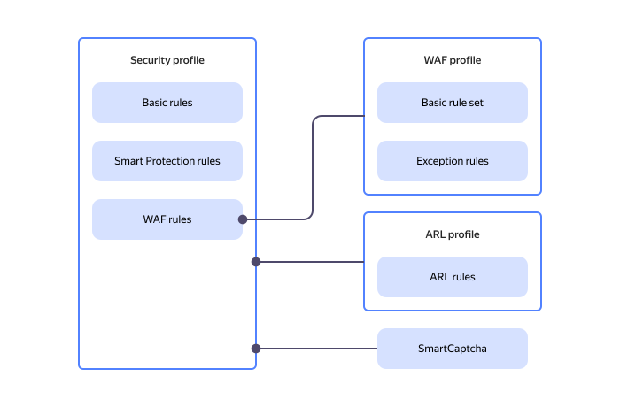

# Security profiles

_Security profile_ is the main {{ sws-name }} component. A security profile consists of a set of HTTP traffic processing [rules](rules.md). The rules contain filtering [conditions](conditions.md) and [actions](rules.md#rule-action) that apply to your web resource's incoming traffic. Security profiles also allow configuring a [CAPTCHA](https://en.wikipedia.org/wiki/CAPTCHA) and request limits based on various conditions. To standardize client response pages for triggered profile rules, you can create your own [response templates](response-templates.md).



You can create security profiles in different ways:
  * _{{ ui-key.yacloud.smart-web-security.title_default-template }}_.

    
    
  * _{{ ui-key.yacloud.smart-web-security.title_no-template }}_. This profile includes only the basic default rule enabled for all traffic.

   

[Connect a security profile](../operations/host-connect.md) to your resource to enable {{ sws-name }} protection.



## Protection modes {#protection-mode}

The _protection mode_ decides which profile rules will apply to traffic and how strict Smart Protection will be. These modes allow you to pre-configure additional rules and activate them during a load surge or attack.

For each rule, you choose when it applies: in all modes (default), in _Enhanced protection_ and _Under attack_ modes, or _Under attack_ only. The final action for a request is determined by the priorities of the active rules.

There are three modes in the profile:

* **Normal**: For standard load. The _All modes_ rules apply.
* **Enhanced protection**: For suspicious load spikes. The _Enhanced protection_ and _Under attack_ mode rules additionally apply. Smart Protection more commonly applies lenient checks to suspicious traffic.
* **Under attack**: For an attack or critical load. Rules selected specifically for this mode additionally apply. Smart Protection checks automated traffic more strictly and requires users to pass verification more frequently.

You can configure the mode switching method when [creating](../operations/profile-create.md) or [editing](../operations/profile-update.md) a profile.

### Automatic switching {#automatic-protection-mode}

The service switches modes based on incoming load. The _Normal_ mode is on by default. For the _Enhanced protection_ and _Under attack_ modes, the following are configured separately:

* _Activation threshold_: Number of incoming requests over a selected interval. If the number of requests over this interval exceeds the threshold, relevant mode gets activated.
* _Mode retention time_: Delay before returning to normal mode after the load drops below the threshold. This delay prevents frequent switching during load fluctuations.

Estimate the standard load based on [traffic monitoring](../operations/monitoring.md#monitoring-dashboards), and the permissible load based on application metrics or load testing results. Set the _Enhanced Protection_ mode threshold above normal peaks with a margin for permissible surges. Set a higher threshold for the _Under attack_ mode – but one below the load level at which the application begins to slow down or throw errors.

Use the same counting interval to compare thresholds. With a one-second interval, you can compare thresholds directly to RPS. After you enable the automatic mode, check if the protection is getting strengthened during normal peak loads and adjust the thresholds as needed.

### Manual switching {#manual-protection-mode}

The selected mode is retained regardless of the load. [Manual switching](../operations/profile-update.md) disables automatic control until you turn it back on.

## Request body analysis {#analyze-request-body}

In the security profile, you can enable request body inspection to improve the web application's performance and security. Limiting the maximum request body size prevents excessive resource consumption and mitigates the effects of DoS/DDoS attacks, where attackers submit large requests in order to exhaust the server's resources.

When you configure a security profile, you can select an action for when the maximum request body size is exceeded:

* `{{ ui-key.yacloud.smart-web-security.waf.label_analyze-request-body-action-ignore }}`: Use it when a legitimate application frequently sends large requests.
* `{{ ui-key.yacloud.smart-web-security.waf.label_analyze-request-body-action-deny }}`: This is a universal and secure approach. {{ sws-name }} blocks any requests exceeding the 8 KB limit, reducing the risk of attacks. If a request is blocked, {{ sws-name }} returns a `403` error.

## Profiles and rules diagram {#profile-rules-schema}

The diagram below illustrates the relationship between {{ sws-name }} profiles and rules. Security profile is the main {{ sws-name }} component you can use to set up basic rules and Smart Protection. You can additionally connect a WAF profile (through a WAF rule), an ARL profile, and {{ captcha-name }}.

#### Useful links {#see-also}

* [Managing security profiles](../operations/index.md#profiles)
* [{#T}](../tutorials/sws-basic-protection.md)
* [Setting up an Ingress controller and test applications](../../managed-kubernetes/tutorials/alb-ingress-controller.md#create-ingress-and-apps)
