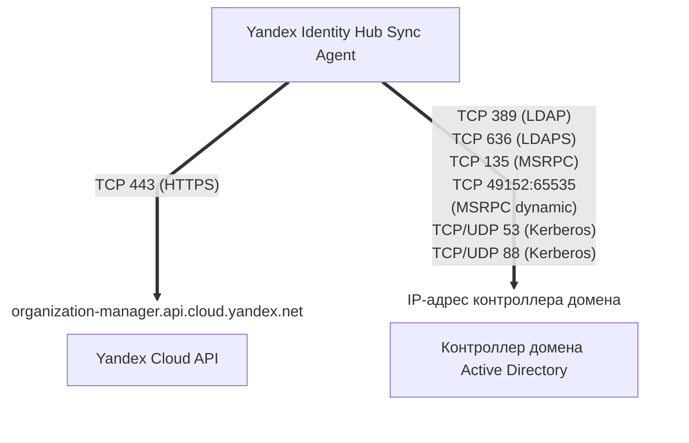

[Документация Yandex Cloud](../../../index.md) > [Yandex Identity Hub](../../index.md) > Концепции > [Синхронизация с внешними службами каталогов](index.md) > Microsoft Active Directory

# Синхронизация пользователей и групп с Microsoft Active Directory

Если для управления пользователями ваша компания использует [Microsoft Active Directory](https://docs.microsoft.com/ru-ru/windows-server/identity/ad-ds/active-directory-domain-services) и вы хотите организовать для ваших пользователей доступ к Yandex Cloud, вам не нужно создавать учетные записи для них вручную. Вместо этого вы можете [настроить](../../operations/sync-external/sync-ad.md) синхронизацию с Yandex Identity Hub пользователей и групп из вашего каталога Active Directory.

Синхронизация пользователей и групп выполняется [агентом синхронизации Yandex Identity Hub Sync Agent](#sync-agent), который может быть запущен на любом сервере под управлением ОС [Linux](https://ru.wikipedia.org/wiki/Linux) или [Windows](https://ru.wikipedia.org/wiki/Windows).

## Схема синхронизации {sync-flow-chart}

На сервере, где [запущен](../../operations/sync-external/sync-ad.md) агент синхронизации, должны быть открыты следующие сетевые порты для входящего и исходящего трафика:

* Для обращения к API Yandex Cloud:

    * `443 (TCP)` — для [HTTPS](https://ru.wikipedia.org/wiki/HTTPS);

* Для обращения к контроллеру домена Active Directory:

    * `389 (TCP)` — для [LDAP](https://learn.microsoft.com/en-us/windows/win32/api/_ldap/);
    * `636 (TCP)` — для [LDAPS](https://learn.microsoft.com/en-us/troubleshoot/windows-server/active-directory/enable-ldap-over-ssl-3rd-certification-authority);
    * `135 (TCP)` — для [MSRPC](https://learn.microsoft.com/en-us/windows/win32/rpc/rpc-start-page);
    * `49152:65535 (TCP)` — диапазон портов для MSRPC dynamic;
    * `53 (TCP/UDP)` и `88 (TCP/UDP)` — для [Kerberos](https://ru.wikipedia.org/wiki/Kerberos).

## Объекты синхронизации {#sync-objects}

Агент Yandex Identity Hub Sync Agent синхронизирует с каталогом Active Directory следующие объекты:

* **Пользователи**.
* **Атрибуты пользователей**.

    Таблица сопоставления атрибутов пользователей:

    Имя атрибута  в конфигурации агента | Имя атрибута в Active Directory  (по умолчанию) | Имя атрибута  в Yandex Identity Hub
    --- | --- | ---
    `FullName` | `displayName` | `full_name`
    `GivenName` | `givenName` | `given_name`
    `FamilyName` | `sn` | `family_name`
    `Email` | `mail` | `email`
    `PhoneNumber` | `telephoneNumber` | `phone_number`
    `Username` | `userPrincipalName` | `username`
    `EmployeeId` | `employeeID` | `employee_id`
    `Department` | `department` | `department`
    `JobTitle` | `title` | `job_title`
    `CompanyName` | `company` | `company_name`
    н/д | `ObjectGUID` | `external_id`

    В параметре `user_attribute_mapping` конфигурации агента вы можете настроить сопоставление имен атрибутов пользователя, отличных от заданных по умолчанию для Active Directory, или отключить синхронизацию отдельных атрибутов.
* **Группы пользователей**.
* **Атрибуты групп пользователей**.

    Таблица сопоставления атрибутов групп пользователей:

    Имя атрибута  в конфигурации агента | Имя атрибута в Active Directory  (по умолчанию) | Имя атрибута  в Yandex Identity Hub
    --- | --- | ---
    `Name` | `name` | `name`
    `Description` | `description` | `description`
    н/д | `ObjectGUID` | `external_id`

    В параметре `group_attribute_mapping` конфигурации агента вы можете настроить сопоставление имен атрибутов групп пользователей, отличных от заданных по умолчанию для Active Directory, или отключить синхронизацию отдельных атрибутов.
* **Членства пользователей в группах**.
* **[Хеши](https://ru.wikipedia.org/wiki/Хеш-функция) паролей пользователей**.

    Пароли пользователей хранятся в Active Directory не в открытом виде, а в виде хешей. Yandex Cloud, получив из каталога Active Directory хеш пароля пользователя, формирует на его основе собственный хеш с использованием современного и устойчивого к взлому алгоритма [Argon2](https://ru.wikipedia.org/wiki/Argon2).

    

    Yandex Cloud не хранит в своих базах данных пароли пользователей в открытом виде.

    

## Обратная запись паролей в Active Directory {#password-writeback}



Функциональность обратной записи паролей находится на стадии [Preview](../../../overview/concepts/launch-stages.md). Чтобы получить к ней доступ, обратитесь в [техническую поддержку](https://center.yandex.cloud/support) или к вашему аккаунт-менеджеру.



Агент синхронизации позволяет выполнять _обратную запись паролей_ пользователей (password writeback) в Active Directory. Обратная запись паролей обновляет пароль пользователя в Active Directory, если пароль этого пользователя был изменен на стороне Yandex Identity Hub в следующих случаях:

* пользователь, для которого настроена синхронизация с Active Directory, [изменил свой пароль](../../operations/manage-account.md#edit-password) в Yandex Identity Hub;
* администратор организации [сбросил пароль](../../operations/user-pools/reset-user-password.md#reset) пользователя, для которого настроена синхронизация с Active Directory;
* пользователь, для которого настроена синхронизация с Active Directory, установил новый пароль в Yandex Identity Hub после того, как пароль этого пользователя был сброшен администратором.

Обратная запись паролей выполняется в следующем порядке:

1. Пользователь или администратор выполняют запрос на изменение пароля пользователя в Yandex Identity Hub.
1. Агент синхронизации предпринимает попытку обновить пароль этого пользователя в Active Directory.

    Попытка смены пароля в Active Directory может завершиться неудачей. Например, если новый пароль не соответствует требованиям, которые установлены в политиках безопасности Active Directory.
1. Если попытка изменить пароль в Active Directory завершилась успехом, пароль пользователя изменяется также и на стороне Yandex Identity Hub.
1. Если попытка изменить пароль в Active Directory завершилась неудачей, пароль пользователя на стороне Yandex Identity Hub также остается неизменным.

Для работы обратной записи паролей аккаунту Active Directory, от имени которого агент выполняет синхронизацию, дополнительно нужны разрешения `Change Password`, `Reset Password` и `Write pwdLastSet`. Назначьте их на весь домен или на те Organization Units (OU), которые попадают под выбранные в конфигурации агента фильтры `sync_settings.filter`.

Чтобы включить обратную запись паролей, [опишите настройки синхронизации](../../operations/sync-external/sync-ad.md#enable-password-writeback) и задайте параметр `enable_password_writeback: true` в конфигурации агента.

## Настройка синхронизации {#sync-setup}

Чтобы реализовать синхронизацию пользователей и групп Yandex Identity Hub с Active Directory, необходимо выполнить предварительные настройки, как на стороне вашего [контроллера домена](https://ru.wikipedia.org/wiki/Контроллер_домена) с развернутыми службами Active Directory, так и на стороне Yandex Cloud.

Если для аутентификации на стороне внешней службы каталогов вы планируете использовать протокол [Kerberos](https://ru.wikipedia.org/wiki/Kerberos), самостоятельно установите на сервер с агентом компоненты, необходимые для работы этого протокола, и создайте файл `keytab` с ключами шифрования.

### Настройка на стороне контроллера домена Active Directory {#dc-setup}

Для корректной работы агента синхронизации на стороне Active Directory выполните следующие действия:

1. Создайте аккаунт пользователя домена или [аккаунт gMSA](*gmsa_account), от имени которого агент будет выполнять синхронизацию.
1. Выдайте этому аккаунту следующие разрешения на домен, указанный в конфигурации агента в секции `sync_settings.filter`:

    * `Replicating Directory Changes`;
    * `Replicating Directory Changes All`.

    Если вы используете обратную запись паролей, дополнительно выдайте аккаунту следующие разрешения на Organization Units (OU), указанные в конфигурации агента в секции `sync_settings.filter`, или на весь домен:

    * `Change Password`;
    * `Reset Password`;
    * `Write pwdLastSet`.
1. На контроллере домена откройте сетевые порты для входящего трафика, поступающего с IP-адреса сервера, на котором установлен агент Yandex Identity Hub Sync Agent:

    * `389 (TCP)` — для [LDAP](https://learn.microsoft.com/en-us/windows/win32/api/_ldap/);
    * `636 (TCP)` — для [LDAPS](https://learn.microsoft.com/en-us/troubleshoot/windows-server/active-directory/enable-ldap-over-ssl-3rd-certification-authority);
    * `135 (TCP)` — для [MSRPC](https://learn.microsoft.com/en-us/windows/win32/rpc/rpc-start-page);
    * `49152:65535 (TCP)` — диапазон портов для MSRPC dynamic;
    * `53 (TCP/UDP)` и `88 (TCP/UDP)` — для [Kerberos](https://ru.wikipedia.org/wiki/Kerberos).

1. (Опционально) Если вы планируете настраивать аутентификацию с использованием протокола [Kerberos](https://ru.wikipedia.org/wiki/Kerberos), настройте [SPN](https://learn.microsoft.com/en-us/windows/win32/ad/service-principal-names).

### Настройка на стороне Yandex Cloud {#yc-setup}

Для корректной работы агента синхронизации на стороне Yandex Cloud выполните следующие действия:

* [Создайте](../../../iam/operations/sa/create.md) сервисный аккаунт, от имени которого синхронизация будет выполняться на стороне Yandex Identity Hub.
* [Назначьте](../../../iam/operations/sa/assign-role-for-sa.md#binding-role-organization) сервисному аккаунту следующие [роли](../../../iam/concepts/access-control/roles.md) на [организацию](../organization.md), в которой находится нужный пул пользователей:

    * [`organization-manager.userpools.syncAgent`](../../security/index.md#organization-manager-userpools-syncAgent);
    * [`organization-manager.groups.viewer`](../../security/index.md#organization-manager-groups-viewer);
    * [`organization-manager.groups.externalCreator`](../../security/index.md#organization-manager-groups-externalCreator);
    * [`organization-manager.groups.externalConverter`](../../security/index.md#organization-manager-groups-externalConverter).
    
    Если вы планируете выгружать логи работы агента синхронизации в [лог-группу](../../../logging/concepts/log-group.md) Yandex Cloud Logging, дополнительно назначьте сервисному аккаунту [роль](../../../logging/security/index.md#logging-writer) `logging.writer` на соответствующую лог-группу или [каталог](../../../resource-manager/concepts/resources-hierarchy.md#folder), в котором она расположена.

* (Опционально) [Создайте](../../../iam/operations/authentication/manage-authorized-keys.md#create-authorized-key) и сохраните [авторизованный ключ](../../../iam/concepts/authorization/key.md) сервисного аккаунта.

    
    
    Авторизованный ключ не нужен, если агент синхронизации устанавливается на [виртуальную машину](../../../compute/concepts/vm.md) Yandex Compute Cloud, к которой привязан сервисный аккаунт с необходимыми правами доступа.
    
    

## Агент синхронизации {#sync-agent}

Агент синхронизации Yandex Identity Hub Sync Agent читает данные о пользователях и группах пользователей в [выбранных](#agent-config) Organization Units (OU) в каталоге Active Directory и синхронизирует их с данными пользователей и групп пользователей в [пуле](../user-pools.md) Yandex Identity Hub.

Скрипт установки агента синхронизации доступен для следующих операционных систем:

* [Linux](https://storage.yandexcloud.net/yc-identityhub-sync/install.sh);
* [Windows](https://storage.yandexcloud.net/yc-identityhub-sync/install.ps1).

### Аутентификация на стороне Active Directory {#agent-ad-auth}

На стороне Active Directory агент синхронизации получает данные пользователей и групп от имени аккаунта, [созданного](#dc-setup) в домене Active Directory. При получении этих данных используются протоколы [LDAP](https://learn.microsoft.com/en-us/windows/win32/api/_ldap/) и [DRSR](https://learn.microsoft.com/en-us/openspecs/windows_protocols/ms-drsr/), запросы отправляются на адрес контроллера домена Active Directory, заданный в [конфигурации](#agent-config) агента.

Вне зависимости от операционной системы сервера, на котором установлен агент синхронизации, аутентификация агента на стороне Active Directory может осуществляться по имени и паролю пользователя домена или с использованием протокола [Kerberos](https://ru.wikipedia.org/wiki/Kerberos) версии 5.

Кроме того, при установке агента синхронизации на сервер с ОС Windows аутентификацию агента на стороне Active Directory можно настроить от имени [аккаунта gMSA](*gmsa_account).



Аккаунт gMSA является предпочтительным способом аутентификации в Active Directory, так как не требует сохранения пароля в файле конфигурации агента или ключей Kerberos на сервере.



### Аутентификация на стороне Yandex Cloud {#agent-yc-auth}

На стороне Yandex Cloud агент синхронизации управляет пользователями и группами пользователей от имени [сервисного аккаунта](../../../iam/concepts/users/service-accounts.md) с [назначенными](#yc-setup) разрешениями на выполнение синхронизации. Запросы к Yandex Cloud направляются на публичный эндпоинт `https://organization-manager.api.cloud.yandex.net` по протоколу [HTTPS](https://ru.wikipedia.org/wiki/HTTPS). Для аутентификации агента в API Yandex Cloud используется авторизованный ключ сервисного аккаунта или (только при установке на ВМ Compute Cloud) — [IAM-токен](../../../iam/concepts/authorization/iam-token.md) сервисного аккаунта, [получаемый](../../../compute/operations/vm-metadata/get-vm-metadata.md#example5) через [сервис метаданных](../../../compute/concepts/vm-metadata.md) ВМ.

### Процесс синхронизации {#sync-process}

В процессе синхронизации данных агент Yandex Identity Hub Sync Agent может создавать, изменять или удалять пользователей и группы пользователей в Yandex Identity Hub. Синхронизация пользователей и групп Yandex Identity Hub с пользователями и группами в Active Directory выполняется в два этапа: [первичная синхронизация](#full-sync) и [инкрементальная синхронизация](#incremental-sync).

При выполнении синхронизации в пуле пользователей может обнаружиться пользователь или группа пользователей с именами, идентичными именам пользователя или группы, которые требуется синхронизировать. В этом случае агент, в зависимости от [заданных настроек](#agent-config), перезапишет данные из Active Directory для существующего пользователя или группы Yandex Identity Hub либо выведет сообщение об ошибке.

#### Полная (первичная) синхронизация {#full-sync}

При выполнении полной синхронизации агент считывает данные всех пользователей, групп и их атрибутов в [выбранных](#agent-config) Organization Units в каталоге Active Directory и создает аналогичных пользователей и группы с аналогичными атрибутами в пуле пользователей Yandex Identity Hub.

Процесс первичной синхронизации большого количества [объектов](#sync-objects) может занять достаточно длительное время. Если процесс полной синхронизации прервется в результате ошибки, повторный запуск агента продолжит синхронизацию с той позиции, на которой прервалась предыдущая попытка. Прогресс полной синхронизации агент отслеживает с помощью файлов с токенами процессов, которые расположены в директории с запущенным агентом:

* `main_sync_replication_token.json`
* `password_hash_replication_token.json`
* `user_control_replication_token.json`

После успешного завершения полной синхронизации агент, запущенный в виде сервиса или службы операционной системы, переходит к непрерывному выполнению частичной (инкрементальной) синхронизации.



Вы можете повторно запустить процесс полной синхронизации. Для этого удалите указанные выше файлы с токенами процессов и перезапустите агент.



#### Частичная (инкрементальная) синхронизация {#incremental-sync}

Инкрементальная синхронизация непрерывно выполняется запущенным агентом со следующей периодичностью:

* _Синхронизация паролей и состояний пользователей_ — агент отслеживает статус блокировки/разблокировки пользователей в домене Active Directory и смену пользовательских паролей и переносит эти изменения в Yandex Identity Hub с периодичностью один раз в несколько секунд. Частоту выполнения этого типа синхронизации изменить нельзя.
* _Синхронизация иных значений_ — агент отслеживает прочие изменения свойств, атрибутов и параметров пользователей и групп с периодичностью, которая [установлена](#agent-config) в файле конфигурации агента.

#### Тестовый запуск (dry run) {#dry-run}

Агент Yandex Identity Hub Sync Agent можно запустить в тестовом режиме (dry run). Этот режим позволяет убедиться в корректности вносимых в конфигурацию агента изменений, прежде чем применять эти изменения в рабочем режиме.

В режиме тестового запуска агент не вносит изменения в данные пользователей и групп Yandex Identity Hub. Вместо этого он тестирует выполнение всех операций, которые вызваны вносимыми в конфигурацию агента изменениями, и сохраняет результаты этих тестов в [логах](#logging) работы агента.

Подробнее о том, как запустить агент в режиме dry run, читайте в разделе [Протестируйте изменения в конфигурации агента](../../operations/sync-external/sync-ad.md#dry-run).

### Отслеживаемые изменения {#tracked-changes}

В процессе непрерывной синхронизации агент отслеживает следующие изменения в Active Directory и переносит их в Yandex Identity Hub:

* создание, изменение, блокировка, разблокировка и удаление пользователей;
* создание, изменение и удаление групп пользователей;
* изменение атрибутов пользователей и групп;
* добавление пользователей в группы и исключение их из групп;
* изменение паролей пользователей.

Если для учетной записи пользователя на стороне Active Directory задано значение поля **accountExpires**, агент синхронизирует это значение с полем **Дата деактивации** (`expires_at`) в свойствах локального пользователя Yandex Identity Hub. При наступлении момента, указанного в этом поле, локальный пользователь Yandex Identity Hub будет автоматически [деактивирован](../../operations/user-pools/deactivate-user.md).

В этом случае, чтобы повторно активировать пользователя, измените или удалите значение поля **accountExpires** для учетной записи пользователя на стороне Active Directory.

### Логирование процесса синхронизации {#logging}

Агент Yandex Identity Hub Sync Agent регистрирует события, возникающие в процессе синхронизации.

По умолчанию информация о событиях и ошибках выводится в [стандартный поток](https://ru.wikipedia.org/wiki/Стандартные_потоки) `stdout`. В [конфигурации](#agent-config) агента вы можете задать настройки для сохранения логов в файлы.

По умолчанию информация о событиях в стандартный поток или файл выводится в простом текстовом формате, но в конфигурации агента формат можно изменить на [JSON](https://ru.wikipedia.org/wiki/JSON).

В [конфигурации](#agent-config) агента вы также можете настроить выгрузку логов в [лог-группу](../../../logging/concepts/log-group.md) Yandex Cloud Logging.

Кроме того, в конфигурации агента можно задать следующие уровни логирования:

* `debug`
* `info`
* `warn`
* `error`
* `dpanic`
* `panic`
* `fatal`

### Проверка прав доступа к файлам с аутентификационными данными {#auth-data-security}

При запуске агент синхронизации может проверять права доступа, назначенные файлам, которые используются агентом и содержат чувствительные данные:

* файл [конфигурации агента](#agent-config) может содержать пароль от учетной записи пользователя, от имени которого агент выполняет синхронизацию на стороне Active Directory;
* файл `keytab` содержит ключи шифрования, необходимые для аутентификации в Active Directory по протоколу Kerberos;
* файл с [авторизованным ключом](../../../iam/concepts/authorization/key.md) сервисного аккаунта содержит ключ, позволяющий получить доступ к Yandex Cloud.

Если проверка прав доступа включена, при запуске агент синхронизации проверяет соблюдение следующих условий:



- Linux {#linux}

  * владельцем файлов является пользователь, от имени которого запускается агент;
  * права на чтение и запись для файлов предоставлены только их владельцу (`chmod 600`).

- Windows {#windows}

  * для файлов отключено наследование прав доступа;
  * полный доступ (разрешение `FullAccess`) к файлам имеют только субъекты `System`, `Local Administrator` и/или субъекты, входящие в группу `BUILTIN\Administrators`;
  * разрешение на чтение файлов есть только у пользователя, от имени которого запускается агент.



Если при запуске агент выявляет нарушение указанных условий, запуск завершается ошибкой.

Включить или отключить проверку прав доступа к файлам с чувствительной информацией можно с помощью параметра `check_config_permissions` конфигурации агента.

### Конфигурация агента {#agent-config}

Конфигурация агента синхронизации задается в [YAML](https://yaml.org/)-файле и зависит от [способа аутентификации](#agent-ad-auth) на стороне Active Directory.

Примеры конфигурации приведены в [инструкции по настройке синхронизации](../../operations/sync-external/sync-ad.md#setup-agent), а описание полей — в разделе [Параметры конфигурации агента](../../operations/sync-external/sync-ad.md#agent-config).

#### Полезные ссылки {#see-also}

* [Синхронизировать пользователей и группы с Microsoft Active Directory](../../operations/sync-external/sync-ad.md)
* [Синхронизация пользователей и групп с LDAP-совместимыми службами каталогов](ldap-sync.md)

[*gmsa_account]: gMSA (group Managed Service Account) — это тип учетных записей в Microsoft Active Directory, паролями для которых автоматически управляет контроллер домена, что упрощает запуск и работу одной и той же службы (SPN) на разных серверах. Подробнее читайте в [документации Microsoft](https://learn.microsoft.com/ru-ru/windows-server/identity/ad-ds/manage/group-managed-service-accounts/group-managed-service-accounts/group-managed-service-accounts-overview).