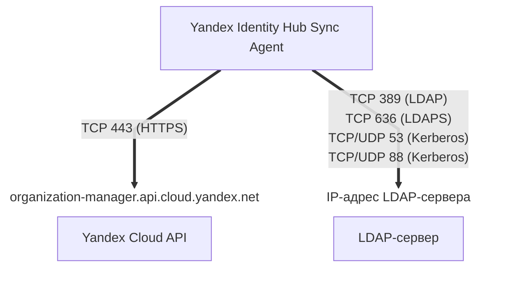

[Документация Yandex Cloud](../../../index.md) > [Yandex Identity Hub](../../index.md) > Концепции > [Синхронизация с внешними службами каталогов](index.md) > LDAP-совместимые службы каталогов

# Синхронизация пользователей и групп с LDAP-совместимыми службами каталогов

Если для управления пользователями ваша компания использует службу каталогов, совместимую с протоколом [LDAP](https://ru.wikipedia.org/wiki/LDAP), и вы хотите организовать для ваших пользователей доступ к Yandex Cloud, вам не нужно создавать учетные записи для них вручную. Вместо этого вы можете [настроить](../../operations/sync-external/sync-ldap.md) синхронизацию с Yandex Identity Hub пользователей и групп из вашего каталога.

Синхронизация пользователей и групп выполняется [агентом синхронизации Yandex Identity Hub Sync Agent](#sync-agent), который может быть запущен на любом сервере под управлением ОС [Linux](https://ru.wikipedia.org/wiki/Linux) или [Windows](https://ru.wikipedia.org/wiki/Windows).

## Схема синхронизации {sync-flow-chart}

На сервере, где [запущен](../../operations/sync-external/sync-ldap.md) агент синхронизации, должны быть открыты следующие сетевые порты для входящего и исходящего трафика:

* Для обращения к API Yandex Cloud:

    * `443 (TCP)` — для [HTTPS](https://ru.wikipedia.org/wiki/HTTPS);

* Для обращения к LDAP-серверу:

    * `389 (TCP)` — для [LDAP](https://learn.microsoft.com/en-us/windows/win32/api/_ldap/);
    * `636 (TCP)` — для [LDAPS](https://learn.microsoft.com/en-us/troubleshoot/windows-server/active-directory/enable-ldap-over-ssl-3rd-certification-authority);
    * `53 (TCP/UDP)` и `88 (TCP/UDP)` — для [Kerberos](https://ru.wikipedia.org/wiki/Kerberos).

## Объекты синхронизации {#sync-objects}

Агент Yandex Identity Hub Sync Agent синхронизирует с внешним LDAP-каталогом следующие объекты:

* **Пользователи**.
* **Атрибуты пользователей**.

    Таблица сопоставления атрибутов пользователей:

    #|
    || **Имя атрибута в конфигурации агента** | **Имя атрибута в Yandex Identity Hub** |::{align="center"} **Имя атрибута во внешнем LDAP-каталоге**&nbsp;^1^ | > | > ||
    || ^ | ^ |::{align="center"} `person`/`inetOrgPerson`/ `organizationalPerson` |::{align="center"} `posixAccount` |::{align="center"} `user` ([Samba](https://ru.wikipedia.org/wiki/Samba) и [Альт домен](https://www.basealt.ru/alt-domain)) ||
    || `FullName` | `full_name` | `displayName` | `cn` | `displayName` ||
    || `GivenName` | `given_name` | `givenName` | — | `givenName` ||
    || `FamilyName` | `family_name` | `sn` | — | `sn` ||
    || `Email` | `email` | `mail` | — | `mail` ||
    || `PhoneNumber` | `phone_number` | `telephoneNumber` | — | `telephoneNumber` ||
    || `Username` | `username` | `uid` | `uid` | `userPrincipalName` ||
    || `EmployeeId` | `employee_id` | `employeeNumber` | `uidNumber` | `employeeID` ||
    || `Department` | `department` | `departmentNumber` | — | `department` ||
    || `JobTitle` | `job_title` | `title` | — | `title` ||
    || `CompanyName` | `company_name` | `o` | — | `company` ||
    |#

    ^1^ Имена атрибутов, которые используются в LDAP-каталогах, зависят от типа каталога и используемого класса объекта (`objectClass`).

    В параметре `user_attribute_mapping` [конфигурации агента](../../operations/sync-external/sync-ldap.md#config-sync-settings) вы можете настроить сопоставление имен атрибутов пользователя, отличных от заданных по умолчанию для внешних каталогов, или отключить синхронизацию отдельных атрибутов.

* **Группы пользователей**.
* **Атрибуты групп пользователей**.

    Таблица сопоставления атрибутов групп пользователей:

    #|
    || **Имя атрибута в конфигурации агента** | **Имя атрибута в Yandex Identity Hub** |::{align="center"} **Имя атрибута во внешнем LDAP-каталоге**&nbsp;^1^ | > | > ||
    || ^ | ^ |::{align="center"} `groupOfNames`/`groupOfUniqueNames` |::{align="center"} `posixGroup` |::{align="center"} `group` ([Samba](https://ru.wikipedia.org/wiki/Samba) и [Альт домен](https://www.basealt.ru/alt-domain)) ||
    || `Name` | `name` | `cn` | `cn` | `name` ||
    || `Description` | `description` | `description` | `description` | `description` ||
    |#

    ^1^ Имена атрибутов, которые используются в LDAP-каталогах, зависят от типа каталога и используемого класса объекта (`objectClass`).

    В параметре `group_attribute_mapping` [конфигурации агента](../../operations/sync-external/sync-ldap.md#config-sync-settings) вы можете настроить сопоставление имен атрибутов групп пользователей, отличных от заданных по умолчанию для внешних каталогов, или отключить синхронизацию отдельных атрибутов.
* **Членства пользователей в группах**.

    Атрибут членства определяется в зависимости от используемого класса `objectClass`:

    Класс | Атрибут
    --- | ---
    `groupOfNames` | `member` (DN)
    `groupOfUniqueNames` | `uniqueMember` (DN)
    `posixGroup` | `memberUid` (UID, значение `uid` пользователя)
    `group` (Samba) | `member` (DN)

* **[Хеши](https://ru.wikipedia.org/wiki/Хеш-функция) паролей пользователей**.

    Как правило, пароли пользователей хранятся во внешних каталогах не в открытом виде, а в виде хешей. Yandex Cloud, получив из внешнего каталога хеш пароля пользователя, формирует на его основе собственный хеш с использованием современного и устойчивого к взлому алгоритма [Argon2](https://ru.wikipedia.org/wiki/Argon2).

    

    Yandex Cloud не хранит в своих базах данных пароли пользователей в открытом виде.

    

Проверяйте имена атрибутов-источников, которые вы указываете в конфигурации агента при их переназначении, и сверяйте с теми именами атрибутов, которые используются в вашем LDAP-каталоге. LDAP-сервер не проверяет значения передаваемых атрибутов, которые заданы в [параметрах конфигурации](#agent-config) `user_attribute_mapping.source` и `group_attribute_mapping.source`, и принимает их как есть.

## Обратная запись паролей во внешние каталоги {#password-writeback}



Функциональность обратной записи паролей находится на стадии [Preview](../../../overview/concepts/launch-stages.md). Чтобы получить к ней доступ, обратитесь в [техническую поддержку](https://center.yandex.cloud/support) или к вашему аккаунт-менеджеру.



Агент синхронизации позволяет выполнять _обратную запись паролей_ пользователей (password writeback). Обратная запись паролей обновляет пароль пользователя во внешнем каталоге, если пароль этого пользователя был изменен на стороне Yandex Identity Hub в следующих случаях:

* пользователь, для которого настроена синхронизация с внешним каталогом, [изменил свой пароль](../../operations/manage-account.md#edit-password) в Yandex Identity Hub;
* администратор организации [сбросил пароль](../../operations/user-pools/reset-user-password.md#reset) пользователя, для которого настроена синхронизация с внешним каталогом;
* пользователь, для которого настроена синхронизация с внешним каталогом, установил новый пароль в Yandex Identity Hub после того, как пароль этого пользователя был сброшен администратором.

Обратная запись паролей выполняется в следующем порядке:

1. Пользователь или администратор выполняют запрос на изменение пароля пользователя в Yandex Identity Hub.
1. Агент синхронизации предпринимает попытку обновить пароль этого пользователя во внешнем каталоге.

    Попытка смены пароля во внешнем каталоге может завершиться неудачей. Например, если новый пароль не соответствует требованиям, которые установлены для паролей в настройках каталога.
1. Если попытка изменить пароль во внешнем каталоге завершилась успехом, пароль пользователя изменяется также и на стороне Yandex Identity Hub.
1. Если попытка изменить пароль во внешнем каталоге завершилась неудачей, пароль пользователя на стороне Yandex Identity Hub также остается неизменным.

Чтобы включить обратную запись паролей, задайте параметр `enable_password_writeback: true` и настройте раздел `ldap.password_writeback` в [конфигурации агента](../../operations/sync-external/sync-ldap.md#agent-config).



В некоторых внешних каталогах (например, [FreeIPA](https://www.freeipa.org/) и [ApacheDS™](https://directory.apache.org/apacheds/)) для выполнения обратной записи паролей необходим дополнительный аккаунт, который позволяет сбрасывать пароль пользователя без необходимости его смены после первого входа. Подробнее читайте в документации к используемой службе каталогов.



## Настройка синхронизации {#sync-setup}

Чтобы реализовать синхронизацию пользователей и групп Yandex Identity Hub с внешним каталогом, необходимо выполнить предварительные настройки как на стороне вашего LDAP-сервера, так и на стороне Yandex Cloud.

Если для аутентификации на стороне внешней службы каталогов вы планируете использовать протокол [Kerberos](https://ru.wikipedia.org/wiki/Kerberos), самостоятельно установите на сервер с агентом компоненты, необходимые для работы этого протокола, и создайте файл `keytab` с ключами шифрования.

### Настройка на стороне LDAP-сервера {#dc-setup}

Для корректной работы агента синхронизации на стороне LDAP-сервера выполните следующие действия:

1. Создайте аккаунт пользователя, от имени которого агент будет выполнять синхронизацию.
1. Выдайте этому аккаунту разрешения, необходимые для чтения информации о пользователях и изменения паролей (хешей паролей) пользователей.

    В зависимости от используемой службы каталогов механизм выдачи и названия конкретных разрешений различаются. В некоторых случаях также могут потребоваться дополнительные полномочия. Подробнее о необходимых разрешениях читайте в документации к используемой службе каталогов.
1. (Опционально) Если вы используете обратную запись паролей, в зависимости от используемой службы каталогов (например, [FreeIPA](https://www.freeipa.org/) и [ApacheDS™](https://directory.apache.org/apacheds/)), создайте дополнительный аккаунт пользователя, который позволит сбрасывать пароль пользователя без необходимости его смены после первого входа. Подробнее читайте в документации к используемой службе каталогов.
1. На LDAP-сервере откройте сетевые порты для входящего трафика, который поступает с IP-адреса сервера с установленным агентом Yandex Identity Hub Sync Agent:

    * `389 (TCP)` — для [LDAP](https://learn.microsoft.com/en-us/windows/win32/api/_ldap/);
    * `636 (TCP)` — для [LDAPS](https://learn.microsoft.com/en-us/troubleshoot/windows-server/active-directory/enable-ldap-over-ssl-3rd-certification-authority);
    * `53 (TCP/UDP)` и `88 (TCP/UDP)` — для [Kerberos](https://ru.wikipedia.org/wiki/Kerberos).

### Настройка на стороне Yandex Cloud {#yc-setup}

Для корректной работы агента синхронизации на стороне Yandex Cloud выполните следующие действия:

* [Создайте](../../../iam/operations/sa/create.md) сервисный аккаунт, от имени которого синхронизация будет выполняться на стороне Yandex Identity Hub.
* [Назначьте](../../../iam/operations/sa/assign-role-for-sa.md#binding-role-organization) сервисному аккаунту следующие [роли](../../../iam/concepts/access-control/roles.md) на [организацию](../organization.md), в которой находится нужный пул пользователей:

    * [`organization-manager.userpools.syncAgent`](../../security/index.md#organization-manager-userpools-syncAgent);
    * [`organization-manager.groups.viewer`](../../security/index.md#organization-manager-groups-viewer);
    * [`organization-manager.groups.externalCreator`](../../security/index.md#organization-manager-groups-externalCreator);
    * [`organization-manager.groups.externalConverter`](../../security/index.md#organization-manager-groups-externalConverter).
    
    Если вы планируете выгружать логи работы агента синхронизации в [лог-группу](../../../logging/concepts/log-group.md) Yandex Cloud Logging, дополнительно назначьте сервисному аккаунту [роль](../../../logging/security/index.md#logging-writer) `logging.writer` на соответствующую лог-группу или [каталог](../../../resource-manager/concepts/resources-hierarchy.md#folder), в котором она расположена.

* (Опционально) [Создайте](../../../iam/operations/authentication/manage-authorized-keys.md#create-authorized-key) и сохраните [авторизованный ключ](../../../iam/concepts/authorization/key.md) сервисного аккаунта.

    
    
    Авторизованный ключ не нужен, если агент синхронизации устанавливается на [виртуальную машину](../../../compute/concepts/vm.md) Yandex Compute Cloud, к которой привязан сервисный аккаунт с необходимыми правами доступа.
    
    

## Агент синхронизации {#sync-agent}

Агент синхронизации Yandex Identity Hub Sync Agent читает данные о пользователях и группах пользователей во внешнем каталоге и синхронизирует их с данными пользователей и групп пользователей в [пуле](../user-pools.md) Yandex Identity Hub.

Скрипт установки агента синхронизации доступен для следующих операционных систем:

* [Linux](https://storage.yandexcloud.net/yc-identityhub-sync/install.sh);
* [Windows](https://storage.yandexcloud.net/yc-identityhub-sync/install.ps1).

### Аутентификация на стороне LDAP-сервера {#agent-ldap-auth}

На стороне LDAP-сервера агент синхронизации получает данные пользователей и групп от имени аккаунта, [созданного](#dc-setup) при настройке синхронизации. При получении этих данных используется протокол [LDAP](https://learn.microsoft.com/en-us/windows/win32/api/_ldap/), запросы отправляются на адрес LDAP-сервера, который задан в [конфигурации](#agent-config) агента.

Аутентификация агента на стороне LDAP-сервера может осуществляться по имени и паролю пользователя или с использованием протокола [Kerberos](https://ru.wikipedia.org/wiki/Kerberos) версии 5.

### Аутентификация на стороне Yandex Cloud {#agent-yc-auth}

На стороне Yandex Cloud агент синхронизации управляет пользователями и группами пользователей от имени [сервисного аккаунта](../../../iam/concepts/users/service-accounts.md) с [назначенными](#yc-setup) разрешениями на выполнение синхронизации. Запросы к Yandex Cloud направляются на публичный эндпоинт `https://organization-manager.api.cloud.yandex.net` по протоколу [HTTPS](https://ru.wikipedia.org/wiki/HTTPS). Для аутентификации агента в API Yandex Cloud используется авторизованный ключ сервисного аккаунта или (только при установке на ВМ Compute Cloud) — [IAM-токен](../../../iam/concepts/authorization/iam-token.md) сервисного аккаунта, [получаемый](../../../compute/operations/vm-metadata/get-vm-metadata.md#example5) через [сервис метаданных](../../../compute/concepts/vm-metadata.md) ВМ.

### Процесс синхронизации {#sync-process}

В процессе синхронизации данных агент Yandex Identity Hub Sync Agent может создавать, изменять или удалять пользователей и группы пользователей в Yandex Identity Hub. Синхронизация пользователей и групп Yandex Identity Hub с пользователями и группами во внешнем каталоге выполняется с периодичностью, которая задана в параметре `sync_settings.interval` конфигурации агента.

При выполнении синхронизации агент считывает данные всех пользователей, групп и их атрибутов во внешнем каталоге и обновляет или создает аналогичных пользователей и группы в пуле пользователей Yandex Identity Hub.

При выполнении синхронизации в пуле пользователей может обнаружиться пользователь или группа пользователей с именами, идентичными именам пользователя или группы, которые требуется синхронизировать. В этом случае агент, в зависимости от [заданных настроек](#agent-config), перезапишет данные из внешнего каталога для существующего пользователя или группы Yandex Identity Hub либо выведет сообщение об ошибке.

#### Тестовый запуск (dry run) {#dry-run}

Агент Yandex Identity Hub Sync Agent можно запустить в тестовом режиме (dry run). Этот режим позволяет убедиться в корректности вносимых в конфигурацию агента изменений, прежде чем применять эти изменения в рабочем режиме.

В режиме тестового запуска агент не вносит изменения в данные пользователей и групп Yandex Identity Hub. Вместо этого он тестирует выполнение всех операций, которые вызваны вносимыми в конфигурацию агента изменениями, и сохраняет результаты этих тестов в [логах](#logging) работы агента.

Подробнее о том, как запустить агент в режиме dry run, читайте в разделе [Протестируйте изменения в конфигурации агента](../../operations/sync-external/sync-ldap.md#dry-run).

### Отслеживаемые изменения {#tracked-changes}

В процессе непрерывной синхронизации агент отслеживает следующие изменения во внешнем каталоге и переносит их в Yandex Identity Hub:

* создание, изменение, блокировка, разблокировка и удаление пользователей;
* создание, изменение и удаление групп пользователей;
* изменение атрибутов пользователей и групп;
* добавление пользователей в группы и исключение их из групп;
* изменение паролей пользователей.

Если на стороне внешнего каталога для учетной записи пользователя в поле `shadowExpire` (класс `posixAccount`) задан срок действия, агент синхронизирует это значение с полем **Дата деактивации** (`expires_at`) в свойствах локального пользователя Yandex Identity Hub. При наступлении момента, который [указан](*shadow_expire_format) в этом поле, локальный пользователь Yandex Identity Hub будет автоматически [деактивирован](../../operations/user-pools/deactivate-user.md).

В этом случае, чтобы повторно активировать пользователя, измените или удалите срок действия для учетной записи пользователя в поле `shadowExpire` на стороне внешнего каталога.

[*shadow_expire_format]: Значение поля `shadowExpire` указывается в формате числа, которое равно количеству дней, прошедших с 01.01.1970. Момент окончания срока действия аккаунта определяется как конец указанного дня ([UTC](https://ru.wikipedia.org/wiki/Всемирное_координированное_время)). Если значение отрицательное или отсутствует, значит, срок действия аккаунта не задан.

### Логирование процесса синхронизации {#logging}

Агент Yandex Identity Hub Sync Agent регистрирует события, возникающие в процессе синхронизации.

По умолчанию информация о событиях и ошибках выводится в [стандартный поток](https://ru.wikipedia.org/wiki/Стандартные_потоки) `stdout`. В [конфигурации](#agent-config) агента вы можете задать настройки для сохранения логов в файлы.

По умолчанию информация о событиях в стандартный поток или файл выводится в простом текстовом формате, но в конфигурации агента формат можно изменить на [JSON](https://ru.wikipedia.org/wiki/JSON).

В [конфигурации](#agent-config) агента вы также можете настроить выгрузку логов в [лог-группу](../../../logging/concepts/log-group.md) Yandex Cloud Logging.

Кроме того, в конфигурации агента можно задать следующие уровни логирования:

* `debug`
* `info`
* `warn`
* `error`
* `dpanic`
* `panic`
* `fatal`

### Проверка прав доступа к файлам с аутентификационными данными {#auth-data-security}

При запуске агент синхронизации может проверять права доступа, назначенные файлам, которые используются агентом и содержат чувствительные данные:

* файл [конфигурации агента](#agent-config) может содержать пароль от учетной записи пользователя, от имени которого агент выполняет синхронизацию на стороне внешнего каталога;
* файл `keytab` содержит ключи шифрования, необходимые для аутентификации на LDAP-сервере по протоколу Kerberos;
* файл с [авторизованным ключом](../../../iam/concepts/authorization/key.md) сервисного аккаунта содержит ключ, позволяющий получить доступ к Yandex Cloud.

Если проверка прав доступа включена, при запуске агент синхронизации проверяет соблюдение следующих условий:



- Linux {#linux}

  * владельцем файлов является пользователь, от имени которого запускается агент;
  * права на чтение и запись для файлов предоставлены только их владельцу (`chmod 600`).

- Windows {#windows}

  * для файлов отключено наследование прав доступа;
  * полный доступ (разрешение `FullAccess`) к файлам имеют только субъекты `System`, `Local Administrator` и/или субъекты, входящие в группу `BUILTIN\Administrators`;
  * разрешение на чтение файлов есть только у пользователя, от имени которого запускается агент.



Если при запуске агент выявляет нарушение указанных условий, запуск завершается ошибкой.

Включить или отключить проверку прав доступа к файлам с чувствительной информацией можно с помощью параметра `check_config_permissions` конфигурации агента.

### Конфигурация агента {#agent-config}

Конфигурация агента синхронизации задается в [YAML](https://yaml.org/)-файле и зависит от [способа аутентификации](#agent-ldap-auth) на стороне внешнего каталога.

Примеры конфигурации приведены в [инструкции по настройке синхронизации](../../operations/sync-external/sync-ldap.md#setup-agent), а описание полей — в разделе [Параметры конфигурации агента](../../operations/sync-external/sync-ldap.md#agent-config).

#### Полезные ссылки {#see-also}

* [Синхронизировать пользователей и группы с LDAP-совместимыми каталогами](../../operations/sync-external/sync-ldap.md)
* [Синхронизация пользователей и групп с Microsoft Active Directory](ad-sync.md)