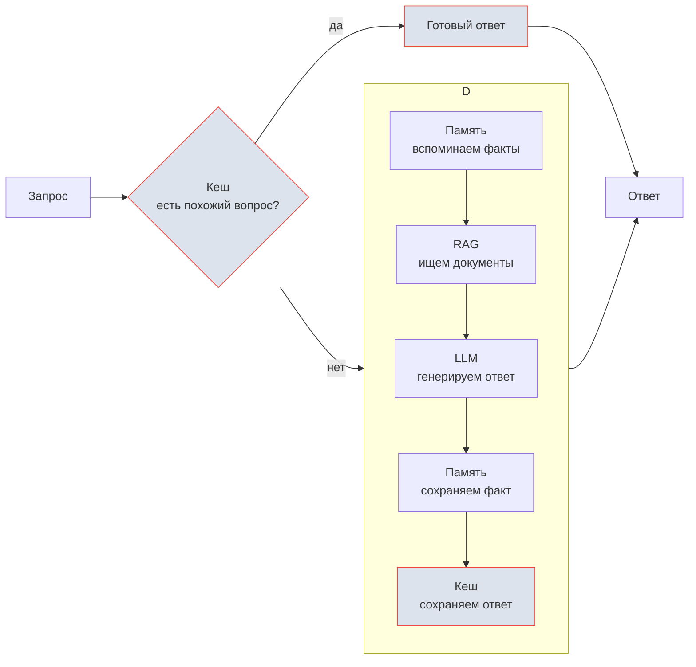

[Документация Yandex Cloud](../../index.md) > [Yandex Managed Service for YDB](../index.md) > [Практические руководства](index.md) > Память, RAG и семантический кеш для ИИ-агента с Managed Service for YDB в режиме Serverless

# Память, RAG и семантический кеш для ИИ-агента с Managed Service for YDB в режиме Serverless

В этом руководстве вы развернете [ИИ-агента](*ai-agent), который использует одну базу данных [Yandex Managed Service for YDB](../index.md) в режиме Serverless для трех задач:

* [Хранение долговременной памяти](#memory).
* [Поиск по фрагментам документов для RAG](#rag).
* [Семантический кеш](#semantic-cache).

Код агента находится в репозитории [ydb-serverless-webinar-ai](https://github.com/ydb-platform/ydb-serverless-webinar-ai). Если вы не хотите писать код агента самостоятельно, в разделе [Память для ИИ-агента через MCP](#mcp-memory) описано, как подключить ту же базу данных к готовому агенту.

## Перед началом работы {#before-you-begin}

Зарегистрируйтесь в Yandex Cloud и создайте [платежный аккаунт](../../billing/concepts/billing-account.md):
1. Перейдите в [консоль управления](https://console.yandex.cloud), затем войдите в Yandex Cloud или зарегистрируйтесь.
1. На странице **[Yandex Cloud Billing](https://center.yandex.cloud/billing/accounts)** убедитесь, что у вас подключен платежный аккаунт, и он находится в [статусе](../../billing/concepts/billing-account-statuses.md) `ACTIVE` или `TRIAL_ACTIVE`. Если платежного аккаунта нет, [создайте его](../../billing/quickstart/index.md) и [привяжите](../../billing/operations/pin-cloud.md) к нему облако.

Если у вас есть активный платежный аккаунт, вы можете создать или выбрать [каталог](../../resource-manager/concepts/resources-hierarchy.md#folder), в котором будет работать ваша инфраструктура, на [странице облака](https://console.yandex.cloud/cloud).

[Подробнее об облаках и каталогах](../../resource-manager/concepts/resources-hierarchy.md).

### Необходимые платные ресурсы {#paid-resources}

В стоимость инфраструктуры для этого руководства входит плата за использование Managed Service for YDB в режиме Serverless и генерацию текста моделью YandexGPT ([тарифы Yandex Managed Service for YDB](../pricing/index.md) и [тарифы Yandex AI Studio](https://aistudio.yandex.ru/docs/ru/ai-studio/pricing)).

В режиме Serverless вы оплачиваете выполненные запросы и объем хранимых данных. Время работы серверов не тарифицируется. [Бесплатный лимит](../../billing/concepts/serverless-free-tier.md#ydb) каждый месяц включает миллион единиц запросов (request units) и 1 ГБ хранения. Этого объема хватает для разработки и демонстрации агента.

При попадании в кеш функция вычисляет один эмбеддинг вопроса и читает одну запись из таблицы вместо генерации ответа моделью. Чем длиннее ответ модели, тем больше вы экономите на каждом попадании в кеш.

В демонстрации агент использовал модель YandexGPT Pro 5.1. Демонстрационный диалог израсходовал 9 000 входящих и 1 500 исходящих токенов. Актуальные цены на модели приведены в [правилах тарификации Yandex AI Studio](https://aistudio.yandex.ru/docs/ru/ai-studio/pricing).

## Как устроен агент {#how-it-works}

Языковая модель обрабатывает каждый запрос независимо и не хранит состояние между запросами. Поэтому агент хранит память во внешнем хранилище. Долговременная память, поиск по документам ([RAG](*rag)) и семантический кеш выполняют одну операцию. Они сохраняют [эмбеддинги](https://aistudio.yandex.ru/docs/ru/ai-studio/concepts/embeddings) текстов и ищут ближайшие векторы по [косинусной близости](https://ru.wikipedia.org/wiki/Косинусное_сходство). Близкие по смыслу тексты получают близкие векторы.

Задачи различаются только данными, которые агент векторизует и возвращает:

* Память векторизует факты о пользователе и возвращает похожие на запрос факты.
* RAG векторизует фрагменты документов и возвращает фрагменты, релевантные запросу пользователя.
* Семантический кеш векторизует вопросы пользователя и возвращает сохраненные ответы модели.

Поэтому агент хранит данные всех трех задач в одной СУБД Managed Service for YDB, в таблицах `memories`, `rag_documents` и `semantic_cache`. Функция агента создает эти таблицы автоматически при первом обращении к ним.

### Состав решения {#components}

* Логика агента работает в одной [функции](../../functions/concepts/function.md) [Yandex Cloud Functions](../../functions/index.md) с точкой входа `index.handler`.
* Ответы генерирует модель [YandexGPT](https://aistudio.yandex.ru/docs/ru/ai-studio/concepts/generation/models), которую задает переменная `LLM_MODEL` со значением `yandexgpt-5.1` по умолчанию.
* Эмбеддинги вычисляют модели YandexGPT Embeddings `text-search-query` и `text-search-doc`.
* Библиотека [mem0](https://github.com/mem0ai/mem0) извлекает факты из сообщений и управляет долговременной памятью.
* Библиотека [langchain-ydb](https://github.com/ydb-platform/langchain-ydb) записывает векторы в Managed Service for YDB и выполняет поиск по ним.
* Локальный чат на [Gradio](https://www.gradio.app/) из файла `ui.py` отправляет сообщения пользователя в функцию.

### Схема обработки сообщения {#message-processing}



1. Если сообщение длиннее 20 символов, функция ищет похожий вопрос в семантическом кеше. При попадании в кеш функция сразу возвращает сохраненный ответ и пропускает остальные шаги.
1. Функция извлекает из памяти факты о пользователе, которые относятся к его сообщению.
1. Функция дополняет сообщение найденными фактами и ищет по этому запросу фрагменты документов.
1. Модель YandexGPT генерирует ответ по системному промпту, в который функция добавила факты и фрагменты.
1. Библиотека mem0 извлекает из сообщения новые факты и сохраняет их в память.
1. Если сообщение длиннее 20 символов, функция сохраняет ответ модели в семантический кеш.

## Разверните агента {#deploy}

Агент использует два сервисных аккаунта с разными ролями. Первый аккаунт работает от имени функции и обращается к Managed Service for YDB и YandexGPT, а второй аккаунт вызывает функцию из локального интерфейса.

### Создайте базу данных и сервисный аккаунт функции {#create-ydb}



- Консоль управления {#console}

  1. В [консоли управления](https://console.yandex.cloud) выберите каталог, в котором будете создавать ресурсы.
  1. [Перейдите](https://console.yandex.cloud/link/ydb) в сервис **Managed Service for&nbsp;YDB**.
  1. Нажмите кнопку **Создать базу данных** и выберите тип **Serverless**.
  1. Задайте имя базы данных и нажмите кнопку **Создать базу данных**.
  1. Дождитесь запуска базы данных. В процессе создания база имеет статус `Provisioning`, а когда готова к использованию — статус меняется на `Running`.
  1. Сохраните значения полей **Эндпоинт** и **Путь к базе данных**. Из эндпоинта возьмите хост и порт для переменных окружения `YDB_HOST` и `YDB_PORT`. Значение поля пути задает переменную `YDB_DATABASE`.
  1. [Перейдите](https://console.yandex.cloud/link/iam) в сервис **Identity and Access Management**.
  1. На панели слева выберите  **Сервисные аккаунты**.
  1. Нажмите кнопку **Создать сервисный аккаунт** и создайте сервисный аккаунт с ролями `ydb.editor` и `ai.languageModels.user`. Роль `ydb.editor` дает доступ к Managed Service for YDB, роль `ai.languageModels.user` разрешает вызывать YandexGPT и модели эмбеддингов.
  1. На панели сверху нажмите кнопку  **Создать новый ключ** и выберите пункт **Создать API-ключ**.
  1. Нажмите кнопку **Создать**.
  1. Сохраните значение секретного ключа — он понадобится для переменной окружения `YANDEX_API_KEY`.
  1. Нажмите кнопку **Закрыть**.
  1. На панели сверху нажмите кнопку  **Создать новый ключ** и выберите пункт **Создать авторизованный ключ**.
  1. Выберите алгоритм шифрования и нажмите кнопку **Создать**.
  1. В открывшемся окне нажмите кнопку **Скачать файл с ключами** и сохраните файл — он понадобится для переменной окружения `YDB_SA_KEY`.
  1. Нажмите кнопку **Закрыть**.



### Разверните функцию {#deploy-function}

1. Клонируйте репозиторий [ydb-serverless-webinar-ai](https://github.com/ydb-platform/ydb-serverless-webinar-ai):

   ```bash
   git clone https://github.com/ydb-platform/ydb-serverless-webinar-ai
   cd ydb-serverless-webinar-ai
   ```

1. Упакуйте содержимое папки `layers/` в архив:

   ```bash
   cd layers
   zip -r ../function.zip .
   cd ..
   ```

1. Создайте функцию:

   

   - Консоль управления {#console}

     1. В [консоли управления](https://console.yandex.cloud) выберите каталог, в котором будете создавать функцию.
     1. [Перейдите](https://console.yandex.cloud/link/functions) в сервис **Cloud Functions**.
     1. Нажмите кнопку **Создать функцию**.
     1. Введите имя функции и нажмите кнопку **Создать**.
     1. Перейдите на вкладку **Редактор** и создайте версию функции:
        1. В поле **Среда выполнения** выберите `Python / 3.12`.
        1. В поле **Источник кода** выберите `ZIP-архив`.
        1. В поле **Файл** прикрепите архив `function.zip`. Архив содержит код функции и файл `requirements-agent.txt` с зависимостями, которые будут установлены автоматически.
        1. В поле **Точка входа** укажите `index.handler`.
        1. В блоке **Параметры** задайте переменные окружения:
           * `YANDEX_API_KEY` — API-ключ сервисного аккаунта функции.
           * `YANDEX_FOLDER_ID` — идентификатор каталога, в котором работают Managed Service for YDB и функция.
           * `YDB_HOST` — адрес эндпоинта Managed Service for YDB. Для режима Serverless укажите `ydb.serverless.yandexcloud.net`.
           * `YDB_PORT` — порт эндпоинта Managed Service for YDB. Для режима Serverless укажите `2135`.
           * `YDB_DATABASE` — путь к базе данных Managed Service for YDB в формате `/ru-central1/<идентификатор_каталога>/<имя_базы_данных>`.
           * `YDB_SA_KEY` — содержимое файла с авторизованным JSON-ключом сервисного аккаунта функции, записанное одной строкой.

           Необязательные переменные `MEMORY_THRESHOLD`, `CACHE_THRESHOLD` и `LLM_MODEL` меняют пороги памяти и кеша и модель генерации.
        1. Нажмите кнопку **Сохранить изменения**.
     1. Перейдите на вкладку **Обзор** и сохраните значение поля **Ссылка для вызова** — оно понадобится для подключения локального интерфейса.

   

### Запустите локальный интерфейс {#run-ui}

1. Создайте второй сервисный аккаунт с ролью `functions.functionInvoker` и скачайте его авторизованный JSON-ключ. Локальный интерфейс вызывает функцию от имени этого сервисного аккаунта.

   

   - Консоль управления {#console}

     1. В [консоли управления](https://console.yandex.cloud) выберите каталог, в котором находится функция.
     1. [Перейдите](https://console.yandex.cloud/link/iam) в сервис **Identity and Access Management**.
     1. На панели слева выберите  **Сервисные аккаунты**.
     1. Нажмите кнопку **Создать сервисный аккаунт** и создайте сервисный аккаунт с ролью `functions.functionInvoker`.
     1. На панели сверху нажмите кнопку  **Создать новый ключ** и выберите пункт **Создать авторизованный ключ**.
     1. Выберите алгоритм шифрования и нажмите кнопку **Создать**.
     1. В открывшемся окне нажмите кнопку **Скачать файл с ключами** и сохраните файл.
     1. Нажмите кнопку **Закрыть**.

   

1. Установите зависимости интерфейса и создайте файл `.env` из шаблона:

   ```bash
   pip install -r requirements-ui.txt
   cp .env.ui.example .env
   ```

1. Укажите в файле `.env` значения двух переменных окружения:
   * `YC_FUNCTION_URL` содержит URL функции, которую вы развернули.
   * `YC_SA_KEY_PATH` содержит путь к JSON-ключу второго сервисного аккаунта, если функция приватная.

1. Запустите интерфейс командой `python ui.py` и откройте в браузере адрес `http://localhost:7860`.

1. Чтобы наполнить RAG, откройте в интерфейсе раздел **Загрузить документ в базу знаний** и загрузите файл `data/cafe_menu.txt`.

## API функции {#api}

Функция принимает HTTP-запросы с объектом JSON в теле и обрабатывает запросы двух видов.

### Сообщение агенту {#message-api}

```json
{"message": "Заказываю пиццу на отдел. Какие пиццы и сколько штук взять?", "user_id": "alice"}
```

Поле `message` обязательно. Поле `user_id` по умолчанию принимает значение `demo`. Функция возвращает ответ агента в поле `answer` и сведения об обработке в поле `meta`:

* `meta.cache_hit` принимает значение `true`, если ответ пришел из семантического кеша.
* `meta.memories_used` показывает, сколько фактов из памяти функция передала модели.
* `meta.docs_used` показывает, сколько фрагментов документов функция передала модели.

При попадании в кеш в поле `meta` остается только `cache_hit`.

### Загрузка документа {#ingest-api}

```json
{"action": "ingest", "text": "<текст документа>", "source": "cafe_menu.txt"}
```

Функция возвращает число сохраненных фрагментов в поле `chunks_added`. Поле `source` по умолчанию принимает значение `upload` и попадает в метаданные каждого фрагмента.

Если тело запроса содержит некорректный JSON или в сообщении нет поля `message`, функция возвращает код 400 и описание ошибки в поле `error`.

## Долговременная память {#memory}

Библиотека mem0 вызывает языковую модель, чтобы извлечь из сообщения атомарные факты, например «в отделе четыре разработчика, любят острое». Затем mem0 сохраняет каждый факт в таблицу `memories` через langchain-ydb. Инструкция для mem0 требует сохранять факты на русском языке и заводить отдельную запись на каждого человека или роль в группе. Функция подключает YandexGPT к mem0 через эндпоинт `https://llm.api.cloud.yandex.net/v1`, совместимый с OpenAI.

Функция `recall` ищет восемь ближайших к сообщению фактов. Модели она передает только те факты, чья косинусная близость не ниже порога `MEMORY_THRESHOLD`. По умолчанию порог равен `0,15`. Мы подобрали это значение для демонстрационного сценария. После ответа функция `remember` передает сообщение в mem0, которая извлекает и сохраняет новые факты.

Поиск фактов фильтрует записи по полю `user_id`, поэтому каждый пользователь получает только свои факты. Если агент запомнил состав отдела для одного пользователя, другой пользователь с тем же вопросом получит ответ без этих фактов.

### Эмбеддинги для памяти {#memory-embeddings}

Модели эмбеддингов YandexGPT образуют асимметричную пару: `text-search-query` векторизует короткие запросы, `text-search-doc` — длинные документы. Память сравнивает между собой однородные тексты, поэтому для нее функция векторизует обе стороны моделью `text-search-query`. На парах из двух фактов асимметричные эмбеддинги дают косинусную близость около `0,22`. Симметричные эмбеддинги поднимают ее примерно до `0,51`.

RAG использует асимметричную пару, потому что сравнивает короткий запрос с фрагментами документов. Семантический кеш векторизует моделью `text-search-query` и сохраненные вопросы, и новые вопросы пользователя.

## RAG по документам {#rag}

Документы хранятся по тому же принципу, что и факты памяти, но функция обрабатывает их без библиотеки mem0. Функция `ingest` делит текст на фрагменты по пустым строкам, то есть по абзацам. Затем она записывает фрагменты в таблицу `rag_documents` пакетами по пять штук. Между пакетами функция ждет полторы секунды, чтобы не превысить ограничение скорости модели эмбеддингов. Каждый фрагмент получает метаданные с источником документа и номером фрагмента.

Функция `retrieve` ищет шестнадцать фрагментов, ближайших к запросу по косинусной близости. Перед поиском функция дополняет сообщение пользователя фактами из памяти. Если память хранит факт о непереносимости лактозы у архитектора, поиск по меню находит блюда без молока, даже когда вопрос об этом не упоминает. Таблица `rag_documents` общая для всех пользователей, поиск по ней не фильтрует записи по `user_id`.

Для проверки RAG репозиторий содержит меню выдуманного кафе «5 девяток» в файле [`data/cafe_menu.txt`](https://github.com/ydb-platform/ydb-serverless-webinar-ai/blob/master/data/cafe_menu.txt). Модель не видела этого меню при обучении, поэтому названия блюд и цены в ответах агента приходят из RAG.

## Семантический кеш {#semantic-cache}

Семантический кеш сокращает число обращений к модели, когда пользователь повторяет вопрос другими словами. Функция векторизует вопрос пользователя и сохраняет вектор вместе с текстом ответа модели в таблицу `semantic_cache`. Записи всех пользователей хранятся в одной таблице. Поиск фильтрует их по полю `user_id`.

При новом запросе функция ищет самый похожий сохраненный вопрос этого пользователя. Если косинусная близость не ниже порога `CACHE_THRESHOLD`, функция возвращает сохраненный ответ и не вызывает модель. По умолчанию порог равен `0,65`. Кеш обрабатывает только сообщения длиннее 20 символов.

Например, пользователь задает три вопроса: «Подойдет ли этот напиток всем коллегам в нашем отделе?», «Это универсальный выбор для всей команды?» и «Нужен один напиток на всех, можно ли остановиться на нем?». На первый вопрос отвечает модель, ответы на второй и третий вопросы функция берет из кеша. Вопросы не совпадают по словам, но функция сопоставляет их по близости векторов.

### Ограничения кеша {#cache-limitations}

Мы подобрали порог `0,65` и минимальную длину сообщения в 20 символов для демонстрационного сценария. Для вашей нагрузки их нужно подобрать заново. Семантический кеш может вернуть ответ на похожий вопрос, который отличается деталью, меняющей результат.

В продакшене подберите порог по реальному трафику, задайте время жизни записей (TTL) и сбрасывайте кеш при изменении данных. Для сценариев, в которых ошибка в ответе недопустима, отключите кеш. Демонстрационная реализация не поддерживает TTL и сброс кеша и показывает только механику кеширования.

## Память для ИИ-агента через MCP {#mcp-memory}

MCP-сервер [mcp-memory-ydb](https://github.com/ydb-platform/mcp-memory-ydb) хранит долговременную память агента в Managed Service for YDB в режиме Serverless. Сервер работает с любым агентом, который поддерживает [MCP-серверы](*mcp), например с Claude Code или [ИИ-ассистентом](https://sourcecraft.dev/portal/docs/ru/code-assistant/) SourceCraft Code Assistant. Агент самостоятельно сохраняет и ищет факты, пользователь не вызывает инструменты вручную.

Сервер предоставляет агенту четыре инструмента:

* `memory_search(query, limit)` ищет факты по смыслу запроса и возвращает их вместе с идентификаторами.
* `memory_save(text)` передает текст в mem0, которая извлекает из него факты и сохраняет их.
* `memory_delete(memory_id)` удаляет устаревший или замененный факт по его идентификатору.
* `memory_update(memory_id, text)` заменяет текст факта с указанным идентификатором на новый.

Библиотека mem0 только добавляет факты и не перезаписывает старые. Чтобы исправить устаревший факт, агент находит его через `memory_search` и удаляет или обновляет по идентификатору.

### Пространства имен {#namespaces}

Сервер хранит все факты в пространстве имен. Его задает переменная `MEMORY_NAMESPACE`, значение по умолчанию — `default`. Агент не выбирает пространство имен, поэтому не может прочитать или записать факты другого пространства имен. Чтобы разделить память проектов, запустите для каждого проекта отдельный экземпляр сервера со своим пространством имен.

Пространство имен фильтрует запросы и не ограничивает доступ к данным. Любой, у кого есть доступ к Managed Service for YDB, может прочитать все пространства имен. Поэтому запускайте собственный экземпляр сервера на собственной СУБД.

### Подключите MCP-сервер {#connect-mcp}

1. Создайте сервисный аккаунт с ролью `ydb.editor` и скачайте его авторизованный JSON-ключ.

1. Запустите мастер настройки, который создаст файл `~/.mcp-memory-ydb.env` с параметрами подключения:

   ```bash
   git clone https://github.com/ydb-platform/mcp-memory-ydb
   cd mcp-memory-ydb
   uvx --from . mcp-memory-ydb setup
   ```

1. Подключите сервер:

   

   - Claude Code

     Выполните команду, указав путь к склонированному репозиторию сервера:

     ```bash
     claude mcp add --scope user memory-ydb -- uvx --from /path/to/mcp-memory-ydb mcp-memory-ydb
     ```

     Затем выполните команду `/mcp`.

   - SourceCraft Code Assistant

     Подключите MCP-сервер через настройки SourceCraft. Подробнее — в [документации SourceCraft](../../sourcecraft/operations/work-with-mcp).

   

1. Убедитесь, что сервер `memory-ydb` подключен и агенту доступны четыре инструмента.

Сервер передает агенту инструкции искать в памяти перед ответом и сохранять важные факты после ответа. Агент применяет эти инструкции автоматически, поэтому системный промпт настраивать не нужно. Если агент игнорирует инструкции сервера, добавьте в системный промпт следующий текст:

```
Before answering, call memory_search for relevant context about the user.
After answering, call memory_save if you learned something important.
Use these tools silently — do not announce or narrate searching or saving.
Save facts in the user's own language, without translating.
```

### Параметры сервера {#mcp-parameters}

Мастер настройки записывает параметры в файл `~/.mcp-memory-ydb.env`, сервер читает их при запуске:

* `LLM_BASE_URL` — адрес провайдера модели. Для YandexGPT укажите `https://llm.api.cloud.yandex.net/v1`.
* `LLM_MODEL` — модель, которая извлекает факты, например `gpt://<идентификатор_каталога>/yandexgpt/latest`.
* `LLM_API_KEY` — API-ключ, с которым сервер обращается к провайдеру модели.
* `EMBEDDINGS_MODEL` — модель эмбеддингов, например `emb://<идентификатор_каталога>/text-search-query/latest`.
* `YDB_ENDPOINT` — эндпоинт Managed Service for YDB. Для режима Serverless укажите `grpcs://ydb.serverless.yandexcloud.net:2135`.
* `YDB_DATABASE` — путь к Managed Service for YDB в формате `/ru-central1/<идентификатор_каталога>/<имя_базы_данных>`.
* `YDB_SA_KEY_FILE` — путь к авторизованному JSON-ключу сервисного аккаунта.
* `MEMORY_NAMESPACE` — пространство имен, в котором сервер хранит и ищет факты.
* `MEMORY_THRESHOLD` — минимальная косинусная близость найденного факта, по умолчанию `0,15`.

mem0 по умолчанию сохраняет факты на английском языке. Чтобы факты сохранялись на русском языке, задайте переменную `MEMORY_FACT_INSTRUCTIONS` с инструкцией на русском языке:

```
MEMORY_FACT_INSTRUCTIONS=Сохраняй каждый факт на языке исходного сообщения, не переводи.
```

Остальные параметры, включая тайм-ауты, перечислены в [README сервера](https://github.com/ydb-platform/mcp-memory-ydb#configuration).

### Проверьте память {#test-memory}

1. В первой сессии сообщите агенту решение по проекту, например что цены в демонстрационном меню намеренно указаны в токенах.
1. Убедитесь, что агент вызвал инструмент `memory_save` и сохранил факт в Managed Service for YDB.
1. Откройте новую сессию и спросите агента, стоит ли перевести цены из токенов в рубли.
1. Убедитесь, что агент вызвал инструмент `memory_search`, нашел сохраненное решение и учел его в ответе.

Ответ агента зависит от наличия факта в Managed Service for YDB. Сам факт не хранится ни в коде проекта, ни в истории Git.

## Просмотрите данные агента {#view-data}

Память, фрагменты документов и кеш хранятся в обычных таблицах Managed Service for YDB без скрытых форматов.

Вы можете прочитать данные агента SQL-запросом в консоли, через YDB CLI, из BI-инструмента или через [MCP-сервер Managed Service for YDB](https://github.com/ydb-platform/ydb-mcp). Так вы проверите, какие факты агент сохранил о пользователе.

## Как удалить созданные ресурсы {#clear-out}

Если созданные ресурсы больше не нужны, удалите их:

1. [Удалите функцию](../../functions/operations/function/function-delete.md).
1. [Удалите базу данных](../operations/manage-databases.md#delete-db) Managed Service for YDB.
1. [Удалите сервисные аккаунты](../../iam/operations/sa/delete.md), созданные для функции и локального интерфейса.

#### Полезные ссылки {#see-also}

* [Репозиторий демонстрационного агента](https://github.com/ydb-platform/ydb-serverless-webinar-ai) — код функции, интерфейс и сценарий проверки.
* [Репозиторий mcp-memory-ydb](https://github.com/ydb-platform/mcp-memory-ydb) — код MCP-сервера и полный список его параметров.
* [Векторный поиск в Managed Service for YDB](https://ydb.tech/docs/ru/concepts/query_execution/vector_search) — подробнее о векторном поиске в документации Managed Service for YDB.

[*ai-agent]: #### {#ai-agent}
             
             *ИИ-агенты* (AI Agents) — автономные системы, способные воспринимать среду, принимать решения и выполнять сложные последовательности задач (например, писать код, тестировать его и исправлять ошибки) для достижения поставленной цели. Подробнее об ИИ-агентах — в [облачном глоссарии](../../glossary/ai-agent-harness.md).
[*rag]: #### {#rag}
        
        *RAG* (Retrieval-Augmented Generation) — генерация с поиском: подход, при котором языковая модель для ответа на запрос пользователя использует результаты поиска в базе данных. Подробнее о RAG-сценариях — в [документации AI Studio](https://aistudio.yandex.ru/docs/ru/ai-studio/concepts/index.html).
[*mcp]: #### {#mcp}
        
        *MCP* (Model Context Protocol) — открытый стандарт, который подключает AI-приложения к внешним системам: инструментам, источникам данных и сервисам. Подробнее о MCP — в [облачном глоссарии](../../glossary/mcp.md).