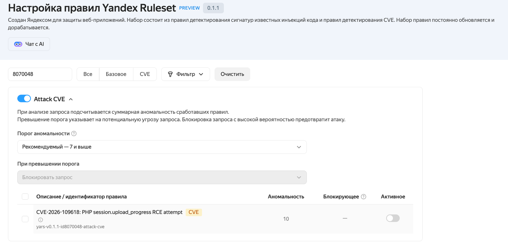

## 22.10.2026 — CVE-2026-109618, CVE-2026-109619 (PHP2Shell) — удаленное выполнение кода в PHP {#CVE-2026-109618}

Идентификаторы CVE (CVE ID): CVE-2026-109618, CVE-2026-109619.

Ссылки на CVE:

* [CVE-2026-109618](https://www.cve.org/CVERecord?id=CVE-2026-109618).
* [CVE-2026-109619](https://www.cve.org/CVERecord?id=CVE-2026-109619).

Ссылки на NVD:

* <https://nvd.nist.gov/vuln/detail/CVE-2026-109618>.
* <https://nvd.nist.gov/vuln/detail/CVE-2026-109619>.

### Исходный отчет {#original-report-CVE-2026-109618}

[Отчет Wiz Research о PHP2Shell](https://www.wiz.io/blog/php2shell-php-rce).

### Краткое описание {#brief-description-CVE-2026-109618}

PHP2Shell — две связанные уязвимости в интерпретаторе PHP, которые позволяют удаленно и без аутентификации выполнить произвольный код с правами рабочего процесса веб-сервера или получить данные из памяти процесса.

Уязвимости связаны с обработкой ошибок и состоянием PHP между запросами:

* **CVE-2026-109618.** При нехватке памяти (OOM) PHP прерывает обработку запроса через `longjmp()`. Если данные запроса в этот момент инициализированы не полностью, при завершении запроса PHP обращается к некорректному состоянию. Нехватку памяти можно вызвать специально сформированным multipart-запросом, который не превышает стандартное ограничение `post_max_size`.
* **CVE-2026-109619.** Глобальное состояние PHP в переиспользуемом рабочем процессе может ссылаться на память уже завершенного запроса. Если состояние не было сброшено до освобождения памяти, следующий запрос в том же процессе может обратиться к освобожденной памяти (use-after-free).

Наиболее подвержена конфигурация, в которой PHP работает как модуль Apache (`mod_php`): для нее удаленное выполнение кода подтверждено с настройками по умолчанию. Конфигурации с PHP-FPM также подвержены уязвимостям, но условия эксплуатации зависят от приложения и конфигурации. Удаленное выполнение кода без аутентификации продемонстрировано на WordPress, Drupal и Joomla!. Наличие одной из этих CMS не является обязательным условием: уязвимости находятся в самом PHP.

### Затронутые технологии {#technologies-affected-CVE-2026-109618}

Уязвимости затрагивают PHP, им подвержены в том числе веб-приложения и образы {{ marketplace-name }}, которые используют уязвимую версию интерпретатора.

### Уязвимые продукты и версии {#vulnerable-products-and-versions-CVE-2026-109618}

Уязвимы следующие версии PHP:

* версии ниже 8.2.35, включая неподдерживаемые ветки 8.1 и ниже;
* 8.3.0–8.3.35;
* 8.4.0–8.4.26;
* 8.5.0–8.5.11.

### Разработчик {#vendor-CVE-2026-109618}

The PHP Group.

### Вектор атаки и уровень опасности согласно CVSS {#attack-vector-and-severity-level-CVE-2026-109618}

В бюллетенях разработчика для обеих уязвимостей указана оценка CVSS 4.0: **9,2 CRITICAL**.

Вектор атаки:

```text
CVSS:4.0/AV:N/AC:H/AT:P/PR:N/UI:N/VC:H/VI:H/VA:H/SC:N/SI:N/SA:N
```

### Рекомендации по обнаружению уязвимости {#recommendations-for-vulnerability-detection-CVE-2026-109618}

Проверьте версию PHP, которая фактически обслуживает запросы. Команда `php --version` показывает версию CLI, которая может отличаться от версии модуля, загруженного в Apache, или версии PHP-FPM.

Для Debian и Ubuntu проверьте загруженный модуль Apache и файл его конфигурации:

```bash
sudo apache2ctl -M | grep -E 'php.*_module'
ls -l /etc/apache2/mods-enabled/php*.load
```

Если вы используете пакеты дистрибутива, сравните их версии с версиями, указанными в его бюллетене безопасности: номер версии PHP сам по себе не позволяет определить наличие перенесенного исправления.

### Безопасная версия уязвимого продукта или патч {#safe-version-CVE-2026-109618}

Как можно скорее обновите PHP до исправленной версии своей ветки или более новой поддерживаемой версии:

* 8.2.35;
* 8.3.36;
* 8.4.27;
* 8.5.12.

Разработчик выпустил исправления только для веток 8.2–8.5. Для веток 8.1 и ниже установите пакет дистрибутива с перенесенным исправлением, если он доступен, либо перейдите на поддерживаемую ветку PHP.

Например, для Ubuntu исправление включено в следующие пакеты:

#|
|| **Дистрибутив** | **Пакет** | **Исправленная версия** ||
|| Ubuntu 24.04 LTS | `php8.3` | `8.3.6-0ubuntu0.24.04.13` ||
|| Ubuntu 22.04 LTS | `php8.1` | `8.1.2-1ubuntu2.28` ||
|| Ubuntu 20.04 LTS | `php7.4` | `7.4.3-4ubuntu2.29+esm5`, только по подписке Ubuntu Pro ||
|| Ubuntu 18.04 LTS | `php7.2` | `7.2.24-0ubuntu0.18.04.17+esm14`, только по подписке Ubuntu Pro ||
|#

Версии пакетов приведены в [бюллетене Ubuntu](https://ubuntu.com/security/CVE-2026-109618). Для других дистрибутивов сверяйтесь с их бюллетенями безопасности.

После обновления перезапустите все процессы, которые обслуживают PHP: Apache с модулем `mod_php`, PHP-FPM и другие долгоживущие процессы PHP.

### Компенсационные меры {#compensatory-measures-CVE-2026-109618}



Полностью устранить уязвимости можно только установкой исправления. Временные настройки не защищают от всех вариантов эксплуатации.



Если обновление пока невозможно, отключите отслеживание прогресса загрузки и, для PHP 8.5, трассировку при фатальных ошибках:

```ini
session.upload_progress.enabled = 0
; Только для PHP 8.5
fatal_error_backtraces = 0
```

Примените настройки на уровне администратора и перезапустите все рабочие процессы PHP. Если приложение не принимает multipart-запросы, блокируйте их на фронтенде до передачи в PHP.

Используйте SolidWall WAF и подключите профиль Cloud WAF с набором правил YARS (Yandex Ruleset) для защиты веб-приложений до завершения обновления:

  * В Cloud WAF: выбрать набор YARS версии 0.1.1 в профиле WAF, группа правил `СVE`, ID правила `id8070048-attack-cve`.

    

  *  SolidWall WAF правило уже включено в активном режиме, дополнительно делать ничего не требуется. Оно применится автоматически, если защита приложения переведена в активный режим.

Полный перечень временных мер и их ограничений приведен в бюллетенях разработчика:

* [GHSA-w8hw-w9fx-j79w — CVE-2026-109618](https://github.com/php/php-src/security/advisories/GHSA-w8hw-w9fx-j79w).
* [GHSA-6wmf-4rv5-p3rp — CVE-2026-109619](https://github.com/php/php-src/security/advisories/GHSA-6wmf-4rv5-p3rp).


### Влияние на сервисы {{ yandex-cloud }} {#impact-on-yandex-cloud-services-CVE-2026-109618}

Уязвимостям подвержены следующие продукты {{ marketplace-name }}, которые содержат PHP:

* WordPress — PHP 8.4;
* Drupal — PHP 8.3;
* Joomla! — PHP 8.2;
* LAMP — PHP 8.2;
* LEMP — PHP 7.2;
* OpenCart — PHP 7.2;
* 1С-Битрикс — PHP 8.1.

Пользователям этих продуктов необходимо самостоятельно обновить PHP на виртуальных машинах, созданных из образов. До обновления примените временные меры с учетом следующих особенностей:

* **WordPress, Drupal, Joomla! и LAMP:** PHP работает как модуль Apache (`mod_php`). После обновления перезапустите Apache и проверьте версию загруженного модуля.
* **LEMP и OpenCart на Ubuntu 18.04 с PHP 7.2:** исправленный пакет доступен только по подписке Ubuntu Pro. Рекомендуем перейти на актуальную версию ОС и поддерживаемую ветку PHP. Для OpenCart это может потребовать обновления самого приложения.
* **1С-Битрикс на CentOS 7 с PHP 8.1:** установите подтвержденное исправление поставщика либо перейдите на поддерживаемую ОС и ветку PHP.
