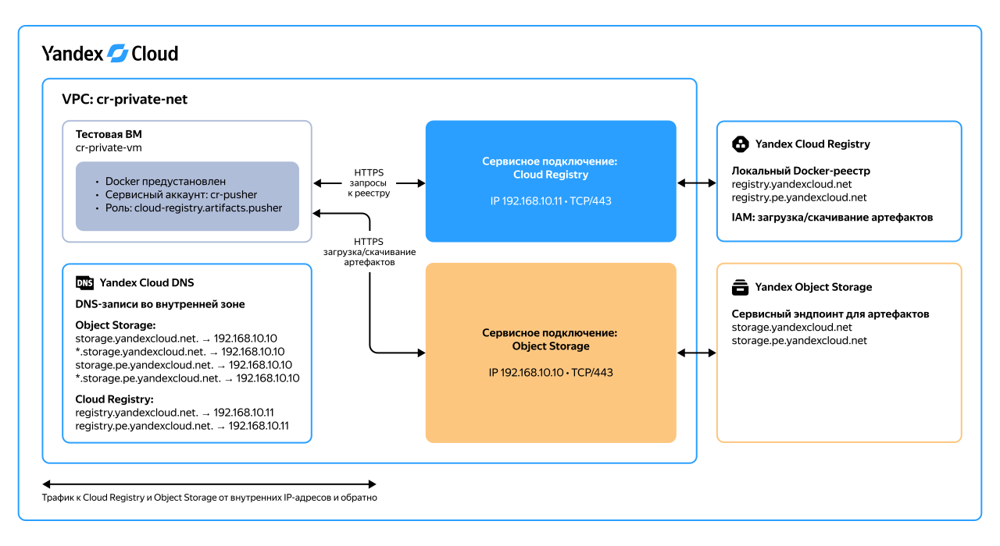

# Подключение к {{ cloud-registry-full-name }} из сети {{ vpc-full-name }} без доступа в интернет

В этом руководстве вы развернете в {{ yandex-cloud }} облачную инфраструктуру для организации доступа к [реестру](../../../cloud-registry/concepts/registry.md) {{ cloud-registry-name }} с ресурсов, которые размещены в облачной сети {{ vpc-name }} ({{ vpc-short-name }}) и не имеют доступа в интернет.

Приватная сетевая связность ресурсов в облачной сети с сервисом {{ cloud-registry-name }} будет организована с использованием [сервисных подключений](../../../vpc/concepts/private-endpoint.md) (_private endpoints_) {{ vpc-short-name }}.

## Схема решения {#flowchart}

На схеме:

* Сервис [{{ dns-full-name }}](../../../dns/index.yaml) разрешает имя `registry.yandexcloud.net` во [внутренний IP-адрес](../../../vpc/concepts/address.md#internal-addresses) сервисного подключения {{ cloud-registry-name }}.
* Через это сервисное подключение [Docker](https://www.docker.com/) обращается к {{ cloud-registry-name }} по HTTPS.
* Для операций с данными артефактов также используется сервисное подключение [{{ objstorage-full-name }}](../../../storage/index.yaml). [Ресурсные записи](../../../dns/concepts/resource-record.md), созданные для имен `storage.yandexcloud.net` и `*.storage.yandexcloud.net`, указывают на внутренний IP-адрес сервисного подключения {{ objstorage-name }}.
* Для обращения к реестру {{ cloud-registry-name }} с тестовой [виртуальной машины](../../../compute/concepts/vm.md) доступ в интернет не требуется.

## Ресурсы в создаваемой инфраструктуре {#resources}

В приведенных инструкциях и примерах команд для развертывания необходимой инфраструктуры создаются следующие ресурсы:

* [Облачная сеть](../../../vpc/concepts/network.md#network) `cr-private-net`.
* [Подсеть](../../../vpc/concepts/network.md#subnet) `cr-private-subnet` в [зоне доступности](../../../overview/concepts/geo-scope.md) `{{ region-id }}-a`. [CIDR](https://ru.wikipedia.org/wiki/Бесклассовая_адресация) подсети `192.168.10.0/24`.
* [Сервисное подключение {{ objstorage-name }}](../../../storage/concepts/bucket.md#access-via-vpc) `storage-pe` со статическим внутренним IP-адресом `192.168.10.10`.
* Сервисное подключение {{ cloud-registry-name }} `cloud-registry-pe` со статическим внутренним IP-адресом `192.168.10.11`.
* Тестовая виртуальная машина `cr-private-vm` без доступа в интернет. ВМ будет создана в зоне доступности `{{ region-id }}-a` в подсети `cr-private-subnet` со статическим внутренним IP-адресом `192.168.10.20`.
* [Сервисный аккаунт](../../../iam/concepts/users/service-accounts.md) `cr-pusher`, который будет привязан к виртуальной машине и от имени которого будет осуществляться доступ к [артефактам](../../../cloud-registry/concepts/artifacts/index.md) в реестре.
* [Реестр](../../../cloud-registry/concepts/registry.md) {{ cloud-registry-name }} `cr-private-demo`.
* Тестовый [Docker-образ](../../../cloud-registry/concepts/artifacts/docker.md) `hello-world:pe-demo`, который будет загружен в реестр и затем скачан из него на тестовой ВМ.
* Служебная виртуальная машина `jump-vm` с доступом в интернет, которая будет использоваться для подключения по SSH к тестовой виртуальной машине.

При необходимости замените адреса, имена и идентификаторы ресурсов на подходящие для вашего [каталога](../../../resource-manager/concepts/resources-hierarchy.md#folder). Убедитесь, что выбранные IP-адреса относятся к выбранной подсети и не заняты другими ресурсами.

## Ограничения и предварительные условия {#limitations}



Сервисные подключения обеспечивают приватную сетевую связность между виртуальной машиной и реестром, но не отключают [публичный эндпоинт](../../../api-design-guide/concepts/endpoints.md) сервиса {{ cloud-registry-name }}. Создаваемая основная DNS-запись изменяет разрешение публичного [FQDN](../../../glossary/fqdn.md) внутри выбранной облачной сети, при этом из других сетей реестр {{ cloud-registry-name }} остается доступен через публичный эндпоинт.

Контроль доступа к артефактам в реестрах {{ cloud-registry-name }} должен осуществляться средствами [{{ iam-full-name }}](../../../iam/concepts/access-control/index.md).



Чтобы создать инфраструктуру для реализации решения, пользователь {{ yandex-cloud }} должен обладать [правами доступа](../../../iam/concepts/access-control/roles.md), достаточными для создания всех [ресурсов](#resources), которые описаны выше.

Перед прохождением руководства [убедитесь]({{ link-console-quotas }}), что в вашем облаке достаточно свободных квот для создания ресурсов.

При прохождении руководства также учитывайте следующее:

* Необходимая инфраструктура включает в себя два сервисных подключения. По умолчанию [квота](../../../vpc/concepts/limits.md#vpc-quotas) на количество сервисных подключений (`vpc.privateEndpoints.count`) составляет два подключения на одно облако. Таким образом, инфраструктура для этого руководства может занять эту квоту целиком.
* В одной облачной сети можно создать не более одного сервисного подключения каждого типа. Если вы планируете использовать имеющуюся сеть и в ней уже есть сервисное подключение {{ objstorage-name }} или {{ cloud-registry-name }}, используйте имеющееся сервисное подключение.
* Сервисное подключение является региональным и распределено по зонам доступности.

## Способы создания инфраструктуры {#deployment-options}

Инфраструктуру для реализации решения вы можете создать с помощью одного из инструментов: