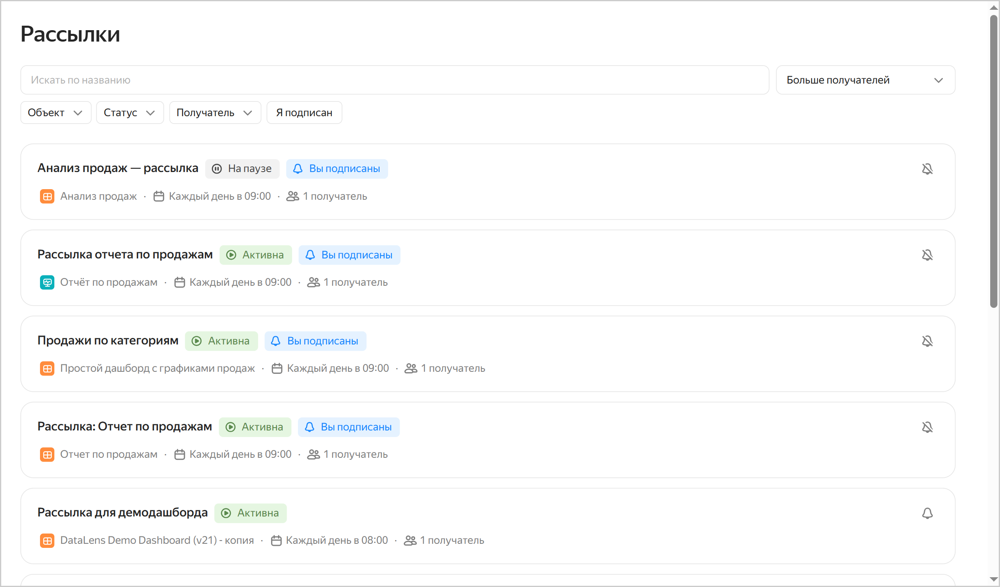

# Список рассылок в {{ datalens-full-name }}

## Открыть список {#open-list}

Чтобы посмотреть список всех рассылок, на панели слева нажмите  **Рассылки**. Если на панели не отображается , сначала выберите  **Ещё**, а затем —  **Рассылки**.

Вы также можете открыть список рассылок для текущего воркбука. Для этого вверху воркбука нажмите  →  **Рассылки**.





## Параметры {#parameters}

Для каждого элемента списка отображаются параметры:

* Название рассылки.
* Состояние рассылки:  **Активна** или  **На паузе**.
* Если вы подписаны на рассылку, отображается  **Вы подписаны**.
* Название дашборда или отчета, для которого создана рассылка.
* Расписание рассылки.
* Количество получателей рассылки.
* Кнопка , чтобы подписаться на рассылку, или , чтобы отписаться от нее. Кнопка  отображается только для пользователей, которые могут подписаться на рассылку: только редактор и администратор (по умолчанию) или любой пользователь. Настройку можно задать в рассылке на вкладке **Получатели**.

Нажав на рассылку, вы перейдете на страницу объекта (дашборда или отчета), для которого она создана.

## Фильтрация и сортировка {#filter-sort}

Вы можете воспользоваться фильтрами вверху списка:

* **Объект** — выберите из списка объект (коллекцию, воркбук, дашборд или отчет), в котором создана рассылка.
* **Статус** — выберите статус рассылки: `Активна`, `На паузе` или `Ошибка`.
* **Получатель** — выберите получателя рассылки.
* **Я подписан** — нажмите, чтобы отобразить только рассылки, на которые вы подписаны.
*  **Сбросить** — нажмите, чтобы сбросить все фильтры. Доступна, если применен хотя бы один фильтр.

При [открытии списка рассылок из воркбука](../workbooks-collections/workbooks-operations.md#maillist-list) автоматически будет задан фильтр **Объект** по этому воркбуку.

Справа от фильтра вы можете задать сортировку:

* **Больше получателей** — по количеству получателей.
* **Сначала новые** — по дате создания.

## Подписка на рассылки {#subscribe-unsubscribe}

Вы можете подписаться или отписаться от рассылки прямо из списка:

* Чтобы подписаться на рассылку, справа от нее нажмите  (**Подписаться**). Кнопка  отображается только для пользователей, которые могут подписаться на рассылку: только редактор и администратор (по умолчанию) или любой пользователь. Настройку можно задать в рассылке на вкладке **Получатели**.
* Чтобы отписаться от рассылки, справа от нее нажмите  (**Отписаться**).



* Чтобы пользователь смог получать рассылку, ему требуется активное рабочее место.
* Рассылку могут получать только пользователи, у которых есть роль на воркбук, в котором настроена эта рассылка.


