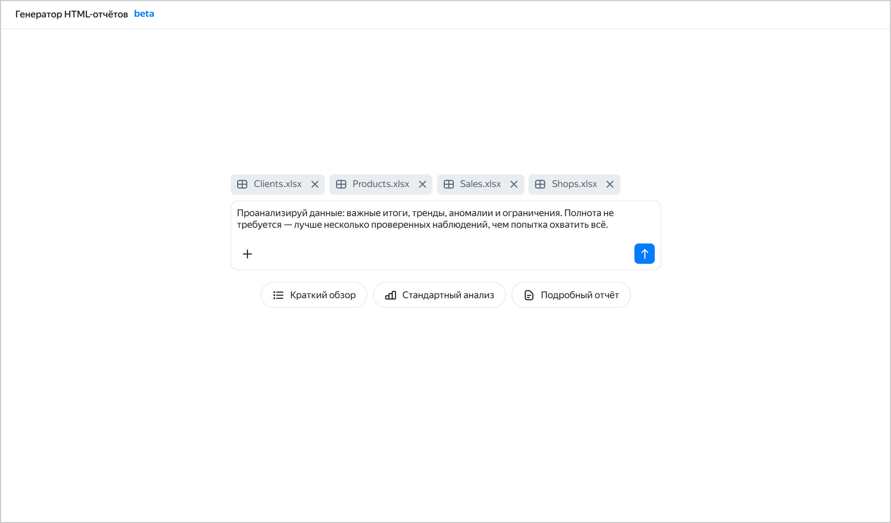
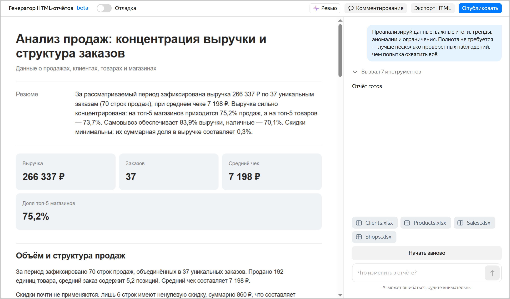
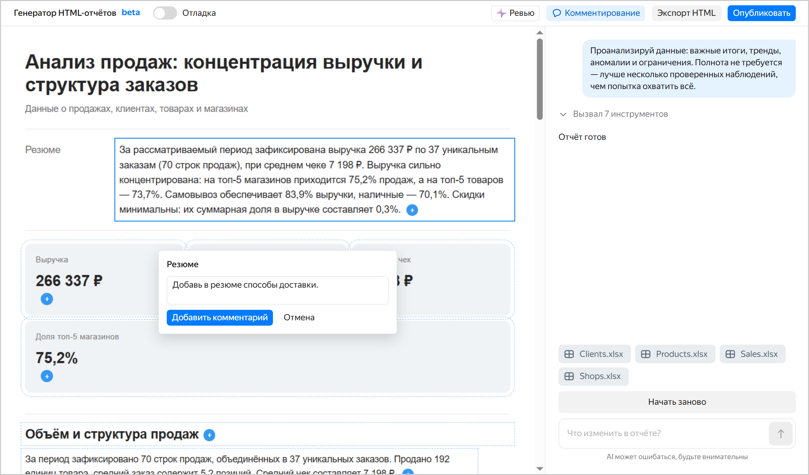
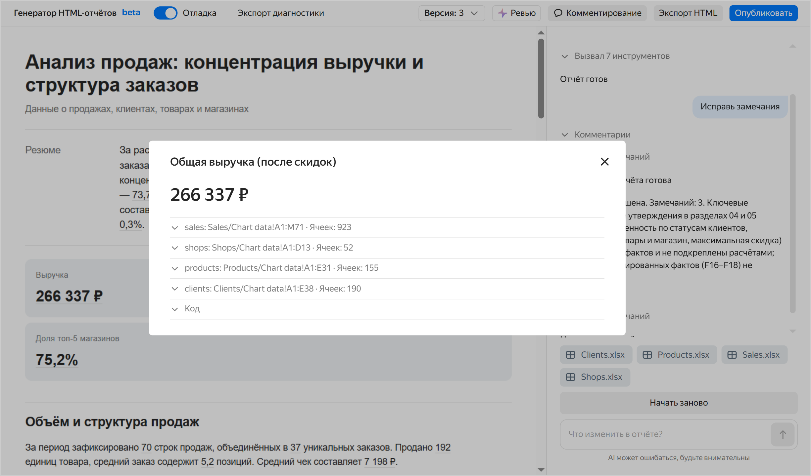

# Генератор HTML-отчетов в {{ datalens-name }}

_Генератор HTML-отчетов_ позволяет пользователям {{ datalens-name }} загрузить файлы в формате `.xlsx` или `.csv` и получить готовую HTML-страницу с анализом от Нейроаналитика.

Нейроаналитик изучит файлы, зафиксирует ключевые факты и сформирует HTML-отчет по шаблону.

Вы можете экспортировать готовый отчет в формате HTML и поделиться отчетом с другими пользователями.



Эта функциональность находится на стадии бета-тестирования.



## Создать HTML-отчет {#create-html}

Чтобы создать HTML-страницу с помощью генератора HTML-отчетов:

1. Перейдите на [главную страницу]({{ link-datalens-main-skip-promo }}) {{ datalens-short-name }}.
1. На панели слева выберите  **Генератор HTML-отчётов**.
1. Добавьте один или несколько файлов в формате `.xlsx` или `.csv`. Для этого нажмите  или перетащите файлы на страницу.
1. Выберите детализацию отчета:

   * **Краткий обзор** — Нейроаналитик даст очень краткую выжимку: 2–3 ключевых показателя и 3–5 главных наблюдений по данным, без диаграмм и подробных таблиц.
   * **Стандартный анализ** — Нейроаналитик проанализирует данные: важные итоги, тренды, аномалии и ограничения.
   * **Подробный отчёт** — Нейроаналитик подготовит подробный отчет: ключевые показатели, динамика, сравнение сегментов, аномалии и ограничения данных. Добавит диаграммы и таблицы, где они уместны.

   
   
   

   

   В поле с промптом вы можете добавить свои рекомендации к промпту по умолчанию.

1. В поле с промптом нажмите кнопку .

   

   

   

   Справа отобразится чат с Нейроаналитиком.

   Чтобы отменить текущее действие, внизу справа нажмите кнопку .

   

   

   

   Нейроаналитик проанализирует файлы и сформирует выводы на основе данных и выбранного или пользовательского промпта.

   

1. (Опционально) Внесите правки в отдельные элементы:

   1. Вверху нажмите  **Комментирование**.
   1. У нужного элемента нажмите , введите комментарий и нажмите кнопку **Добавить комментарий**.
   
      
      
      

      

   1. Внизу чата напротив `Исправить замечания` нажмите кнопку .

      

      

      

      Нейроаналитик сформирует новую версию отчета. Вы можете выбрать версию вверху страницы в раскрывающемся списке.

1. (Опционально) Чтобы экспортировать готовый отчет в формате HTML, вверху нажмите **Экспорт HTML**.
1. (Опционально) Вверху нажмите **Ревью**, чтобы Нейроаналитик проанализировал отчет и выдал рекомендации по его улучшению. Чтобы применить рекомендации, под ответом нажмите **Исправить**.
1. (Опционально) Вверху включите опцию **Отладка**, чтобы посмотреть расчеты для любого показателя отчета:
   
   * Нажмите на нужный показатель, чтобы отобразить расчеты для его получения.
 
     

     

     

   * Справа от опции нажмите **Экспорт диагностики**, чтобы экспортировать файл формата `json` с информацией для диагностики.

1. Опубликуйте отчет:

   1. Вверху нажмите **Опубликовать**.
   1. Выберите воркбук или создайте новый.
   1. Нажмите кнопку **Продолжить**.
   1. Введите название HTML-страницы и нажмите кнопку **Создать**.
 
      

      Исходные данные используются только для подготовки отчета и не сохраняются в сервисе. Они недоступны для генератора отчета после обновления страницы или после нажатия кнопки **Начать заново**.

      

      На новой вкладке браузера отобразится созданная [HTML-страница](./index.md). Вы можете [поделиться ссылкой](./index.md#link-on-html) на нее, [загрузить новую версию](./index.md#html-change).

## Ограничения {#restrictions}

* Загрузить можно только файлы в формате `.xlsx` или `.csv`.
* Максимальный размер одного файла — 20 МБ.
* Максимальное количество файлов — 16.
* Максимальный суммарный размер всех файлов — 64 МБ.
* Максимальное количество листов во всех файлах — 512.
* Максимальное количество заполненных ячеек во всех файлах — 4 000 000.
