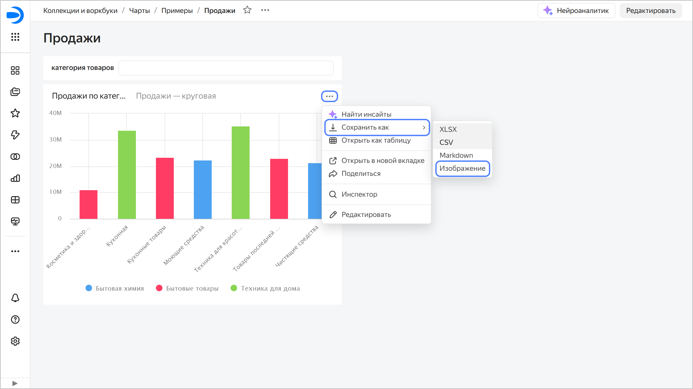

# Сохранить чарт как изображение в {{ datalens-full-name }}

Вы можете сохранить чарт в формате `PNG`. Доступно для [чартов в визарде](../../concepts/chart/dataset-based-charts.md), [QL-чартов](../../concepts/chart/ql-charts.md) и [чартов в Editor](../../charts/editor/index.md).

Чтобы сохранить чарт как изображение:

1. Откройте чарт и в правом верхнем углу чарта нажмите  →  **Сохранить как** → **Изображение**.
   Или на дашборде у чарта вверху справа нажмите  →  **Сохранить как** → **Изображение**.

   

   

   

1. Выберите разрешение:

   * Стандартное 900 x 600 px.
   * Широкоформатное 1 600 x 720 px.
   * Укажите вручную другое. Область отрисовки не превышает 6 000 пикселей по ширине и высоте. Большие значения {{ datalens-name }} уменьшает до этого размера и может обрезать часть изображения.
  
1. При необходимости включите опцию **Отображать элементы интерфейса**.
1. Нажмите кнопку **Скачать**.
