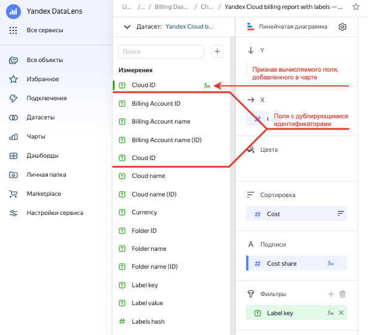

# Датасеты




















### Что делать, если при валидации датасета возникает ошибка `ERR.DS_API.FIELD.TITLE.CONFLICT`? {#field-title-conflict}

В разделе **Дополнительная информация** при этой ошибке отображаются сообщения `Field title conflicts with another field` и `ERR.DS_API.FIELD.TITLE.CONFLICT`.

Ошибка возникает из-за конфликта названий полей. У каждого поля в датасете должно быть уникальное название.

Конфликт также может возникнуть, если поле с таким названием сначала добавили в чарт, а затем в его датасет. В этом случае переименуйте поле, добавленное в чарте.



### Что делать, если в предпросмотре датасета возникает ошибка `ERR.DS_API.SOURCE_CONFIG.TABLE_NOT_CONFIGURED`? {#table-not-configured}

После загрузки таблицы из Google Sheets или CSV-файла может появиться ошибка:

```json
{
  "code": "ERR.DS_API.SOURCE_CONFIG.TABLE_NOT_CONFIGURED",
  "message": "Table is not ready yet",
  "level": "error"
}
```

Ошибка означает, что схема датасета только что изменилась. Дождитесь пересоздания таблицы предпросмотра. Это может занять несколько минут.

### Почему в датасетах {{ metrika }} отображаются не все поля? {#metrika-fields}

Состав доступных полей можно посмотреть на [демонстрационном дашборде Metrica Live](https://yandex.cloud/ru/marketplace/products/yandex/metrica-live-demo). После подключения дашборда в разделе **{{ ui-key.datalens.component.aside-header.view.switch_datasets }}** появятся датасеты `Метрика Визиты` и `Метрика Просмотры`.

Если нужных полей нет, экспортируйте данные из [Logs API {{ metrika }}](https://yandex.ru/dev/metrika/doc/api2/logs/intro.html) в [{{ mch-name }}](../../managed-clickhouse/) и подключите {{ datalens-name }} к созданной базе данных.



### Можно ли объединить несколько таблиц Яндекс Документов в одну? {#how-to-join-tables}

Вы можете объединить несколько таблиц [Яндекс Документов](../operations/connection/create-yadocs.md), настроив [связи](../dataset/create-dataset.md#links) между ними. Объединить несколько таблиц в одну путем слияния можно с помощью оператора `UNION` в SQL-запросе. Но использование SQL-запросов доступно только для БД в качестве источников.


