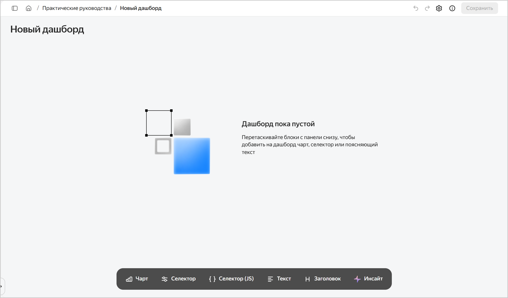

# История изменений в {{ datalens-full-name }} в октябре 2026

* [Изменения базовых возможностей](#base)
* [Исправления и улучшения](#fixes)

## Изменения базовых возможностей {#base}

* Собрали [стенд](https://gleb.dev.datalens.tech/iframe) с примерами встраивания аналитики {{ datalens-name }}:
  
  * [Публичное](../security/embedded-objects.md) — общедоступная ссылка, только в облаке.
  * [Защищенное](../security/private-embedded-objects.md) — подписанная ссылка с защищенными параметрами.
  * С авторизацией — на общем с {{ datalens-name }} домене, только для [{{ datalens-name }} On-premises]({{ link-datalens-main }}/on-premises/docs/).

  Продемонстрировали использование параметров, JWT, `postMessage`, а также примеры кода.
  
  Подробнее в чате [{{ datalens-short-name }}](https://t.me/YandexDataLens/28631/152655) в Telegram.

* Пользователи {{ datalens-name }} теперь могут активировать промокоды в [платежном аккаунте](../settings/service-plan.md#billing-account).
* Добавили диапазоны IP-адресов для [подключения внешней БД](../concepts/connection/index.md#external-db-connection), которая не является ресурсом {{ yandex-cloud }}:

  

  - ipv4 {#ipv4}

    * `130.193.60.16/28`

  - ipv6 {#ipv6}

    * `2a02:6b8:c32::f83d:a987:0/112`

  

* Добавили возможность получать [рассылки](../concepts/maillists.md) отчетов и дашбордов в мессенджерах Telegram и {{ messenger-full-name }}. Изменить способ получения рассылок можно в [настройках {{ yandex-cloud }}](../settings/index.md#user-settings).

* Добавили новый тип селектора — **Переключатель**. Подобно селектору с типом **Чекбокс** позволяет выбрать одно из двух значений с типом `Логический` — `True` или `False`.

### Изменения Нейроаналитика {#neuroanalyst-fixes}

* В Нейроаналитике добавили поиск по недавно посещенным сущностям.
* Добавили общую историю диалогов с Нейроаналитиком. Список диалогов отображается в чате с Нейроаналитиком при нажатии значка . Доступен поиск по названиям диалогов, поддерживаются постраничная навигация и удаление.

## Исправления и улучшения {#fixes}

* Исправили ошибку, из-за которой [параметризация источников датасета](../dataset/parametrization.md) была недоступна при разрешенных параметрах в подключении.
* Исправили некорректное отображение визуального редактора для текстовых виджетов при отключенной панели инструментов.
* В настройке [доступа на уровне строк данных (RLS)](../security/row-level-security.md) добавили возможность:

  * выбрать существующие значения поля;

    

    

    

  * просмотреть список доступных пользователей и групп пользователей.

* В отчетах добавили [фильтрацию чартов чартами](../dashboard/chart-chart-filtration.md).

### Изменения в чартах {#chart-fixes}

* В чартах добавили настройку для расположения легенды.
* Добавили возможность раскрасить линии градиентом в [линейной диаграмме](../visualization-ref/line-chart.md). Для этого перетащите [Measure Values](../concepts/chart/measure-values.md) в секцию **Цвета**.
* В [столбчатой](../visualization-ref/column-chart.md) и [линейчатой](../visualization-ref/bar-chart.md) диаграммах добавили настройки:
  
  * **Наложение** — задает наложение столбцов друг на друга.
  * **Ширина переднего столбца** — задает ширину переднего столбца при наложении. Доступно, если включена настройка **Наложение**.

* Исправили тип поля в итогах при [прямом экспорте данных](../concepts/chart/data-export.md#save-data) из таблицы в формате `XLSX`.

### Изменения на дашборде {#dashboard-fixes}

* Обновили дизайн панели добавления виджетов: сделали ее более компактной и заметной.

  

  
  
  

* Теперь при добавлении виджета страница дашборда автоматически прокручивается до него.
* Исправили проблему, при которой диаграммы [Mermaid](../dashboard/markdown.md#mermaid) в некоторых случаях отображались некорректно.
