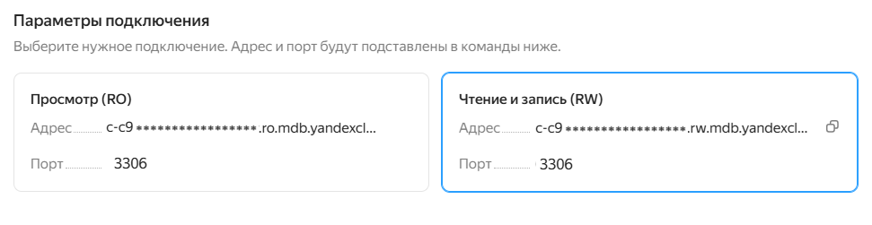

# Примеры кода для подключения к кластеру {{ MY }}

## Примеры строк подключения {#connection-string}



В приведенных примерах подключения используется [особый FQDN](./fqdn.md#special-fqdns) мастера (RW).




