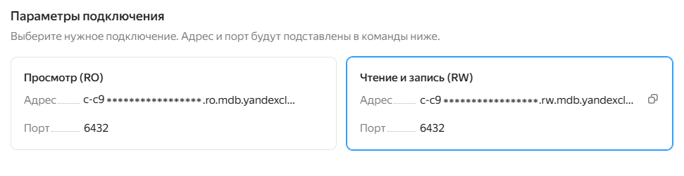

# Примеры кода для подключения к кластеру {{ PG }}



Подключиться к хостам {{ PG }} в публичном доступе можно только с использованием SSL-сертификата. Перед подключением к таким хостам [подготовьте сертификат](./index.md#get-ssl-cert).

В примерах ниже предполагается, что SSL-сертификат `root.crt` расположен в директории:

* `/home/<домашняя_директория>/.postgresql/` для Ubuntu;
* `$HOME\AppData\Roaming\postgresql` для Windows.

Подключение без использования SSL-сертификата поддерживается только для хостов, находящихся не в публичном доступе. В этом случае трафик внутри облачной сети при подключении к БД шифроваться не будет.

В приведенных примерах подключения используется [особый FQDN](./fqdn.md#special-fqdns) мастера (RW).





При успешном подключении к кластеру и выполнении тестового запроса будет выведена версия {{ PG }}. Исключение — [пример для фреймворка userver](#cpp-userver), в котором будет выполняться тестовый запрос `SELECT 1 as ping` для периодической проверки доступности кластера {{ PG }}.
