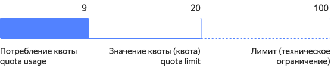

# Как начать работать с {{ quota-manager-full-name }}



Сервис {{ quota-manager-name }} позволяет управлять квотами с помощью различных интерфейсов. Некоторые сервисы, например {{ speechkit-name }}, в {{ quota-manager-short-name }} недоступны.

**Квоты** — ограничения на использование ресурсов в облаке или организации. Они помогают контролировать потребление ресурсов, избегать перерасхода и планировать бюджет.

У квот есть два показателя:

* **Значение квоты** или просто **квота** (quota limit) — текущее ограничение на ресурс для облака или организации.

* **Потребление квоты** (quota usage) — объем фактически используемого ресурса.

Квоты можно увеличить по запросу в пределах _лимитов_.

**Лимиты** — технические ограничения, обусловленные особенностями архитектуры {{ yandex-cloud }}, физическими характеристиками оборудования или внешними ограничениями.





Для управления квотами ресурсов через CLI и API используйте их идентификаторы из раздела [{#T}](all-quotas.md).

## Перед началом работы {#before-you-begin}

Предполагается, что у вас уже есть ресурсы {{ yandex-cloud }} в облаке или организации.

Убедитесь, что у пользователя или сервисного аккаунта есть [роли](../iam/concepts/access-control/roles.md):





- Консоль управления {#console}

  Войдите в [консоль управления]({{ link-console-main }}) и выберите облако.

- Интерфейс {{ cloud-center }} {#cloud-center}

  Войдите в [{{ cloud-center }}]({{ cloud-center-link }}) и выберите организацию.

- CLI {#cli}

  

  

- REST API {#api}

    1. Установите утилиту [cURL](https://curl.haxx.se).
    1. [Создайте сервисный аккаунт](../iam/operations/sa/create.md) и [назначьте ему](../iam/operations/sa/assign-role-for-sa.md) одну из ролей, указанных выше.
    1. 

- gRPC API {#grpc-api}

    1. Установите утилиту [gRPCurl](https://github.com/fullstorydev/grpcurl).
    1. [Создайте сервисный аккаунт](../iam/operations/sa/create.md) и [назначьте ему](../iam/operations/sa/assign-role-for-sa.md) одну из ролей, указанных выше.
    1. 



## Получить информацию о квотах {#get-quota-info}



- Консоль управления {#console}

  Чтобы получить информацию о квотах в облаке:

  

- Интерфейс {{ cloud-center }} {#cloud-center}

  Чтобы получить информацию о квотах в организации:

  

- CLI {#cli}

  1. Посмотрите список сервисов с квотами.

     ```bash
     yc quota-manager quota-limit list-services \
       --resource-type <тип_ресурса>
     ```

     Где `--resource-type` — [тип ресурса](concepts/index.md#resources-types):

     * `resource-manager.cloud` — [облако](../resource-manager/concepts/resources-hierarchy.md#cloud);
     * `organization-manager.organization` — [организация](../organization/concepts/organization.md);
     * `billing.account` — [платежный аккаунт](../billing/concepts/billing-account.md).

     Пример команды:

     ```bash
     yc quota-manager quota-limit list-services \
       --resource-type resource-manager.cloud
     ```

     Будет выведен список сервисов с квотами на уровне облака.

  1. Посмотрите значения и потребление всех квот для сервиса.

     ```bash
     yc quota-manager quota-limit list \
       --service <имя_сервиса> \
       --resource-type <тип_ресурса> \
       --resource-id <идентификатор_ресурса>
     ```

     Где:

     * `--service` — идентификатор сервиса, полученный на предыдущем шаге.
     * `--resource-id` — идентификатор [ресурса](../resource-manager/concepts/resources-hierarchy.md): идентификатор облака, организации или платежного аккаунта.
     * `--resource-type` — тип ресурса: `resource-manager.cloud`, `organization-manager.organization`, `billing.account`.

     Пример команды:

     

     

  1. Посмотрите значение и потребление определенной квоты.

     ```bash
     yc quota-manager quota-limit get \
       --quota-id <идентификатор_квоты> \
       --resource-id <идентификатор_ресурса> \
       --resource-type <тип_ресурса>
     ```

     Где:

     * `--quota-id` — идентификатор квоты. Узнать идентификатор можно в разделе [{#T}](all-quotas.md).
     * `--resource-id` — идентификатор ресурса (облака, организации или платежного аккаунта).
     * `--resource-type` — тип ресурса: `resource-manager.cloud`, `organization-manager.organization`, `billing.account`.

     Пример команды:

     

     

- REST API {#api}

  1. Посмотрите список сервисов, для которых есть квоты.

     Воспользуйтесь методом REST API [listServices](api-ref/QuotaLimit/listServices.md) для ресурса [QuotaLimit](api-ref/QuotaLimit/index.md):

     ```bash
     curl \
       --request GET \
       --header "Authorization: Bearer <IAM-токен>" \
       "https://{{ api-host-quota-manager }}/quota-manager/v1/quotaLimits/services?resourceType=<тип_ресурса>"
     ```

     Где:

     * `<IAM-токен>` — IAM-токен для сервисного аккаунта или переменная окружения, в которой находится IAM-токен.
     * `<тип_ресурса>` — [тип ресурса](concepts/index.md#resources-types): `resource-manager.cloud`, `organization-manager.organization`, `billing.account`.

     Пример запроса:

     ```bash
     curl \
       --request GET \
       --header "Authorization: Bearer ${IAM_TOKEN?}" \
       'https://{{ api-host-quota-manager }}/quota-manager/v1/quotaLimits/services?resourceType=resource-manager.cloud'
     ```

     Пример ответа:

     ```json
     {
       "services": [
         {
           "id": "alb",
           "name": "Application Load Balancer"
         },
         {
           "id": "audit-trails",
           "name": "Audit Trails"
         },
         ...
         {
           "id": "ylb",
           "name": "Network Load Balancer"
         },
         {
           "id": "yq",
           "name": "Yandex Query"
         }
       ]
     }
     ```

  1. Посмотрите значения и потребление всех квот для сервиса.

     Воспользуйтесь методом REST API [list](api-ref/QuotaLimit/list.md) для ресурса [QuotaLimit](api-ref/QuotaLimit/index.md):

     ```bash
     curl \
       --request GET \
       --header "Authorization: Bearer <IAM-токен>" \
       "https://{{ api-host-quota-manager }}/quota-manager/v1/quotaLimits?service=<идентификатор_сервиса>&resource.id=<идентификатор_ресурса>&resource.type=<тип_ресурса>"
     ```

     Где:

     * `<IAM-токен>` — IAM-токен для сервисного аккаунта или переменная окружения, в которой находится IAM-токен.
     * `<идентификатор_сервиса>` — идентификатор сервиса, полученный на предыдущем шаге.
     * `<идентификатор_ресурса>` — идентификатор ресурса: облака, организации или платежного аккаунта.
     * `<тип_ресурса>` — тип ресурса: `resource-manager.cloud`, `organization-manager.organization`, `billing.account`.

     Пример запроса:

     

     Пример ответа:

     

  1. Посмотрите значение и потребление определенной квоты.

     Воспользуйтесь методом REST API [get](api-ref/QuotaLimit/get.md) для ресурса [QuotaLimit](api-ref/QuotaLimit/index.md):

     ```bash
     curl \
       --request GET \
       --header "Authorization: Bearer <IAM-токен>" \
       "https://{{ api-host-quota-manager }}/quota-manager/v1/quotaLimits/<идентификатор_квоты>?resource.id=<идентификатор_ресурса>&resource.type=<тип_ресурса>"
     ```

     Где:

     * `<IAM-токен>` — IAM-токен для сервисного аккаунта или переменная окружения, в которой находится IAM-токен.
     * `<идентификатор_квоты>` — идентификатор квоты. Узнать идентификатор можно в разделе [{#T}](all-quotas.md).
     * `<идентификатор_ресурса>` — идентификатор ресурса (облака, организации или платежного аккаунта).
     * `<тип_ресурса>` — тип ресурса: `resource-manager.cloud`, `organization-manager.organization`, `billing.account`.

     Пример запроса:

     

     Пример ответа:

     

- gRPC API {#grpc-api}

  1. Посмотрите список сервисов, для которых есть квоты.

     Воспользуйтесь вызовом gRPC API [QuotaLimitService/ListServices](api-ref/grpc/QuotaLimit/listServices.md):

     ```bash
     grpcurl \
       -H "Authorization: Bearer <IAM-токен>" \
       -d "{\"resource_type\": \"<тип_ресурса>\"}" \
       {{ api-host-quota-manager }}:443 yandex.cloud.quotamanager.v1.QuotaLimitService/ListServices
     ```

     Где:

     * `<IAM-токен>` — IAM-токен для сервисного аккаунта или переменная окружения, в которой находится IAM-токен.
     * `<тип_ресурса>` — [тип ресурса](concepts/index.md#resources-types): `resource-manager.cloud`, `organization-manager.organization`, `billing.account`.

     Пример запроса:

     ```bash
     grpcurl \
       -H "Authorization: Bearer ${IAM_TOKEN?}" \
       -d "{\"resource_type\": \"resource-manager.cloud\"}" \
       {{ api-host-quota-manager }}:443 yandex.cloud.quotamanager.v1.QuotaLimitService/ListServices
     ```

     Пример ответа:

     ```json
     {
       "services": [
         {
           "id": "alb",
           "name": "Application Load Balancer"
         },
         {
           "id": "audit-trails",
           "name": "Audit Trails"
         },
         ...
         {
           "id": "ylb",
           "name": "Network Load Balancer"
         },
         {
           "id": "yq",
           "name": "Yandex Query"
         }
       ]
     }
     ```

  1. Посмотрите значения и потребление всех квот для сервиса.

     Воспользуйтесь вызовом gRPC API [QuotaLimitService/List](api-ref/grpc/QuotaLimit/list.md):

     ```bash
     grpcurl \
       -H "Authorization: Bearer <IAM-токен>" \
       -d "{ \"resource\": { \"id\": \"<идентификатор_ресурса>\", \"type\": \"<тип_ресурса>\" }, \"service\": \"<идентификатор_сервиса>\"}" \
       {{ api-host-quota-manager }}:443 yandex.cloud.quotamanager.v1.QuotaLimitService/List
     ```

     Где:

     * `<IAM-токен>` — IAM-токен для сервисного аккаунта или переменная окружения, в которой находится IAM-токен.
     * `<идентификатор_ресурса>` — идентификатор ресурса: облака, организации или платежного аккаунта.
     * `<тип_ресурса>` — тип ресурса: `resource-manager.cloud`, `organization-manager.organization`, `billing.account`.
     * `<идентификатор_сервиса>` — идентификатор сервиса, полученный на предыдущем шаге.

     Пример запроса:

     

     Пример ответа:

     

  1. Посмотрите значение и потребление определенной квоты.

     Воспользуйтесь вызовом gRPC API [QuotaLimitService/Get](api-ref/grpc/QuotaLimit/get.md):

     ```bash
     grpcurl \
       -H "Authorization: Bearer <IAM-токен>" \
       -d "{ \"resource\": { \"id\": \"<идентификатор_ресурса>\", \"type\": \"<тип_ресурса>\" }, \"quota_id\": \"<идентификатор_квоты>\"}" \
       {{ api-host-quota-manager }}:443 yandex.cloud.quotamanager.v1.QuotaLimitService/Get
     ```

     Где:

     * `<IAM-токен>` — IAM-токен для сервисного аккаунта или переменная окружения, в которой находится IAM-токен.
     * `<идентификатор_ресурса>` — идентификатор ресурса (облака, организации или платежного аккаунта).
     * `<тип_ресурса>` — тип ресурса: `resource-manager.cloud`, `organization-manager.organization`, `billing.account`.
     * `<идентификатор_квоты>` — идентификатор квоты. Узнать идентификатор можно в разделе [{#T}](all-quotas.md).

     Пример запроса:

     

     Пример ответа:

     



## Запросить изменение квот {#request-quota-change}



- Консоль управления {#console}

  

- Интерфейс {{ cloud-center }} {#cloud-center}

  

- CLI {#cli}

  1. Создайте запрос на изменение квоты.

     

     Пример команды:

     

     

     Пример ответа:

     

  1. Посмотрите список запросов на изменение квот.

     

     Пример команды:

     

     Пример ответа:

     

  1. Посмотрите статус запроса на изменение квоты.

     

     Пример ответа:

     

- REST API {#api}

  1. Создайте запрос на изменение квоты.

     [Посмотрите идентификатор квоты](all-quotas.md) и воспользуйтесь методом REST API [create](api-ref/QuotaRequest/create.md) для ресурса [QuotaRequest](api-ref/QuotaRequest/index.md):

     ```bash
     curl \
       --request POST \
       --header "Authorization: Bearer <IAM-токен>" \
       --data '{"resource": {"id": "<идентификатор_ресурса>", "type": "<тип_ресурса>"}, "desired_quota_limits": [{"quota_id": "<идентификатор_квоты>", "desired_limit": "<новое_значение_квоты>"}]}' \
         'https://{{ api-host-quota-manager }}/quota-manager/v1/quotaRequests'
     ```

     Где:

     * `<IAM-токен>` — IAM-токен для сервисного аккаунта или переменная окружения, в которой находится IAM-токен.
     * `<идентификатор_ресурса>` — идентификатор ресурса (облака, организации или платежного аккаунта).
     * `<тип_ресурса>` — тип ресурса: `resource-manager.cloud`, `organization-manager.organization`, `billing.account`.
     * `<идентификатор_квоты>` — идентификатор квоты, которую нужно изменить.
     * `<новое_значение_квоты>` — новое значение, которое нужно присвоить выбранной квоте.

     Пример запроса:

     

     Пример ответа:

     

  1. Посмотрите список запросов на изменение квот.

     Воспользуйтесь методом REST API [list](api-ref/QuotaRequest/list.md) для ресурса [QuotaRequest](api-ref/QuotaRequest/index.md):

     ```bash
     curl \
       --request GET \
       --header "Authorization: Bearer <IAM-токен>" \
       'https://{{ api-host-quota-manager }}/quota-manager/v1/quotaRequests?page_size=<размер_страницы>&resource.id=<идентификатор_ресурса>&resource.type=<тип_ресурса>'
     ```

     Где:

     * `<IAM-токен>` — IAM-токен для сервисного аккаунта или переменная окружения, в которой находится IAM-токен.
     * `<размер_страницы>` — количество элементов на одной странице.
     * `<идентификатор_ресурса>` — идентификатор ресурса (облака, организации или платежного аккаунта).
     * `<тип_ресурса>` — тип ресурса: `resource-manager.cloud`, `organization-manager.organization`, `billing.account`.

     Пример запроса:

     

     Пример ответа:

     

  1. Посмотрите статус запроса на изменение квоты.

     Воспользуйтесь методом REST API [get](api-ref/QuotaRequest/get.md) для ресурса [QuotaRequest](api-ref/QuotaRequest/index.md):

     ```bash
     curl \
       --request GET \
       --header "Authorization: Bearer <IAM-токен>" \
       'https://{{ api-host-quota-manager }}/quota-manager/v1/quotaRequests/<идентификатор_запроса>'
     ```

     Где:

     * `<IAM-токен>` — IAM-токен для сервисного аккаунта или переменная окружения, в которой находится IAM-токен.
     * `<идентификатор_запроса>` — идентификатор запроса на изменение квоты, полученный на предыдущем шаге.

     Пример запроса:

     

     Пример ответа:

     

- gRPC API {#grpc-api}

  1. Создайте запрос на изменение квоты.

     [Посмотрите идентификатор квоты](all-quotas.md) и создайте запрос с помощью вызова gRPC API [QuotaRequestService/Create](api-ref/grpc/QuotaRequest/create.md):

     ```bash
     grpcurl \
       -H "Authorization: Bearer <IAM-токен>" \
       -d "{\"resource\": {\"id\": \"<идентификатор_ресурса>\", \"type\": \"<тип_ресурса>\"}, \"desired_quota_limits\": [{\"quota_id\": \"<идентификатор_квоты>\", \"desired_limit\": \"<новое_значение_квоты>\"}]}" \
       {{ api-host-quota-manager }}:443 yandex.cloud.quotamanager.v1.QuotaRequestService/Create
     ```

     Где:

     * `<IAM-токен>` — IAM-токен для сервисного аккаунта или переменная окружения, в которой находится IAM-токен.
     * `<идентификатор_ресурса>` — идентификатор ресурса (облака, организации или платежного аккаунта).
     * `<тип_ресурса>` — тип ресурса: `resource-manager.cloud`, `organization-manager.organization`, `billing.account`.
     * `<идентификатор_квоты>` — идентификатор квоты, которую нужно изменить.
     * `<новое_значение_квоты>` — новое значение, которое нужно присвоить выбранной квоте.

     Пример запроса:

     

     Пример ответа:

     

  1. Посмотрите список запросов на изменение квот.

     Воспользуйтесь вызовом gRPC API [QuotaRequestService/List](api-ref/grpc/QuotaRequest/list.md):

     ```bash
     grpcurl \
       -H "Authorization: Bearer <IAM-токен>" \
       -d "{\"resource\": {\"id\": \"<идентификатор_ресурса>\", \"type\": \"<тип_ресурса>\"}}" \
       {{ api-host-quota-manager }}:443 yandex.cloud.quotamanager.v1.QuotaRequestService/List
     ```

     Где:

     * `<IAM-токен>` — IAM-токен для сервисного аккаунта или переменная окружения, в которой находится IAM-токен.
     * `<идентификатор_ресурса>` — идентификатор ресурса (облака, организации или платежного аккаунта).
     * `<тип_ресурса>` — тип ресурса: `resource-manager.cloud`, `organization-manager.organization`, `billing.account`.

     Пример запроса:

     

     Пример ответа:

     

  1. Посмотрите статус запроса на изменение квоты.

     Воспользуйтесь вызовом gRPC API [QuotaRequestService/Get](api-ref/grpc/QuotaRequest/get.md):

     ```bash
     grpcurl \
       -H "Authorization: Bearer <IAM-токен>" \
       -d "{\"quota_request_id\": \"<идентификатор_запроса>\"}" \
       {{ api-host-quota-manager }}:443 yandex.cloud.quotamanager.v1.QuotaRequestService/Get
     ```

     Где:

     * `<IAM-токен>` — IAM-токен для сервисного аккаунта или переменная окружения, в которой находится IAM-токен.
     * `<идентификатор_запроса>` — идентификатор запроса на изменение квоты, полученный на предыдущем шаге.

     Пример запроса:

     

     Пример ответа:

     



Запросить увеличение квот можно и через [техническую поддержку]({{ link-console-support }}), указав облако или организацию, квоты и желаемые значения.
