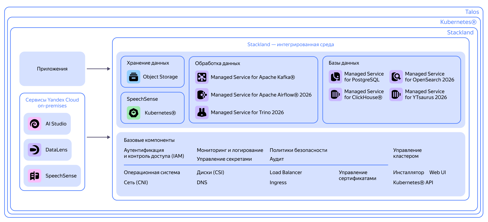

# Архитектура {{ stackland-full-name }} и роли компонентов

В этом рецепте вы получите общее представление о {{ stackland-full-name }}: узнаете, из чего состоит продукт, какие задачи он помогает решать и в чем его ценность.

## Обзор {{ stackland-name }} {#overview}

**{{ stackland-name }}** — это платформа контейнеризации на базе Kubernetes с интегрированным набором базовых компонентов и PaaS-сервисов {{ yandex-cloud }}. При самостоятельной сборке Kubernetes-кластера вы выбираете ОС, устанавливаете и настраиваете каждый компонент отдельно, а {{ stackland-name }} — это готовое решение. Вы получаете целостную платформу со всеми необходимыми компонентами для централизованного управления микросервисными, аналитическими и ИИ-приложениями в on-premises.

### Из чего состоит {{ stackland-name }} {#components}

Основные компоненты Stackland

В основе {{ stackland-name }} лежат Talos и Kubernetes.

* **Talos-based Linux** — операционная система, спроектированная специально для Kubernetes. Это минималистичная неизменяемая ОС на базе ядра Linux, которая не поддерживает интерактивный доступ по SSH и управляется исключительно через API. Она содержит только необходимые для работы компоненты и поставляется в составе дистрибутива {{ stackland-name }}.

    Подробнее о Talos Linux — на [официальном сайте](https://www.talos.dev/).

* **Kubernetes** — промышленный стандарт оркестрации контейнеров.

* **CNI (Container Network Interface)** — интерфейс для реализации наложенных сетей в кластере. В {{ stackland-name }} используется Cilium. Он обеспечивает высокую производительность и поддержку сетевых политик (Network Policy).

    Подробнее о Cilium — на [официальном сайте](https://www.cilium.io/).

#### Основные компоненты {#core-components}

{{ stackland-full-name }} включает набор готовых к использованию компонентов. Пользователь может изменить их настройки в специальном кастомном ресурсе.

Компоненты можно включать и отключать по мере необходимости. Также можно развертывать несколько инстансов одного и того же компонента, например для построения multi-stage-сред. Для управления компонентами служит сервис Component Manager.

* **{{ stackland-name }} IAM** ({{ iam-name }}) — компонент управления идентификацией и доступом. Обеспечивает аутентификацию и авторизацию пользователей в кластере и проектах. Пользователям назначают роли, которые определяют их права доступа. Поддерживаются федерации SAML, LDAP и синхронизация с Active Directory.

* **Load Balancer** — это компонент для сервисов Kubernetes с типом `LoadBalancer`. Балансировщик в {{ stackland-name }} построен на базе Cilium и использует L2-анонсы (ARP) для обеспечения отказоустойчивости. В будущих версиях {{ stackland-name }} могут появиться иные реализации сетевых балансировщиков и механизмов обеспечения отказоустойчивости.

* **Logging Stack** отвечает за логирование в кластере. В компонент входит средство сбора логов Loki, средство поставки логов Fluent Bit и интерфейс для просмотра логов Grafana.

* **DNS.** В задачи этого компонента входит разрешение (резолвинг) всех имен, которые используются в кластере {{ stackland-name }}. В его основе лежит CoreDNS — стандарт де-факто в экосистеме Kubernetes. DNS-сервер этого компонента отвечает за зону, назначенную кластеру {{ stackland-name }} при развертывании.

    Подробнее о CoreDNS — на [официальном сайте](https://coredns.io).

* **Ingress** — обратный прокси, который выступает как L7-балансировщик над подами с бэкендом приложений в Kubernetes. Также терминирует входящие HTTPS-соединения. {{ stackland-name }} использует Ingress-контроллер Contour™.

    Подробнее о Contour™ — на [официальном сайте](https://projectcontour.io/).

* **Certificate Manager** — сервис управления сертификатами в кластере на основе cert-manager. Автоматизирует выпуск сертификатов и их размещение в секретах кластера.

    Подробнее о cert-manager — на [официальном сайте](https://cert-manager.io).

* **Policy Manager** объединяет инструменты, которые проверяют ресурсы Kubernetes на соответствие политикам и генерируют отчеты в формате OpenReports. Реализован на Kyverno.

    Подробнее об [OpenReports](https://openreports.io/docs/api/) и [Kyverno](https://kyverno.io/) — на официальных сайтах.

* **Secrets Store** управляет секретами в кластере. В задачи Secrets Store входит безопасное хранение, версионирование секретов и встраивание их в поды в момент старта. В Secrets Store можно хранить пароли, токены, приватные ключи и другие секреты. Secrets Store базируется на OpenBao, форке Vault.

    Подробнее об [OpenBao](https://openbao.org/) и [Vault](https://www.vaultproject.io/) — на официальных сайтах.

* **Volumes (Дисковая подсистема)** — компонент управления блочным хранилищем на основе [TopoLVM](https://github.com/topolvm/topolvm), драйвера CSI (Container Storage Interface) для Kubernetes. Использует LVM на узлах кластера для создания томов и управления ими. Компонент может динамически увеличивать размер томов и учитывает свободное место на дисках перед размещением подов.

    Репозиторий TopoLVM — на [GitHub](https://github.com/topolvm/topolvm).

* **{{ objstorage-name }}** — S3-совместимое объектное хранилище на базе {{ objstorage-full-name }}. Можно использовать с любыми инструментами и SDK, поддерживающими S3 API. Компонент позволяет управлять бакетами с помощью ресурса `Bucket`. Доступом управляют через {{ iam-name }}.

* **Monitoring** — набор средств мониторинга, визуализации метрик и алертинга. Prometheus собирает метрики ресурсов кластера, запущенных приложений и инфраструктуры. Он использует язык запросов PromQL и предоставляет готовых агентов для популярных СУБД, веб-серверов, очередей сообщений и других сервисов. Alertmanager настраивает правила алертинга и обрабатывает алерты. {{ stackland-name }} предоставляет готовый набор дашбордов и алертов, но можно и настраивать собственные с помощью привычных инструментов.

* **«Поддержка {{ nvidia }} GPU»** — компонент поддержки графических ускорителей {{ nvidia }} в кластере. Обеспечивает обнаружение GPU на узлах, установку драйверов и интеграцию с Kubernetes через механизм Device Plugin.

#### Платформенные компоненты {#platform-components}

* **{{ mpg-name }}** — открытая объектно-реляционная СУБД. Компонент упрощает развертывание и обновление кластера БД, обеспечивает отказоустойчивость, предоставляет средства резервного копирования и мониторинга. Компонент позволяет создавать сущности PostgreSQL — пользователей и базы данных — с помощью кастомных Kubernetes-ресурсов `PostgresqlRole` и `PostgresqlDatabase`.

    Подробнее — в статье [{{ mpg-name }}](../../concepts/components/postgresql.md).

* **{{ mkf-name }}** — брокер сообщений. Компонент позволяет создавать сущности {{ KF }} — кластер, топики и пользователей — с помощью кастомных Kubernetes-ресурсов `KafkaCluster`, `KafkaTopic` и `KafkaUserAccess`.

    Подробнее — в статье [{{ mkf-name }}](../../concepts/components/kafka.md).

* **{{ mch-name }}** — колоночная аналитическая СУБД. Компонент упрощает развертывание и управление кластерами {{ CH }}, обеспечивает мониторинг и масштабирование. Позволяет создавать сущности {{ CH }} — пользователей, роли и базы данных — с помощью кастомных Kubernetes-ресурсов `ClickhouseUser`, `ClickhouseRole` и `ClickhouseDatabase`.

    Подробнее — в статье [{{ mch-name }}](../../concepts/components/clickhouse.md).

* **{{ rest-catalog-name }}** — каталог метаданных для таблиц Apache Iceberg™ по протоколу {{ rest-catalog-name }}. Компонент позволяет создавать каталоги и пользователей с доступом по OAuth2 с помощью кастомных ресурсов `RestCatalog` и `RestCatalogPrincipal`.

    Подробнее — в статье [{{ rest-catalog-name }}](../../concepts/components/rest-catalog.md).

* **{{ mtr-name }}** — распределенный SQL-движок для аналитических запросов к различным источникам данных. Компонент упрощает развертывание кластеров Trino, управление каталогами источников данных (PostgreSQL, {{ CH }}, Apache Iceberg™) и настройку правил доступа.

    Подробнее — в статье [{{ mtr-name }}](../../concepts/components/trino.md).

* **{{ yt-name }}** — распределенная платформа для хранения и обработки больших данных. Компонент разворачивает один общий кластер {{ yt-name }} на платформу: MapReduce-движок, динамические таблицы, движок запросов YQL, веб-интерфейс и интеграцию с {{ iam-name }}. Состав подкомпонентов и ресурсы задаются через кастомный ресурс `YTsaurusConfig`.

    Подробнее — в статье [{{ yt-name }}](../../concepts/components/ytsaurus.md).

#### Модули {#modules}

* **{{ datalens-name }}** — платформа бизнес-аналитики и визуализации данных. Позволяет создавать интерактивные дашборды и графики на основе различных источников данных. Компонент не входит в базовую поставку и требует отдельной лицензии.

    Подробнее — в статье [{{ datalens-name }}](../../concepts/components/datalens.md).

* **{{ speechsense-name }}** — модуль речевой аналитики. Позволяет анализировать записи разговоров и текстовые диалоги. Компонент не входит в базовую поставку и требует отдельной лицензии.

    Подробнее — в статье [{{ speechsense-name }}](../../concepts/components/speechsense.md).

* **{{ model-gallery-name }}** — модуль для хостинга и инференса больших языковых моделей и моделей эмбеддингов. Включает реестр моделей, хранилище весов, очередь инференса и gRPC-сервер для генеративных моделей семейства YandexGPT. Обеспечивает единую точку доступа к foundation-моделям для других модулей платформы. Компонент не входит в базовую поставку и требует отдельной лицензии.

* **{{ agent-atelier-name }}** — модуль для создания и запуска AI-агентов и ассистентов. Позволяет собирать сценарии на базе workflows, подключать инструменты через MCP-gateway, готовить датасеты и выполнять файнтюнинг моделей. Использует {{ model-gallery-name }} как источник моделей и {{ iam-name }} для управления доступом. Компонент не входит в базовую поставку и требует отдельной лицензии.

### Kubernetes vs {{ stackland-name }} {#kubernetes-vs-stackland}

В сравнительной таблице собрали отличия {{ stackland-name }} от Kubernetes.

#|
|| **Аспект** | **Kubernetes®** | **{{ stackland-name }}** ||
|| **Операционная система** | Любой Linux-дистрибутив — Ubuntu, CentOS, RHEL и другие. Администратор сам выбирает и настраивает ОС | Специализированная ОС Talos Linux, созданная для Kubernetes® ||
|| **Установка кластера** | kubeadm, kubespray, k3s или другие инструменты | Единый инсталлятор `sladm`. Установка одной командой ||
|| **Сетевой плагин (CNI)** | Администратор выбирает и настраивает самостоятельно: Calico, Flannel, Cilium и другие | Установлен Cilium ||
|| **DNS** | Установлен CoreDNS | Компонент **DNS**. Установлен CoreDNS ||
|| **Управление доступом** | Нативный RBAC Kubernetes® | Компонент **{{ iam-short-name }}**: обеспечивает централизованную аутентификацию и авторизацию во всех сервисах платформы (интегрирован с RBAC) и поддержку клиентских IdP ||
|| **Политики безопасности** | Базовый механизм Pod Security Standards | Компонент **Policy Manager** на базе Kyverno ||
|| **Управление секретами** | Нативные Secrets Kubernetes® | Компонент **Secrets Store** на базе OpenBao, форка Vault ||
|| **Балансировщик** | Не установлен — сервисы типа `LoadBalancer` не получают внешний IP-адрес | Компонент **Load Balancer** на базе Cilium-L2. Сервисы типа `LoadBalancer` получают IP-адрес из заданного диапазона ||
|| **Ingress-контроллер** | Не установлен — нет маршрутизации внешнего трафика | Компонент **Ingress**, установлен Contour™ ||
|| **Мониторинг** | Не установлен — нет сбора метрик, дашбордов, алертов | Компонент **{{ monitoring-name }}**, установлены Prometheus, Grafana, Alertmanager ||
|| **Логирование** | Не установлено — нет хранилища и инструмента работы с логами | Компонент **Logging Stack**: Loki и Fluent Bit, доступ к логам через Grafana ||
|| **{{ certificate-manager-name }}** | Не установлен — нет автоматического выпуска сертификатов | Компонент **{{ certificate-manager-name }}** на базе cert-manager ||
|| **Хранилище (StorageClass)** | Не установлен — PVC не инициализируются, поды с томами не запускаются | Компонент **Volumes (Дисковая подсистема)** на базе TopoLVM. Обеспечивает динамическое выделение блочного хранилища для рабочих нагрузок Kubernetes® ||
|| **Объектное хранилище (S3)** | Не установлено | Компонент **{{ objstorage-name }}** ||
|| **Базы данных** | Не установлены | Управляемые сервисы **PostgreSQL**, **{{ CH }}** и **{{ KF }}** доступны из коробки ||
|| **Консоль управления** | Не установлена | Компонент **{{ stackland-name }} Console** — веб-интерфейс управления кластером ||
|| **GPU** | Не установлено | Компонент **{{ gpu-operator }}** ||
|| **Сертификация ФСТЭК** | Отсутствует | Платформа зарегистрирована в реестре российского ПО и в процессе сертификации по четвертому уровню ФСТЭК ||
|#

## Возможности {{ stackland-name }} {#features}

Расскажем, какие ключевые инженерные и бизнес-задачи можно решать с помощью {{ stackland-name }} и какие компоненты платформы для этого подходят.

* **Развертывание контейнеризированных приложений**
Стандартный Kubernetes API для запуска и оркестрации контейнеров.
Компоненты: Kubernetes, Contour, Cilium (CNI), Load Balancer, DNS.

* **Управление пользователями и доступом**
Централизованная аутентификация и авторизация с интеграцией в корпоративные системы.
Компонент: IAM.

* **Обеспечение безопасности приложений**
Контроль соответствия манифестов стандартам безопасности и автоматическое управление TLS-сертификатами.
Компоненты: Policy Manager, Certificate Manager.

* **Хранение и доставка секретов в приложения**
Безопасное хранение паролей, ключей и токенов без их попадания в образы или переменные окружения.
Компонент: Secrets Store.

* **Запуск и управление базами данных**
Готовые к использованию отказоустойчивые кластеры PostgreSQL, {{ CH }} и {{ KF }}.
Компоненты: {{ mpg-name }}, {{ mch-name }}, {{ mkf-name }}.

* **Хранение данных приложений**
Постоянные тома для подов и S3-совместимое хранилище для файлов и резервных копий.
Компоненты: Volumes, {{ objstorage-name }}.

* **Мониторинг, логирование и алертинг**
Сбор метрик со всех компонентов и приложений, централизованный сбор логов и настройка уведомлений о проблемах.
Компоненты: Monitoring (Prometheus, Grafana, Alertmanager), Logging Stack (Fluent Bit, Loki).

* **Визуализация и анализ данных**
Создание дашбордов и чартов на основе данных из различных источников.
Компонент: {{ datalens-full-name }}.

* **Работа с генеративными моделями и AI-агентами**
Платформа для хостинга и инференса LLM, создания AI-агентов и ассистентов, тонкой настройки моделей и ресурсоемких вычислений с использованием GPU.
Компоненты: «Поддержка {{ nvidia }} GPU», {{ model-gallery-name }}, {{ agent-atelier-name }}.

* **Изоляция команд в одном кластере**
Несколько команд могут безопасно работать в одном кластере с разделением ресурсов.
Компоненты: IAM (проекты и роли), ограничение ресурсов команд с помощью квот.

## Итоги {#summary}

Вы познакомились с архитектурой и ключевыми возможностями {{ stackland-name }}. Теперь вы знаете:

* что такое {{ stackland-name }}: готовое решение на базе Kubernetes и Talos-based Linux, которое автоматизирует сборку и настройку инфраструктуры;

* из чего состоит платформа: {{ stackland-name }} включает все необходимые компоненты из коробки — базы данных, хранилища, инструменты мониторинга, логирования и безопасности;

* какие задачи решает: {{ stackland-name }} закрывает ключевые потребности бизнеса и команд разработки — запуск и оркестрацию приложений, управление доступом, безопасность, хранение и управление данными, мониторинг и логирование, работу с ИИ, изоляцию команд в одном кластере;

* как {{ stackland-name }} обеспечивает безопасность: высокий уровень защиты данных и регистрация в реестре российского ПО.
