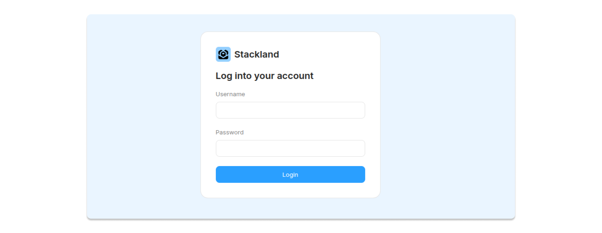
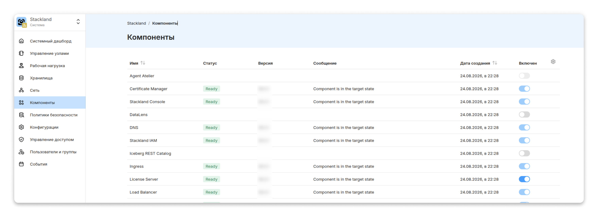
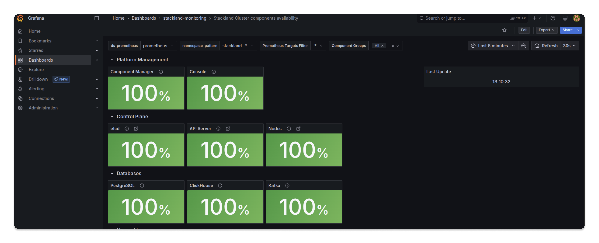

# Запуск инсталляции

Этот рецепт поможет вам запустить процесс установки {{ stackland-name }} и получить работающий кластер, готовый к первичной настройке. Вы научитесь управлять утилитой `sladm`, поймете, что происходит на каждом этапе инсталляции, проверите статус этого процесса и успешность завершения.



Рецепт основан на версии 26.2.1. В других релизах детали процесса могут отличаться.



## Из чего состоит поставка {{ stackland-name }} {#distribution}

* **Утилита `sladm`** — единый бинарный файл, который выполняет все операции с кластером: установку, обновление, сбор диагностики. `sladm` не требует установки — достаточно скачать его и сделать исполняемым.

* **Установочный ISO-образ** — содержит Talos Linux, операционную систему, которая будет установлена на все серверы кластера. С этого образа загружаются все будущие узлы кластера при первичной установке.

## Основные сценарии использования утилиты `sladm` {#sladm-usage}

Прежде чем перейти к установке кластера, расскажем о базовом наборе команд, которые пригодятся как до инсталляции, так и после.



Более подробную информацию об утилите и ее параметрах вы найдете в [Руководстве по установке](../../quickstart.md) и в справке самой утилиты `sladm --help`.



* **Подготовка секретов**

    Первоначальное создание ресурса `StacklandSecretsConfig`. Генерирует сертификат и ключ внутреннего удостоверяющего центра (CA), которым будут подписываться сертификаты всех сервисов {{ stackland-name }}.

    ```bash
    sladm secrets add --out config/secrets.yaml --license-key key.json
    ```

* **Подготовка секретов с использованием собственного сертификата и ключа промежуточного удостоверяющего центра**

    Что это значит на практике:

    * Все сертификаты, которые выпускает {{ stackland-name }} для своих сервисов, будут подписаны вашим корпоративным промежуточным CA, а не самоподписанным внутренним CA платформы. Межсервисное взаимодействие внутри кластера, например между компонентами {{ stackland-name }}, будет защищено сертификатами, выпущенными вашим CA.

    * Сертификаты, выпускаемые компонентом certificate-manager для Ingress, например для URL UI компонентов {{ stackland-name }}, будут также подписаны вашим CA.

    ```bash
    sladm secrets add \
      --out config/secrets.yaml \
      --license-key key.json \
      --int-ca-chain ca.crt \
      --int-ca-key ca.key
    ```

* **Обновление существующего секрета**

    Команда заменит в ресурсе сертификат и ключ промежуточного CA.

    ```bash
    sladm secrets update config/secrets.yaml \
      --int-ca-chain ca.crt \
      --int-ca-key ca.key
    ```

* **Проверка конфигурационных файлов**

    Проверяется:

    * общий синтаксис;
    * форматы и допустимые значения полей;
    * согласованность конфигурации;
    * доступность узлов кластера по `hostname` (параметр из `StacklandHostsList`).

    ```bash
    sladm validate --config config/
    ```

* **Установка кластера в среде с доступом в интернет**

    Все необходимые артефакты скачиваются во время установки.

    ```bash
    sladm install --config config/
    ```

* **Подготовка артефактов**

    Используется для загрузки артефактов на хосте с доступом в интернет, чтобы затем перенести их в изолированную среду для установки.

    ```bash
    sladm pull \
      --config config/ \
      --image-bundle full
    ```

* **Установка кластера в изолированной среде**

    ```bash
    sladm install \
      --config config/ \
      --image-bundle-folder stackland-full-oci \
      --image-bundle full
    ```

* **Сбор диагностической информации с установленного кластера**

    ```bash
    sladm diag \
      --artifacts-dir /path/to/_out \
      --install-log /path/to/install.log
    ```

## Запуск установки {#run-installation}



Убедитесь, что все подготовительные действия уже выполнены: конфигурационные файлы заполнены, секреты сгенерированы, а инфраструктура соответствует минимальным требованиям. Подробнее об этом — в рецепте [Подготовка к инсталляции](02-installation-preparation.md).





В этом рецепте инсталляция проходит в среде с доступом в интернет.



### Шаг 1. Проверка конфигурационных файлов {#validate-config}

Перед установкой проверьте корректность конфигурационных файлов. Если возникнут ошибки, исправьте их.

```bash
sladm validate --config config/
```

### Шаг 2. Запуск инсталляции {#start-installation}

Запустите процесс установки кластера {{ stackland-name }}:

```bash
sladm install --config config/
```

По умолчанию для процесса установки {{ stackland-name }} установлен тайм-аут в один час. При необходимости его можно переопределить с помощью флага `--installation-timeout`.

## Этапы установки {#installation-stages}

Расскажем подробнее об этапах инсталляции. Понимание процессов, которые происходят на каждом из них, поможет выявить и исправить ошибки, если они возникнут.

### 1. Валидация установочного конфигурационного файла {#stage-validation}

В установочных файлах проверяются:

* корректность синтаксиса;

* форматы и допустимые значения полей;

* согласованность конфигурации в целом.

Результат — проверенная и преобразованная во внутренние структуры `sladm` конфигурация для установки кластера.

### 2. Подготовка локального набора образов {#stage-images}

Проверяется наличие локальной директории с Docker-образами. По умолчанию она называется `stackland-<версия>-<набор_образов>-oci`, например: `stackland-26.2.1-full-oci`. Если директории нет, утилита создает ее и загружает в нее необходимый набор образов: `minimal` или `full`.

Набор `minimal` содержит только системные образы и предполагает, что из кластера есть доступ к `cr.yandex`: недостающие образы будут загружены оттуда. Если доступа нет, обязательно используется набор `full`. До окончания загрузки всех образов `sladm` не выполняет никаких действий с узлами кластера.

Результат — необходимый для установки набор образов. Затем `sladm` начинает развертывание кластера на отдельных узлах.

### 3. Предварительные проверки узлов {#stage-node-checks}

После загрузки узла с ISO-образа и получения доступа к нему по сети (порт 50000) утилита проверяет:

* наличие установочного IP-адреса либо разрешаемость DNS-имени;

* соответствие оборудования минимальным требованиям;

* наличие сетевых интерфейсов, перечисленных в установочных файлах;

* отсутствие на целевых дисках метаданных файловых систем, томов LVM и массивов RAID.

В результате `sladm` отсеивает проблемные узлы и явно указывает на ошибки, которые привели бы к сбою установки на следующих этапах.

### 4. Установка Talos на диск {#stage-install-talos}

Для каждого узла `sladm` генерирует его конфигурацию: сеть, маршруты, аутентификацию, аудит-логирование, а затем применяет эту конфигурацию к узлу. После этого устанавливает операционную систему на жесткий диск и перезагружает ее.

Результат — установленная система, которая может загружаться с жесткого диска. Теперь ISO-образ можно отключить. Если в дальнейшем потребуется переустановка системы на узел, необходимо очистить диски и заново подключить ISO-образ.

### 5. Загрузка образов в локальный registry {#stage-push-images}

Каждый узел имеет собственный registry для хранения образов. Он развернут на порту 5001 и использует mTLS-аутентификацию. На этом этапе `sladm` копирует образы из директории, подготовленной на [этапе 2](#stage-images), в локальный registry узла. Системные компоненты Kubernetes — `kubelet`, `kube-apiserver`, `etcd` и другие — также распространяются в виде Docker-образов и попадают на узел во время копирования.

Результат — узел с набором образов, необходимых для развертывания кластера. После копирования на узле запускается сервис `kubelet`.

### 6. Сборка `etcd`-кластера и запуск статических подов `kube-apiserver` {#stage-etcd}

Сначала `sladm` инициализирует `etcd` и `kube-apiserver` на одном узле `control-plane`. Затем остальные узлы `control-plane` добавляются в этот кластер. Далее регистрируются `worker`-узлы через работающий API-сервер. Узлы получают необходимые для этого секреты на [этапе 4](#stage-install-talos) в процессе установки Talos.

Результат — работающий `kube-apiserver` на узлах `control-plane` и подключенные `worker`-узлы.

### 7. Установка CNI Cilium {#stage-cilium}

Helm-чарт устанавливает Cilium через `kube-apiserver`. Он работает в режиме замены `kube-proxy` с нативным Kubernetes IPAM и обеспечивает сетевую связность подов, NodePort и сетевые политики. Если в конфигурации выбран тип балансировщика `cilium-l2`, дополнительно развертываются ресурсы L2-балансировки.

Результат — установленный CNI и сетевая связность между подами кластера.

### 8. Установка расширенной функциональности на узлы {#stage-node-extensions}

Если в конфигурации для узла включены дополнительные функции (features), `sladm` устанавливает соответствующие расширения, например компонент «Поддержка {{ nvidia }} GPU». Установка выполняется через механизм обновления узла с выводом сообщений в консоль. Чтобы изменения вступили в силу, `sladm` перезапускает узлы. Если ОС Talos загружалась с RAW-образов дисков, то на этом этапе `sladm` также удаляет расширения, которые были нужны только для начальной установки.

Результат — узлы с поддержкой расширенной функциональности, если она была определена в установочных файлах.

### 9. Установка Component Manager и передача ему настроек через CR {#stage-component-manager}

Helm-чарт устанавливает Component Manager (CM). После установки и запуска CM создает описания кастомных ресурсов (CRD). Затем `sladm` создает по этим описаниям ресурсы (CR), через которые передаются начальные настройки кластера.

В результате развертывание кластера переходит от `sladm` к CM.

### 10. Установка компонентов {#stage-components}

Получив настройки, Component Manager развертывает платформенные компоненты (Certificate Manager, {{ objstorage-name }}, Secrets Store и другие) и согласует их состояние. Для каждого компонента есть ресурс `ComponentInstallation` с именем компонента и статусом: `Pending`, `Installing`, `Ready`, `Error`. Прогресс можно отслеживать по этим ресурсам. Дополнительные компоненты включаются через конфигурационные CR: например, `LoadBalancerConfig` для типа балансировщика и пула адресов. `sladm` ожидает, пока общий статус платформы не перейдет в `Installed`, а все компоненты — в фазу `Ready`. Если какой-либо компонент получает статус `Error`, `sladm` выводит причину ошибки в лог.

В результате `sladm` сохраняет `kubeconfig`, выводит пароль администратора кластера, и установка считается успешной.

## Мониторинг инсталляции кластера {#monitor-installation}

Расскажем, как отслеживать процесс инсталляции.

### Отслеживание логов команды инсталляции {#installation-logs}

Команда `sladm install --config ./config/` пишет лог-файл с именем `install-DDMMYY-HHMM.log` в директорию, из которой запускается установка. Пока не станет доступным `kubernetes-api`, этот лог — основной источник информации о ходе установки. Он помогает:

* **понять, на каком этапе находится установка:** лог содержит сообщения от каждого контроллера с временными метками;

* **увидеть статус узлов**, например: `"Node installation status transition: from=Empty, to=Bootstrapping"`;

* **увидеть статус компонентов**, например: `"Components not ready: [dns (phase: Installing), ...]"`;

* **обнаружить ошибки:** многие ошибки могут быть нормой на определенных этапах инсталляции, система исправляет их сама; примеры ошибок:

    * `"Failed to create Kubeconfig resource: no ready control plane nodes found"` — ожидаемая ошибка на ранних этапах установки;

    * `"Connection error: failed to start watching MachineStatus: rpc error: ... tls: certificate required"` — проблема с TLS-сертификатами при подключении к узлу;

    * `"the server could not find the requested resource"` — компонент или CRD еще не созданы.

### Просмотр статуса компонентов через `kubectl` {#monitor-components}



Если `kubernetes-api` долго недоступен, то, вероятно, произошла ошибка на начальных этапах инсталляции или есть проблемы с DNS. Проверьте лог-файл инсталляции и настройки DNS.



Как правило, `kubernetes-api` становится доступным через несколько минут после сообщения от инсталлятора: `✓ Cluster network is ready`. После этого можно воспользоваться `kubectl` или любыми другими инструментами взаимодействия с кластером Kubernetes для просмотра состояния компонентов.

```bash
# Статус установки всех компонентов платформы
kubectl get componentinstallations
```

Вывод покажет, какие компоненты еще не готовы (`phase: Installing`, `phase: Pending`), а какие уже получили статус `Ready`.

### Просмотр событий кластера {#cluster-events}

Можно смотреть события (`Events`), которые показывают проблемы с различными ресурсами Kubernetes:

```bash
# Разовый просмотр событий
kubectl get events -A --sort-by='.lastTimestamp'

# Отслеживание в реальном времени
watch -n 10 kubectl get events -A --sort-by='.lastTimestamp'
```

Это поможет, если какой-то компонент долго не получает статус `Ready`, — в событиях будет указана причина, например `ImagePullBackoff`, `CrashLoopBackoff` или нехватка ресурсов.

### Просмотр статуса подов {#pod-status}

Показывает, все ли поды запущены и работают:

```bash
# Вывести все поды из всех пространств имен в состоянии, отличном от Running, и упорядочить их по времени создания
kubectl get pods -A --field-selector=status.phase!=Running,status.phase!=Succeeded --sort-by=.metadata.creationTimestamp
```

На ранних этапах установки многие поды будут в статусе `Pending` или `ContainerCreating` — это нормально. К концу установки все поды должны перейти в `Running` или `Completed`.

## Проверка кластера после инсталляции {#check-cluster}

Способы, которые мы описали в [предыдущем разделе](#monitor-installation), подходят и для проверки кластера после инсталляции. Расскажем о дополнительных способах.

### Проверка DNS {#check-dns}

DNS имеет смысл проверить на hostname, которое прописывается в конфигурационный файл `kubeconfig` после установки, то есть `api.sys.<base_domain>`. При успешном разрешении имени удостоверьтесь в корректной работе делегирования зоны. При попытке разрешить hostname вы должны получить записи на IP-адреса всех узлов `control-plane` или `combined` в кластере.

```bash
nslookup api.sys.stackland.internal
Server:		127.0.0.53
Address:	127.0.0.53#53

Non-authoritative answer:
Name:	api.sys.stackland.internal
Address: 172.19.11.136
Name:	api.sys.stackland.internal
Address: 172.19.11.138
Name:	api.sys.stackland.internal
Address: 172.19.11.137
```

### Проверка работы LoadBalancer {#check-load-balancer}

Получите IP-адрес, назначенный сервису `envoy` с типом `LoadBalancer` из пространства имен `stackland-ingress`. IP-адрес должен быть из диапазона `ipPools`, который вы указывали в конфигурации `StacklandClusterConfig`.

```bash
kubectl get svc -n stackland-ingress | grep LoadBalancer | grep envoy
envoy                          LoadBalancer   10.111.3.71      172.19.11.73   80:32721/TCP,443:32444/TCP   25m
```

Чтобы убедиться в корректной работе виртуального IP-адреса, проверьте доступность TCP-порта 443, так как за ним находится Ingress-контроллер.

```bash
nc -zv 172.19.11.73 443
Connection to 172.19.11.73 443 port [tcp/https] succeeded!
```

### Проверка Ingress {#check-ingress}

После того как вы убедились в корректной работе DNS и LoadBalancer, проверьте доступность веб-интерфейсов, опубликованных с помощью Ingress. Откройте в браузере консоль управления {{ stackland-name }}: `https://console.sys.<domain>`. Вы увидите страницу ввода логина и пароля:



### Проверка доступности Kubernetes API и `kubeconfig` {#check-api}

Выполните команду:

```bash
kubectl cluster-info
Kubernetes control plane is running at https://api.sys.stackland.internal:6443
CoreDNS is running at https://api.sys.stackland.internal:6443/api/v1/namespaces/kube-system/services/kube-dns:dns/proxy

To further debug and diagnose cluster problems, use 'kubectl cluster-info dump'.
```

Вывод покажет адреса API-сервера и CoreDNS. Успешное выполнение команды означает, что кластер работает и `kubeconfig` настроен правильно.

### Проверка статуса платформы {#check-platform}

```bash
kubectl get platformconfigs
NAME   RELEASE CHANNEL   REGISTRY BASE URI     INITIAL INSTALLATION STATE   AGE
main   Stable            cr.yandex/stackland   Installed                    77m
```

Когда `PlatformConfig` находится в статусе `Installed`, платформа готова к работе.

### Проверка статуса компонентов с помощью `kubectl` {#check-components-kubectl}

`kubectl` показывает факт установки компонента:

```bash
kubectl get ComponentInstallation
NAME                       PHASE        VERSION   MESSAGE                                                                      AGE
certificate-manager-main   Ready        26.2.1    Component is in the target state                                             48m
console-main               Ready        26.2.1    Component is in the target state                                             16m
dns-main                   Ready        26.2.1    Component is in the target state                                             48m
...
```

Также доступна более подробная информация по конкретным компонентам, например:

```bash
kubectl describe ComponentInstallation iam-main
Name:         iam-main
Namespace:
Labels:       <none>
Annotations:  <none>
API Version:  stackland.yandex.cloud/v1alpha1
Kind:         ComponentInstallation
Metadata:
  Creation Timestamp:  2026-08-24T18:34:52Z
  Generation:          1
  Resource Version:    115399
  UID:                 ca399c0d-cc5f-4640-993b-10688c6b7bcb
Spec:
  Component Name:  iam
Status:
  Installed Version:  26.2.1
  Message:            Component is in the target state
  Phase:              Ready
Events:               <none>
```

* `Spec.Component Name` — имя компонента;

* `Status.Phase` — текущая фаза: `Pending`, `Installing`, `Ready`, `Error`, `Updating`, `Uninstalling`;

* `Status.Installed Version` — установленная версия компонента;

* `Status.Message` — сообщение о текущем статусе или ошибке.

### Проверка статуса компонентов через консоль управления {#check-components-console}

Информацию о компонентах в консоли можно получить по ссылке: `https://console.sys.<domain>/system/components`.



### Проверка статуса компонентов в Grafana {#check-components-grafana}

Статус всех компонентов можно посмотреть на встроенном дашборде в Grafana — Stackland Cluster components availability.

Логин и пароль для доступа к Grafana находятся в секрете `grafana-admin-credentials` из пространства имен `stackland-monitoring`.



## Итоги {#summary}

Вы запустили установку {{ stackland-name }} и получили работающий кластер. Теперь вы знаете, что:

* поставка {{ stackland-name }} состоит из установочного ISO-образа и утилиты `sladm`, которая выполняет установку, обновление и диагностику кластера;

* установка проходит в 10 этапов: от проверки конфигурации и загрузки образов до установки Talos, настройки `etcd`, развертывания Cilium и компонентов платформы;

* отслеживать прогресс инсталляции можно по логам инсталляции, статусам узлов, статусам компонентов кластера и событиям кластера;

* проверить успешность установки можно через консоль управления, `kubectl` и дашборды в Grafana.
