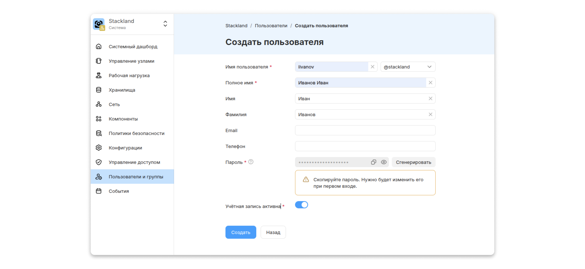
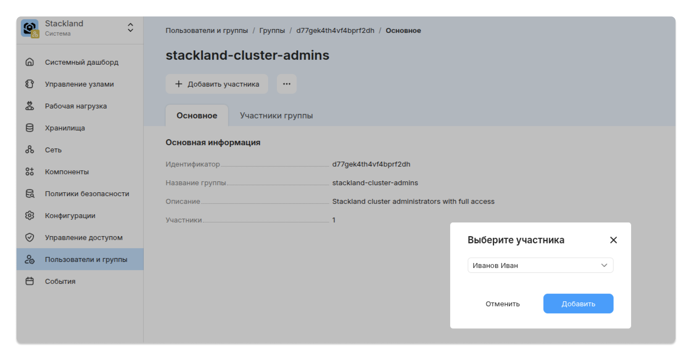

# Первичная настройка

С помощью этого рецепта вы научитесь выполнять базовую настройку кластера {{ stackland-name }} после инсталляции — она повысит безопасность и удобство работы.

## Создание учетной записи администратора {#create-admin}

Ниже собран набор действий, которые пригодятся для дальнейшей работы с кластером.

### Шаг 1. Создание пользователя {#create-user}

Не используйте учетную запись `admin@stackland` для повседневной работы. После первого входа в консоль управления сразу создайте персонализированную учетную запись администратора.



Создание локального пользователя доступно только через консоль управления.



1. В консоли управления перейдите в раздел **Пользователи и группы**.

1. На вкладке **Пользователи** нажмите **Создать пользователя**.

1. Укажите имя пользователя.

1. Задайте временный пароль.

1. Активируйте учетную запись (по умолчанию новая учетная запись не активна).

1. Нажмите **Создать**.

При первом входе пользователю потребуется изменить временный пароль.



### Шаг 2. Назначение прав {#assign-permissions}

Необходимые права можно выдать двумя способами: напрямую пользователю через `AccessBinding` или `RoleBinding`, либо через группу, у которой уже есть нужные права.



Права лучше выдавать через группы, а не напрямую пользователю. Так проще масштабировать доступ при большом количестве пользователей, ниже вероятность ошибок и выше прозрачность.



Для выдачи административных прав подойдет группа `stackland-cluster-admins`. Она создается автоматически при установке {{ stackland-name }} и уже имеет роль `admin` на уровне кластера.



Управление членством в группах доступно только через консоль управления.



Чтобы добавить пользователя в группу:

1. В консоли управления перейдите в раздел **Пользователи и группы**.

1. На вкладке **Группы** выберите `stackland-cluster-admins`.

1. Нажмите **Добавить участника**.

1. Выберите пользователей, которых нужно добавить в группу.

1. Нажмите **Добавить**.



После этих шагов пользователь получит административные права на уровне кластера — они наследуются через группу.

## Настройка Policy Manager {#configure-policy-manager}

* **Policy Manager** объединяет инструменты, которые проверяют ресурсы Kubernetes на соответствие политикам и генерируют отчеты. В него входят пресеты политик, которые проверяют ресурсы на соответствие Pod Security Standards (PSS).

    Подробнее о компоненте — в статье [Policy Manager](../../concepts/components/policy-manager.md).

* **PSS** — это стандарт Kubernetes, который определяет три уровня безопасности подов: Privileged, Baseline и Restricted. В {{ stackland-name }} можно выбрать два из них — Baseline и Restricted.

    Подробнее о PSS — на [сайте Kubernetes](https://kubernetes.io/docs/concepts/security/pod-security-standards/).

По умолчанию после установки {{ stackland-name }} включен пресет Baseline — это базовая защита от известных эскалаций привилегий, которая подходит для большинства приложений. Для повышения безопасности рекомендуется дополнительно активировать пресет Restricted: он следует принципу наименьших привилегий.

### Активация пресета Restricted {#enable-restricted}

Включить Restricted можно двумя способами — через консоль управления и с помощью CLI.



- Консоль управления {#console}

  1. В левом меню выберите **Политики безопасности**.

  1. Перейдите на вкладку **Настройки**.

  1. В разделе **Kyverno** отметьте оба пресета: **Baseline** и **Restricted** — изменения применятся автоматически.

  

- CLI {#cli}

  1. Создайте файл `clusterpolicyset.yaml`:

      ```yaml
      apiVersion: policy.stackland.yandex.cloud/v1alpha1
      kind: ClusterPolicySet
      metadata:
        name: stackland-policies
      spec:
        engines:
          kyverno:
            presets:
              - baseline
              - restricted
      ```

  1. Примените манифест:

      ```bash
      kubectl apply -f clusterpolicyset.yaml
      ```



## Включение и настройка Secrets Store {#secrets-store}

**Secrets Store** — компонент для безопасного хранения и доставки секретов в приложения: паролей, токенов, ключей API.



По умолчанию после установки {{ stackland-name }} компонент Secrets Store выключен, и его нужно включить вручную.



### Включение Secrets Store {#enable-secrets-store}

Включить Secrets Store можно двумя способами.



- Консоль управления {#console}

  1. В левом меню выберите **Компоненты**.

  1. Активируйте компонент **Secrets Store**.

  1. Подтвердите активацию.

- CLI {#cli}

  1. Откройте ресурс `SecretsStoreConfig` для редактирования. Он управляет всеми настройками компонента.

      ```bash
      kubectl edit secretsstoreconfigs main
      ```

  1. Установите для параметра `enabled` значение `true`.



Чтобы проверить, что компонент включился, убедитесь, что появилось пространство имен `stackland-secrets-store` и ресурсы в нем.

### Получение доступа к Secrets Store {#access-secrets-store}



Интерфейс и доступ к API Secrets Store по умолчанию выключены.



Откройте ресурс `SecretsStoreConfig` для редактирования.

* Чтобы открыть доступ к **API** Secrets Store извне кластера, установите флаг `server.ingress.enabled = true`.

* Чтобы открыть доступ к **интерфейсу** Secrets Store извне кластера, установите флаги `server.ingress.enabled = true` и `ui.enabled = true`.

Интерфейс и API станут доступны по адресу `https://secrets.sys.<домен кластера>`. Если `ui.enabled = true`, а `server.ingress.enabled = false`, то доступ к интерфейсу будет только внутри кластера.

Root-токен для доступа к API или входа в интерфейс можно взять из секрета `openbao-root-token` в пространстве имен `stackland-secrets-store`:

```bash
kubectl get secret openbao-root-token -n stackland-secrets-store -o jsonpath='{.data.token}' | base64 -d
```

## Выпуск сертификата для публичных сервисов {#issue-certificate}

Если планируется публикация веб-сервисов в интернете, для их корректной работы в браузерах нужны доверенные TLS-сертификаты.



Самоподписанные сертификаты, которые {{ stackland-name }} использует по умолчанию, будут вызывать в браузере предупреждение безопасности.



Выпустить доверенный сертификат можно с помощью компонента Certificate Manager через эмитент Let's Encrypt. Порядок действий:

1. Включите эмитент Let's Encrypt. По умолчанию эмитент Let's Encrypt HTTP01 выключен и требует настройки. Отредактируйте глобальный ресурс `CertificateManagerConfig` — блок `clusterIssuers` должен выглядеть так:

    ```yaml
    clusterIssuers:
      letsencryptHttp01:
        enabled: true                              # Включить поддержку Let's Encrypt HTTP01
        email: your-email@example.com              # Действительный адрес электронной почты, на который будут приходить уведомления Let's Encrypt
    ```

1. Создайте ресурс `Certificate`.

    ```yaml
    apiVersion: cert-manager.io/v1
    kind: Certificate
    metadata:
      name: my-app-tls
      namespace: <пространство_имен_приложения>
    spec:
      secretName: my-app-tls-secret
      issuerRef:
        name: stackland-letsencrypt
        kind: ClusterIssuer
      dnsNames:
        - app.example.com
    ```

    * `secretName` — имя секрета, в который будут сохранены выпущенный сертификат и приватный ключ;

    * `issuerRef.name` — используемый эмитент `stackland-letsencrypt`;

    * `dnsNames` — список доменов, для которых выпускается сертификат.

1. После создания ресурса `Certificate` компонент Certificate Manager автоматически создает Ingress в указанном пространстве имен для прохождения проверки и размещает по нему токен `http://app.example.com/.well-known/acme-challenge/<токен>`.

    

    Let's Encrypt проверяет, что токен доступен по этому URL. Поэтому убедитесь, что домен, для которого выпускается сертификат, разрешается из интернета. Трафик должен приходить на IP-адрес Ingress-контроллера {{ stackland-name }}, выбранного для эмитента.

    

    ```bash
    kubectl get ingress -n default
    NAME                        CLASS               HOSTS                     ADDRESS        PORTS   AGE
    cm-acme-http-solver-8h9b5   stackland-default   app.example.com   172.19.11.72   80      35m
    ```

1. После прохождения проверки сертификат будет выпущен и помещен в указанный ранее секрет `my-app-tls-secret`.

## Настройка мониторинга {#configure-monitoring}

В {{ stackland-name }} по умолчанию настроен набор алертов. Чтобы получать их, настройте канал уведомлений.

### Настройка SMTP для Alertmanager {#configure-smtp}

Alertmanager в {{ stackland-name }} настраивается через ресурс `AlertmanagerConfig` в пространстве имен `stackland-monitoring`. Этот ресурс описывает получателей, правила группировки и маршрутизации алертов.

1. Для безопасного хранения пароля от SMTP создайте секрет Kubernetes.

    ```yaml
    apiVersion: v1
    kind: Secret
    metadata:
      name: smtp-secret
      namespace: stackland-monitoring
    type: Opaque
    stringData:
      password: "<ваш-smtp-пароль>"
    ```

1. Создайте ресурс `AlertmanagerConfig`.

    Подробнее о конфигурации Alertmanager — в [документации Prometheus](https://prometheus.io/docs/alerting/latest/configuration/).

    ```yaml
    apiVersion: monitoring.coreos.com/v1alpha1
    kind: AlertmanagerConfig
    metadata:
      name: stackland-email-config
      namespace: stackland-monitoring
    spec:
      route:
        groupBy: ['namespace', 'alertname']
        groupWait: 30s
        groupInterval: 5m
        repeatInterval: 4h
        receiver: email-receiver
        routes:
        - matchers:
          - name: severity
            value: critical
            matchType: "="
          receiver: email-receiver
          groupWait: 10s
          repeatInterval: 1h
      receivers:
      - name: email-receiver
        emailConfigs:
        - to: "admin@example.com"
          from: "infra@example.com"
          smarthost: "email-smtp.example.com:587"
          authUsername: "<smtp-username>"
          authPassword:
            name: smtp-secret
            key: password
          authIdentity: "<smtp-username>"
          requireTLS: true
          sendResolved: true
          headers:
          - key: Subject
            value: '[{{ .Status | toUpper }}] {{ .GroupLabels.alertname }}'
    ```

    После этого алерты начнут приходить, но только из пространства имен `stackland-monitoring`. Чтобы получать алерты из всех пространств имен, добавьте в ресурс `Alertmanager` параметр `alertmanagerConfigMatcherStrategy`:

    ```bash
    kubectl patch alertmanager kube-monitoring -n stackland-monitoring --type='merge' -p '{"spec":{"alertmanagerConfigMatcherStrategy":{"type":"None"}}}'
    ```

### Настройка срока хранения метрик Prometheus {#configure-retention}

По умолчанию Prometheus хранит метрики десять дней. При активной эксплуатации этого может быть недостаточно для анализа инцидентов.

1. Отредактируйте конфигурацию мониторинга.

    ```bash
    kubectl edit monitoringconfigs main
    ```

1. Измените параметры в секции `prometheus`.

    ```yaml
    spec:
      settings:
        prometheus:
          retention: 30d
          resources:
            limits:
              cpu: "2"
              memory: 4Gi
            requests:
              cpu: 200m
              memory: 800Mi
    ```



При увеличении срока хранения убедитесь, что на узлах достаточно свободного места.



## Итоги {#summary}

Вы выполнили первичную настройку кластера {{ stackland-name }} после инсталляции. Вот что важно запомнить:

* Не используйте стандартную учетную запись `admin@stackland` — создайте персонализированную.

* Настройка Policy Manager с пресетом Restricted усиливает контроль безопасности подов по стандарту Pod Security Standards.

* Включение и настройка Secrets Store позволяют использовать единое хранилище секретов.

* Выпуск доверенных сертификатов через Certificate Manager и Let's Encrypt дает веб-сервисам валидные TLS-сертификаты для безопасной публикации в интернете.

* Для надежной эксплуатации можно подключить уведомления мониторинга о критических событиях и при необходимости увеличить срок хранения метрик Prometheus.
