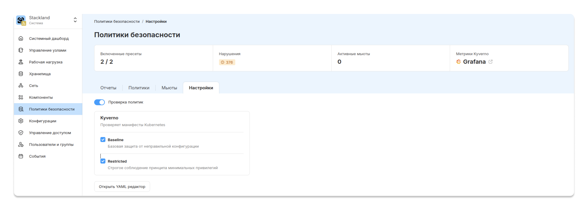

# Внедрение политик безопасности и аудит конфигураций

Этот рецепт поможет внедрять политики безопасности в кластере {{ stackland-name }}. Вы сможете активировать пресет политик, создать тестовый проект и развернуть в нем приложение, настроить кастомные политики безопасности и провести базовый аудит проекта. Для каждого найденного нарушения политик вы примете решение о деактивации нарушения или исправлении конфигурации.

## Policy Manager {#policy-manager}

За политики безопасности в {{ stackland-name }} отвечает компонент **Policy Manager**. Он объединяет инструменты, которые проверяют ресурсы Kubernetes на соответствие политикам, и генерирует отчеты в формате [OpenReports](https://openreports.io/docs/api/). Подробнее об этом компоненте читайте в статье [Policy Manager](../../concepts/components/policy-manager.md).

Policy Manager поставляется с двумя готовыми пресетами. Оба построены на [Pod Security Standards](https://kubernetes.io/docs/concepts/security/pod-security-standards/) (PSS) — стандарте Kubernetes, который описывает три уровня требований к подам: Privileged, Baseline и Restricted. Из этих трех уровней в платформе используются два: Baseline и Restricted.

### Пресет Baseline {#baseline-preset}

**Baseline** — пресет с минимальными ограничениями, который направлен на распространенные способы повышения привилегий. Он разрешает запускать поды без явного указания настроек безопасности — полагаясь на параметры Kubernetes, заданные по умолчанию, но запрещает хорошо известные опасные практики. Это отправная точка для обычных приложений, чтобы контейнеры не могли легко выйти за пределы изолированной среды.

Политики, которые входят в пресет, и их краткое описание — в таблице ниже.

#|
|| **Название политики** | **Описание** ||
|| `stackland-restrict-apparmor-profiles` | Запрещает использование любых AppArmor-профилей, кроме `runtime/default` и `localhost/*` ||
|| `stackland-restrict-seccomp` | Запрещает установку Seccomp-профиля в значение `Unconfined` ||
|| `stackland-restrict-sysctls` | Разрешает использование только ограниченного набора параметров ядра `sysctls`, которые считаются безопасными ||
|| `stackland-disallow-capabilities` | Запрещает добавлять Linux Capabilities, кроме строго определенного списка разрешенных ||
|| `stackland-disallow-host-namespaces-ipc` | Запрещает подам использовать IPC-пространство имен хоста `hostIPC` ||
|| `stackland-disallow-host-namespaces-network` | Запрещает подам использовать сетевое пространство имен хоста `hostNetwork` ||
|| `stackland-disallow-host-namespaces-pid` | Запрещает подам использовать PID-пространство имен хоста `hostPID` ||
|| `stackland-disallow-host-path` | Запрещает монтировать тома типа `hostPath` ||
|| `stackland-disallow-host-ports` | Запрещает использование `hostPort`, за исключением порта `0` ||
|| `stackland-disallow-proc-mount` | Запрещает изменение стандартного proc-монтирования `procMount` ||
|| `stackland-disallow-privileged-containers` | Запрещает запуск привилегированных контейнеров ||
|| `stackland-disallow-selinux` | Запрещает или ограничивает настройку SELinux-опций ||
|#

### Пресет Restricted {#restricted-preset}

**Restricted** — пресет, содержащий политики со строгими ограничениями. Пресет Restricted соответствует актуальным практикам обеспечения безопасности подов (pod hardening). Он включает в себя самые строгие политики и требует от приложений работы без использования `root` (rootless), ограниченного набора Capabilities, установки Seccomp и других ограничений. Restricted ориентирован на приложения, требующие максимального уровня безопасности.

В таблице ниже вы найдете описание политик, которые входят в пресет.

#|
|| **Название политики** | **Краткое описание** ||
|| `stackland-disallow-capabilities-strict` | Запрещает добавлять любые Capabilities, кроме `NET_BIND_SERVICE`, и требует явного сброса `ALL` ||
|| `stackland-restrict-seccomp-strict` | Требует явной установки Seccomp-профиля в `RuntimeDefault` или `Localhost` ||
|| `stackland-disallow-privilege-escalation` | Запрещает повышение привилегий: `allowPrivilegeEscalation: false` ||
|| `stackland-require-run-as-nonroot` | Требует обязательной установки `runAsNonRoot: true` ||
|| `stackland-require-run-as-non-root-user` | Требует, чтобы пользователь в контейнере был не `root`: `UID > 0` ||
|| `stackland-restrict-volume-types` | Запрещает использование небезопасных типов томов, разрешая только core-типы, например `configMap`, `secret`, PVC ||
|#



Пресеты используют как отдельно, так и вместе. Можно также создавать свои собственные политики, например для контроля публичных бакетов или наличия квот на проекте.



Команды для просмотра полного списка активных политик кластера и содержимого отдельных политик:

```bash
# получение списка всех политик в кластере
kubectl get ClusterPolicy

# получение содержимого отдельной политики
kubectl get ClusterPolicy stackland-disallow-privileged-containers -o yaml
```

## Внедрение политик безопасности {#implement-policies}

Внедрение политик может быть опасным для существующих и будущих рабочих нагрузок. Чтобы избежать проблем, необходимо знать, как политики обрабатывают нарушения и как отслеживать и исправлять эти нарушения. Далее мы расскажем о **безопасном** процессе внедрения политик.

### Способы обработки нарушений {#violation-handling}

Перед активацией любых политик важно понимать, в каком режиме они будут работать. Каждая политика (`ClusterPolicy`) имеет параметр `validationFailureAction`, который определяет реакцию на нарушение.

```yaml
spec:
  validationFailureAction: Audit   # или Enforce
```

Существует два режима работы политик — Audit и Enforce.

#### Audit {#audit-mode}

Когда политика работает в режиме **Audit**:

* Запрос на создание или изменение ресурса **пропускается**, даже если он нарушает политику.

* Kyverno создает запись о нарушении в ресурсы `Events` и `PolicyReport`.

* Ничего не блокируется, приложения продолжают работать.

Это режим наблюдения, который позволяет собрать статистику: кто нарушает, насколько массово, какие именно поля в манифестах проблемные.

#### Enforce {#enforce-mode}

Когда политика работает в режиме **Enforce**:

* Запрос на создание или изменение ресурса **отклоняется**, если он нарушает политику.

* Kyverno возвращает отказ с сообщением из поля `message` в политике.

* Под не создается, Deployment не обновляется.

Это активная защита: нельзя создать или изменить ресурс, который не соответствует политике.



По умолчанию все политики в {{ stackland-name }} активируются в режиме Audit, чтобы не нарушать работу существующих приложений.



#### Переход от Audit к Enforce {#audit-to-enforce}

Переход к Enforce требует пошаговой подготовки, чтобы не заблокировать легитимные рабочие нагрузки.

1. **Сбор информации (Audit)**

    Все политики должны быть в режиме Audit. Policy Manager собирает информацию о нарушениях в ресурсы `Events` и `PolicyReport`.

1. **Исправление**

    Все нарушения исправляют на основе полученных отчетов.

1. **Повторный сбор информации (Audit)**

    Необходимо убедиться, что все нарушения, кроме намеренных исключений, исправлены.

1. **Переключение**

    Когда для конкретной политики не осталось неисправленных нарушений, можно перевести ее в режим Enforce.



Рекомендуется переключать политики по одной, начиная с наименее ограничительных (Baseline), и отслеживать работу приложений после каждого изменения.



### Активация пресета политик {#enable-preset}

По умолчанию в кластере включен только пресет Baseline. Чтобы повысить уровень безопасности, добавьте Restricted.

Включить Restricted можно двумя способами: через консоль управления или с помощью CLI.



- Консоль управления {#console}

  1. В меню слева выберите **Политики безопасности**.

  1. Перейдите на вкладку **Настройки**.

  1. В разделе **Kyverno** отметьте оба пресета: **Baseline** и **Restricted**.

  Изменения применятся автоматически.

  

- CLI {#cli}

  Внесите изменения в ресурс `policymanagerconfigs`:

  ```bash
  kubectl edit policymanagerconfigs
  ```

  ```yaml
  apiVersion: v1
  items:
  - apiVersion: stackland.yandex.cloud/v1alpha1
    kind: PolicyManagerConfig
    metadata:
      name: main
    spec:
      enabled: true
      settings:
        defaultPolicySet:
          engines:
            kyverno:
              presets:
              - baseline
              - restricted       # добавить пресет Restricted
   ...
  ```



### Создание тестовых ресурсов {#create-test-resources}

Разверните проект с ресурсами, которые вы будете проверять на соответствие политикам безопасности: приложение с избыточными правами и публичный бакет. Для этого:

1. Создайте проект `security-demo`. Намеренно не задавайте ему квоты `spec.quotas` — это понадобится для аудита позже. Подробнее о создании проекта — в инструкции «[{#T}](../../operations/projects/create-project.md)».

    ```yaml
    apiVersion: stackland.yandex.cloud/v1alpha1
    kind: Project
    metadata:
      name: security-demo
    spec:
      displayName: "Security Demo"
      description: "Песочница для разбора нарушений политик"
    ```

    ```bash
    kubectl apply -f project.yaml
    ```

1. Создайте пространство имен `security-demo-app`.

    Как управлять пространством имен, читайте в инструкции «[{#T}](../../operations/projects/manage-namespaces.md)».

    ```yaml
    apiVersion: stackland.yandex.cloud/v1alpha1
    kind: ProjectNamespace
    metadata:
      namespace: project-security-demo
      name: security-demo-app
    spec:
      allowDeletion: true
    ```

    ```bash
    kubectl apply -f namespace.yaml
    ```

1. Разверните тестовое приложение `legacy-agent`. Его под намеренно нарушает несколько политик:

    * запущен в привилегированном режиме;

    * запущен от пользователя `root`;

    * запущен с лишними capabilities;

    * монтирует корень узла.

    ```yaml
    apiVersion: apps/v1
    kind: Deployment
    metadata:
      name: legacy-agent
      namespace: security-demo-app
    spec:
      replicas: 1
      selector:
        matchLabels:
          app: legacy-agent
      template:
        metadata:
          labels:
            app: legacy-agent
        spec:
          containers:
            - name: agent
              image: nginx:1.27
              securityContext:
                privileged: true              # нарушение Baseline
                runAsUser: 0                  # нарушение Restricted
                capabilities:
                  add: ["NET_ADMIN", "SYS_ADMIN"]   # нарушение Baseline/Restricted
              volumeMounts:
                - name: host
                  mountPath: /host
          volumes:
            - name: host
              hostPath:                       # нарушение Baseline
                path: /
    ```

    ```bash
    kubectl apply -f legacy-agent.yaml
    ```

    Уже на этом шаге кластер сразу предупреждает о проблемах — `kubectl` возвращает список нарушений еще до того, как вы откроете отчет:

    ```plaintext
    Warning: would violate PodSecurity "restricted:latest": privileged (container "agent" must not set securityContext.privileged=true), allowPrivilegeEscalation != false (container "agent" must set securityContext.allowPrivilegeEscalation=false), unrestricted capabilities (container "agent" must set securityContext.capabilities.drop=["ALL"]; container "agent" must not include "NET_ADMIN", "SYS_ADMIN" in securityContext.capabilities.add), restricted volume types (volume "host" uses restricted volume type "hostPath"), runAsNonRoot != true (pod or container "agent" must set securityContext.runAsNonRoot=true), runAsUser=0 (container "agent" must not set runAsUser=0), seccompProfile (pod or container "agent" must set securityContext.seccompProfile.type to "RuntimeDefault" or "Localhost")
    deployment.apps/legacy-agent created
    ```

    `Warning` означает, что под все равно создан: нарушения только фиксируются, а не блокируются.

1. **Создайте публичный бакет** `public-reports`. Подробнее о создании бакета — в инструкции «[{#T}](../../operations/storage/create-bucket.md)».

    ```yaml
    apiVersion: storage.stackland.yandex.cloud/v1alpha1
    kind: Bucket
    metadata:
      name: public-reports
      namespace: security-demo-app
    spec:
      anonymousAccessFlags:
        read: true        # анонимное чтение — потенциальная утечка
        list: true
    ```

    ```bash
    kubectl apply -f bucket.yaml
    ```

### Создание кастомных политик безопасности {#create-custom-policies}

Платформенные PSS-пресеты проверяют только поды. Чтобы аудит охватывал другие ресурсы (в этом примере — публичные бакеты и квоты), добавьте две собственные политики Kyverno.



Готовые решения для распространенных сценариев есть в библиотеке [Kyverno Policies](https://kyverno.io/policies/), адаптируйте их под конкретные задачи.



#### Политика запрета анонимного доступа к бакетам {#public-buckets-policy}

Политика помечает бакеты с включенным анонимным доступом:

```yaml
apiVersion: kyverno.io/v1
kind: ClusterPolicy
metadata:
  name: audit-public-buckets
spec:
  validationFailureAction: Audit
  background: true
  rules:
    - name: bucket-anonymous-access
      match:
        any:
          - resources:
              kinds:
                - storage.stackland.yandex.cloud/v1alpha1/Bucket
      validate:
        message: "Бакет открыт для анонимного доступа. Подтвердите, что публикация данных намеренна."
        pattern:
          spec:
            =(anonymousAccessFlags):
              =(read): "false"
              =(list): "false"
```

```bash
kubectl apply -f audit-public-buckets.yaml
```

При создании политики `kubectl` выводит предупреждение:

```plaintext
Warning: system:serviceaccount:stackland-policy-manager:kyverno-reports-controller requires permissions get,list,watch for resource storage.stackland.yandex.cloud/v1alpha1/Bucket
clusterpolicy.kyverno.io/audit-public-buckets created
```

Созданная политика не будет работать сразу, так как у Kyverno нет прав для кастомных ресурсов платформы, например `Bucket`, — их нужно выдать отдельно.

Права расширяются штатным для Kyverno способом — через агрегацию ролей. Создайте дополнительную `ClusterRole` с метками агрегации, и ее правила автоматически добавятся к ролям контроллеров Kyverno.

Подробнее — в документации Kyverno: [Customize Permissions](https://kyverno.io/docs/installation/customization/).

```yaml
apiVersion: rbac.authorization.k8s.io/v1
kind: ClusterRole
metadata:
  name: kyverno:view-buckets
  labels:
    rbac.kyverno.io/aggregate-to-reports-controller: "true"
    rbac.kyverno.io/aggregate-to-background-controller: "true"
rules:
  - apiGroups: ["storage.stackland.yandex.cloud"]
    resources: ["buckets"]
    verbs: ["get", "list", "watch"]
```

```bash
kubectl apply -f kyverno-view-buckets.yaml
```

#### Политика обязательного наличия квот на проекте {#project-quota-policy}

Квоты в {{ stackland-name }} задаются на уровне проекта — в поле `spec.quotas` ресурса `Project` (см. [Создать проект](../../operations/projects/create-project.md)). Напишите политику, которая будет помечать проекты без заданных квот. Она инспектирует сам объект `Project` и срабатывает, когда поле `spec.quotas` пусто или отсутствует:

```yaml
apiVersion: kyverno.io/v1
kind: ClusterPolicy
metadata:
  name: require-project-quota
spec:
  background: true
  validationFailureAction: Audit
  rules:
    - name: check-project-quota
      match:
        any:
          - resources:
              kinds:
                - stackland.yandex.cloud/v1alpha1/Project
      validate:
        message: "У проекта должны быть заданы квоты в spec.quotas."
        deny:
          conditions:
            all:
              - key: "{{ request.object.spec.quotas || `{}` | length(@) }}"
                operator: Equals
                value: 0
```

```bash
kubectl apply -f require-project-quota.yaml
```

`Project` — это кастомный ресурс {{ stackland-name }}, поэтому, как и в случае с бакетами, Kyverno нужно выдать права на его чтение, иначе при создании политики появится предупреждение о недостающих правах:

```yaml
apiVersion: rbac.authorization.k8s.io/v1
kind: ClusterRole
metadata:
  name: kyverno:view-projects
  labels:
    rbac.kyverno.io/aggregate-to-reports-controller: "true"
    rbac.kyverno.io/aggregate-to-background-controller: "true"
rules:
  - apiGroups: ["stackland.yandex.cloud"]
    resources: ["projects"]
    verbs: ["get", "list", "watch"]
```

```bash
kubectl apply -f kyverno-view-projects.yaml
```

## Аудит проекта {#project-audit}

Теперь пора найти нарушения политик и принять по ним решения. Результаты проверок публикуются:

* в консоли управления: **Политики безопасности** → **Отчеты** или **Система → События**;

* через `kubectl` — в виде ресурсов `PolicyReport`.

Сводный список по проекту:

```bash
kubectl get policyreport -n security-demo-app
```

```plaintext
NAME                                   KIND         NAME                           PASS   FAIL   WARN   ERROR   SKIP   AGE
4b234805-be91-4b27-a2eb-155ac9ff7d65   Deployment   legacy-agent                   20     0      0      0       0      16m
db997982-fe19-497e-9f5f-f8db709a1543   Pod          legacy-agent-656475ffb-rz9wt   20     0      0      0       0      2m
e84aa4fd-fd2d-43d4-9a77-61c4aa315553   Bucket       public-reports                0      1      0      0       0      17m

```

Колонки `KIND` и `NAME` показывают тип и проверяемый ресурс, `PASS` — количество проверок, `FAIL` — число нарушений. Чтобы понять, что именно не так, посмотрите детали отчета:

```bash
kubectl describe policyreport -n security-demo-app
```

В каждой записи есть поля:

* `Category` — к какому уровню PSS относится проверка (Baseline или Restricted).

* `Message` — описание политики или проверки, которую она осуществляет. Это ключевая подсказка для исправления: она позволяет увидеть, что ожидалось и чего не хватает.

* `Policy` — название политики.

* `Result` — результат проверки: `pass` — проверка пройдена, `fail` — нарушение политики.

* `Rule` — конкретное правило внутри политики.

### Нарушение 1. Чрезмерные права контейнеров {#violation-privileges}

Это зона ответственности платформенных PSS-пресетов. В выводе `describe` для пода `legacy-agent` видно сразу несколько проваленных проверок (ниже показаны не все):

```plaintext
  Policy:   stackland-disallow-privileged-containers
  Rule:     autogen-privileged-containers
  Result:   fail
  Message:  validation error: Privileged mode is disallowed. The fields spec.containers[*].securityContext.privileged ... must be unset or set to `false`.

  Policy:   stackland-disallow-capabilities
  Rule:     autogen-adding-capabilities
  Result:   fail
  Message:  Any capabilities added beyond the allowed list (AUDIT_WRITE, CHOWN, ...) are disallowed.

  Policy:   stackland-disallow-host-path
  Rule:     autogen-host-path
  Result:   fail
  Message:  validation error: HostPath volumes are forbidden. The field spec.volumes[*].hostPath must be unset.

  Policy:   stackland-require-run-as-nonroot
  Rule:     autogen-run-as-non-root
  Result:   fail
  Message:  validation error: Running as root is not allowed. Either the field spec.securityContext.runAsNonRoot must be set to `true` ...
```

Под нарушает несколько политик:

* привилегированный режим — `stackland-disallow-privileged-containers`;

* запуск от `root` — `stackland-require-run-as-nonroot`, `stackland-require-run-as-non-root-user`;

* лишние capabilities `NET_ADMIN` и `SYS_ADMIN` — `stackland-disallow-capabilities`;

* монтирование корня узла через `hostPath` — `stackland-disallow-host-path`.

**Решение**

Большинство таких нарушений — лишние привилегии, которые приложению не нужны. Их убирают правкой манифеста.

Каждая запись отчета однозначно отображается в поле манифеста. Сопоставьте нарушения и правки:

#|
|| **Сообщение из отчета** | **Что изменить в манифесте** ||
|| Any capabilities added beyond the allowed list are disallowed | Убрать `NET_ADMIN`, `SYS_ADMIN` из `capabilities.add` ||
|| Any capabilities added other than NET_BIND_SERVICE are disallowed | Оставить только `NET_BIND_SERVICE` или убрать все capabilities ||
|| Containers must drop ALL capabilities | `capabilities.drop: ["ALL"]` ||
|| HostPath volumes are forbidden | Заменить `hostPath` на `emptyDir`, PVC или `configMap` ||
|| Only allowed volume types may be used | Использовать только разрешенные типы: `configMap`, `csi`, `downwardAPI`, `emptyDir`, `ephemeral`, `persistentVolumeClaim`, `projected`, `secret` ||
|| Privilege escalation is disallowed | `allowPrivilegeEscalation: false` ||
|| Privileged mode is disallowed | Убрать `privileged: true` или явно задать `privileged: false` ||
|| Running as root is not allowed (runAsUser) | `runAsUser > 0` (непривилегированный UID, например `101`) ||
|| Running as root is not allowed (runAsNonRoot) | `runAsNonRoot: true` ||
|| Use of custom Seccomp profiles is disallowed | `seccompProfile.type: RuntimeDefault` ||
|#

Соберите корректный `securityContext`. Поскольку требуется запуск не от `root`, используйте непривилегированный образ nginx, который умеет работать без прав суперпользователя, а `hostPath` замените на `emptyDir`:

```yaml
apiVersion: apps/v1
kind: Deployment
metadata:
  name: legacy-agent
  namespace: security-demo-app
spec:
  replicas: 1
  selector:
    matchLabels:
      app: legacy-agent
  template:
    metadata:
      labels:
        app: legacy-agent
    spec:
      securityContext:
        runAsNonRoot: true                    # запрет запуска от root
        runAsUser: 101                        # непривилегированный пользователь (nginx)
        seccompProfile:
          type: RuntimeDefault                # seccomp-профиль по умолчанию
      containers:
        - name: agent
          image: nginxinc/nginx-unprivileged:1.27   # образ, не требующий root
          ports:
            - containerPort: 8080
          securityContext:
            privileged: false                 # запрет привилегированного режима
            allowPrivilegeEscalation: false   # запрет повышения привилегий
            capabilities:
              drop: ["ALL"]                   # сброс всех capabilities
            runAsNonRoot: true                # запрет root на уровне контейнера
            runAsUser: 101                    # непривилегированный UID
          volumeMounts:
            - name: data
              mountPath: /data
      volumes:
        - name: data
          emptyDir: {}                        # временное хранилище вместо hostPath
```

Примените исправленный манифест:

```bash
kubectl apply -f legacy-agent.yaml
```

Замена образа на непривилегированный и отказ от `hostPath` — типичные нюансы при переходе на Restricted: многие официальные образы по умолчанию работают от `root`, а `hostPath` дает доступ к файловой системе узла. Если приложению действительно необходима привилегия или `hostPath` и убрать их нельзя, нарушение можно деактивировать с помощью `ClusterPolicyMute`.

**Использование деактивации нарушения (мьюта)**

Допустим, вашему приложению требуется доступ к каталогу узла через `hostPath`. Тогда вместо исправления следует оформить обоснованную деактивацию нарушения для конкретной политики через `ClusterPolicyMute` с указанием причины, срока и ответственного.

Как сделать это с помощью консоли управления, читайте в инструкции «[{#T}](../../operations/policy-manager/apply-mute.md)».

```yaml
apiVersion: policyreporter.kyverno.io/v1alpha1
kind: ClusterPolicyMute
metadata:
  name: mute-kyverno-stackland-disallow-host-path-legacy-agent
  labels:
    policy.stackland.io/engine: kyverno
    policy.stackland.io/policy: stackland-disallow-host-path
spec:
  engine: kyverno
  policyName: stackland-disallow-host-path
  resource:
    kind: Deployment
    name: legacy-agent
    namespace: security-demo-app
  reason: "Легаси-агенту временно нужен доступ к каталогу узла. Запланирован переход на sidecar до Q3."
  expiresAt: "2026-09-01T00:00:00Z"
  createdBy: "admin@stackland"
```

```bash
kubectl apply -f clusterpolicymute.yaml
```

`ClusterPolicyMute` — это объект слоя уведомлений (Policy Reporter), а не самого движка проверок Kyverno, поэтому он **не меняет отчет**. В `kubectl get policyreport` нарушение по `stackland-disallow-host-path` останется со статусом `fail`, а счетчик `FAIL` не уменьшится — это нормальная работа. `ClusterPolicyMute` отключает уведомления и события, связанные с этим нарушением. Кроме того, нарушение исчезает из списка активных в разделе **Политики безопасности**. Смысл мьюта — убрать шум по осознанно принятому исключению, а не «починить» отчет.



Мьюты `ClusterPolicyMute` **не защищают** от блокировки. Если политика переведена в режим Enforce, она все равно заблокирует создание ресурса, даже если у него есть активный мьют.





Для легитимных исключений при переходе на Enforce необходимо добавлять исключения **внутри самих политик** через `preconditions` с `AnyNotIn`. Подробности — в [документации Kyverno](https://kyverno.io/docs/policy-types/cluster-policy/preconditions/).



Работа мьюта подтверждается двумя признаками: ресурс мьюта создан, а новые уведомления больше не поступают.

```bash
kubectl get clusterpolicymute
mute-kyverno-stackland-disallow-host-path-legacy-agent   1m
```

По истечении срока (`expiresAt`) мьют перестанет действовать и уведомления возобновятся — это страховка от «вечных» исключений.



Если есть нарушение, рекомендуем всегда **исправлять** ресурс, его вызвавший. Настройка мьюта оправданна, только если требование политики несовместимо с приложением и у такого решения есть владелец, причина и, желательно, срок.



### Нарушение 2. Публичные бакеты {#violation-public-buckets}

Чтобы убедиться, что нарушение есть, получите список отчетов в целевом пространстве имен. Для этого выполните команду:

```bash
kubectl get policyreport -n security-demo-app | grep Bucket
e84aa4fd-fd2d-43d4-9a77-61c4aa315553   Bucket       public-reports                0      1      0      0       0      19m
```

Далее просмотрите подробности отчета и найдите срабатывание политики:

```bash
kubectl describe policyreport e84aa4fd-fd2d-43d4-9a77-61c4aa315553 -n security-demo-app
...
Policy:   audit-public-buckets
  Rule:     bucket-anonymous-access
  Result:   fail
  Message:  Бакет открыт для анонимного доступа. Подтвердите, что публикация данных намеренна.
...
```

**Решение**

Если публичный доступ не нужен, исправьте конфигурацию бакета на стороне платформы: уберите блок `anonymousAccessFlags` из ресурса бакета или измените конфигурацию через консоль управления.

```yaml
apiVersion: storage.stackland.yandex.cloud/v1alpha1
kind: Bucket
metadata:
  name: public-reports
  namespace: security-demo-app
spec: {}
```

```bash
kubectl apply -f bucket.yaml
```

После следующего сканирования отчет по бакету станет `PASS 1 / FAIL 0`. Если же публикация бакета намеренная (например, он содержит статические файлы сайта), то можно создать мьют `ClusterPolicyMute` по аналогии с примером выше.

### Нарушение 3. Отсутствие квот на проекте {#violation-no-quota}

Проект `security-demo` вы создали без квот: ресурсы проекта ничем не ограничены. Кастомная политика `require-project-quota` должна это зафиксировать.



`Project` — ресурс кластерного уровня, поэтому отчет по нему лежит не в `PolicyReport` проекта, а в ресурсе `ClusterPolicyReport`. Команда `kubectl get policyreport -n ...` его не покажет.



```bash
kubectl get clusterpolicyreport
NAME                                   KIND      NAME                PASS   FAIL   WARN   ERROR   SKIP   AGE
1f48c5b6-f845-4519-804c-830dddc61188   Project   security-demo   0            1      0       0      5m
```

Чтобы получить подробности по отчету, используйте команду:

```bash
kubectl describe clusterpolicyreport
...
  Policy:   require-project-quota
  Rule:     check-project-quota
  Result:   fail
  Message:  У проекта должны быть заданы квоты в spec.quotas.
...
```

**Решение**

Исправьте конфигурацию на стороне платформы: задайте квоты проекту в поле `spec.quotas`.

```yaml
apiVersion: stackland.yandex.cloud/v1alpha1
kind: Project
metadata:
  name: security-demo
spec:
  displayName: "Security Demo"
  description: "Песочница для разбора нарушений политик"
  quotas:
    requests.cpu: "4"
    requests.memory: "8Gi"
    limits.cpu: "8"
    limits.memory: "16Gi"
    requests.storage: "100Gi"
```

```bash
kubectl apply -f project.yaml
```

### Повторный аудит {#re-audit}

После предпринятых мер проверьте результат. Сначала — отчеты по ресурсам проекта:

```bash
kubectl get policyreport -n security-demo-app
```

```plaintext
NAME                                   KIND         NAME                           PASS   FAIL   WARN   ERROR   SKIP   AGE
4b234805-be91-4b27-a2eb-155ac9ff7d65   Deployment   legacy-agent                   20     0      0      0       0      25m
db997982-fe19-497e-9f5f-f8db709a1543   Pod          legacy-agent-656475ffb-rz9wt   20     0      0      0       0      10m
e84aa4fd-fd2d-43d4-9a77-61c4aa315553   Bucket       public-reports                1      0      0      0       0      25m
```

Отдельно — отчет по проекту (кластерный ресурс):

```bash
kubectl get clusterpolicyreport
```

```plaintext
NAME                                   KIND      NAME                PASS   FAIL   WARN   ERROR   SKIP   AGE
9773e15d-d1f9-47d6-91a6-ac65b736935e   Project   security-demo       1      0      0      0       0      28m
```

Что видно:

* бакет `public-reports` — `FAIL 0`: публичный доступ закрыт правкой конфигурации;

* проект `security-demo` — `FAIL 0`: квоты заданы в `spec.quotas`;

* `legacy-agent` — `FAIL 0`: все нарушения исправлены в манифесте Deployment.

## Итоги {#summary}

Вы внедрили политики безопасности в {{ stackland-name }}. Что важно запомнить:

* Все политики по умолчанию запускаются в режиме Audit, который только фиксирует нарушения. Переход в режим активной защиты Enforce возможен только после устранения всех найденных проблем.

* Платформа предоставляет два готовых пресета: Baseline — минимальные ограничения против известных угроз и Restricted — строгие требования, включая запрет на запуск от пользователя `root` и сброс всех привилегий.

* Для проверки ресурсов, которые не входят в стандартные пресеты, необходимо создавать кастомные политики Kyverno. При проверке кастомных ресурсов {{ stackland-name }} понадобится дополнительно выдавать Kyverno права на их чтение.

* Результаты проверок доступны в консоли управления и через `kubectl` в виде ресурсов `PolicyReport` для пространств имен и `ClusterPolicyReport` для кластерных ресурсов. В них подробно описаны причины сбоев.

* При обнаружении нарушения необходимо либо исправить конфигурацию ресурса, либо оформить временную деактивацию нарушения (мьют) через `ClusterPolicyMute`. Мьют скроет уведомление, но не снимет блокировку в режиме Enforce.
