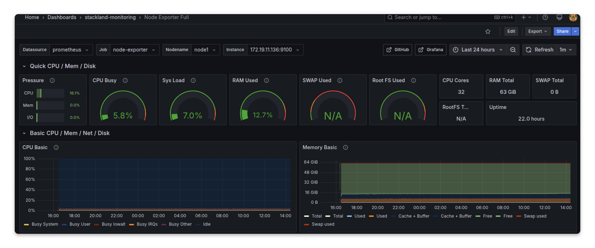
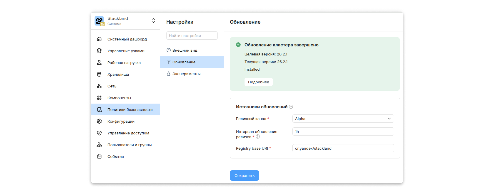
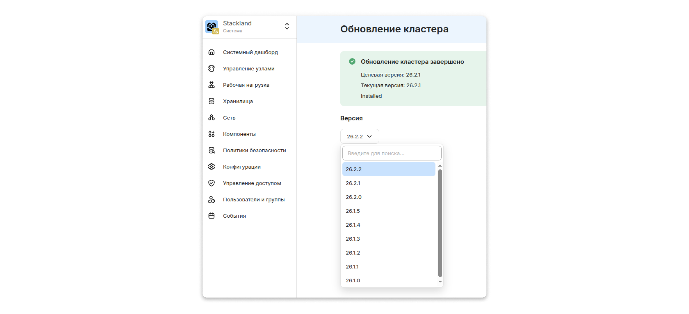

# Обновление кластера

В этом рецепте вы узнаете, как устроен процесс обновления {{ stackland-name }}, какие риски с ним связаны и как подготовиться к обновлению кластера. Также вы выясните, как запускать процесс обновления и отслеживать его состояние.

## Как работает обновление {{ stackland-name }} {#how-update-works}

Понимание архитектуры обновления помогает правильно подготовить кластер к этой процедуре и решить проблемы, которые могут возникнуть в процессе обновления.

### Обзор процесса {#process-overview}

Обновление {{ stackland-name }} — это идемпотентная процедура приведения кластера к целевому состоянию, описанному в установочных конфигурациях. Процесс обновления охватывает три уровня:

* операционную систему (Talos);

* системные образы (`kubelet`, `etcd`, Cilium);

* платформенные компоненты (IAM, Monitoring, {{ objstorage-name }} и другие).

#### Ключевые принципы {#key-principles}

* **Идемпотентность**. Запуск `sladm` идемпотентен. При прерывании процесса (например, при перезапуске пода на другом узле) `sladm` заново проверяет состояние узлов и возобновляет работу с момента остановки. Уже обновленные узлы пропускаются.

* **Последовательное обновление.** Узлы обновляются по одному, что обеспечивает доступность stateful-сервисов во время обновления.

* **Порядок обновления узлов.** Узлы `control-plane` обновляются перед `worker`-узлами.

* **Возможность отката.** При неудачном обновлении откат к предшествующему состоянию выполняется автоматически.



Запуск отката вручную не поддерживается.



Итак, утилита `sladm` сравнивает фактическое состояние кластера с желаемым, вычисляет разницу и применяет изменения в правильном порядке, обеспечивая отказоустойчивость и возможность возобновления работы после прерывания.

### Процесс обновления {#update-process}

Обновление можно разделить на пять ключевых этапов.

#### Этап 1. Запуск обновления и валидация конфигурации {#stage-validation}

1. Задание `sladm` начинает работу в пространстве имен `stackland-install`.

1. Монтируется конфигурация кластера:

    * ConfigMap: `stackland-cluster-config` (`cluster.yaml`), `stackland-hosts-list` (`hosts.yaml`);

    * Secret: `stackland-secrets-config` (`secrets.yaml`).

1. Конфигурационные файлы валидируются.

#### Этап 2. Загрузка образов {#stage-images}

1. Утилита `sladm` загружает образы для релиза из `cr.yandex`.

1. Утилита `sladm` формирует OCI-бандл.

#### Этап 3. Последовательное обновление узлов {#stage-update-nodes}

1. Узлы обновляются строго по одному, в первую очередь — `control-plane`.

1. Для каждого узла:

    * `sladm` подключается к Talos API узла.

    * `sladm` загружает образы в локальный registry узла (`<hostname>:5001`).

    * `sladm` запускает `kubelet`.

    * `sladm` проверяет версию Talos и список расширений.

    * Если установленная версия Talos не совпадает с целевой, `sladm` запускает обновление Talos через `stackland-installer`.

    * После обновления Talos узел перезагружается.

    * После загрузки настраиваются системные компоненты (`kubelet`, `etcd` и другие).

    * При изменении в системных компонентах узел перезагружается.

    * После всех перезагрузок узел переходит в статус `Configuring`.

#### Этап 4. Завершение работы `sladm` {#stage-sladm-complete}

1. Задание `sladm` ожидает перехода всех узлов в статус `Ready`.

1. Задание `sladm` завершается.



Обновление платформенных компонентов продолжается асинхронно.



#### Этап 5. Обновление платформенных компонентов {#stage-components}

1. Component Manager получает управление, когда инфраструктура готова.

1. Component Manager вычисляет разницу между текущим и целевым состоянием для каждого компонента.

1. Component Manager применяет изменения в следующем порядке:

    * **Add** — установка новых компонентов;

    * **Edit** — обновление существующих;

    * **Delete** — удаление компонентов, которых нет в целевом манифесте.

    Каждый компонент обновляется с учетом зависимостей. Например, IAM зависит от `certificate-manager` и `volumes`.

1. Component Manager отмечает статус обновления в ресурсе `ComponentInstallation`.

## Рекомендации перед обновлением {#before-update}

Как и при других критических операциях, перед обновлением платформы следует провести ряд действий и проверок. Мы разделили рекомендации на несколько блоков:

* {{ stackland-name }} и его компоненты

* Пользовательские нагрузки

* Управляемые сервисы

### {{ stackland-name }} и его компоненты {#check-platform}

Убедитесь, что платформа готова к обновлению. Для этого следуйте рекомендациям:

1. **Проверка релизного канала**

    Релизный канал определяет, какие версии {{ stackland-name }} доступны для обновления — стабильные релизы (Stable) либо релизы для тестирования новых функций (Alpha). По умолчанию используется канал Stable.

    Для проверки релизного канала выполните команду:

    ```bash
    kubectl describe platformconfig main | grep 'Release Channel'
    ```

    ```plaintext
    Release Channel:            Stable
    ```

1. **Ознакомление с Release Notes целевой версии**

    Перед любым обновлением обязательно изучите Release Notes версии, на которую планируете перейти. В новой версии могут содержаться изменения, требующие дополнительных действий.

1. **Проверка состояния кластера**

    Команда `talosctl health` выполняет комплексную проверку состояния кластера. Подробнее — в инструкции «[{#T}](../../operations/troubleshooting.md#talosctl-usage)».

    Все проверки должны завершиться успешно:

    ```bash
    # Необходимо указать IP-адрес любого узла control-plane
    talosctl --nodes 172.19.11.136 health
    ```

    ```plaintext
    discovered nodes: ["172.19.11.136" "172.19.11.137" "172.19.11.138"]
    waiting for etcd to be healthy: ...
    waiting for etcd to be healthy: OK
    waiting for etcd members to be consistent across nodes: ...
    waiting for etcd members to be consistent across nodes: OK
    waiting for etcd members to be control plane nodes: ...
    waiting for etcd members to be control plane nodes: OK
    waiting for apid to be ready: ...
    waiting for apid to be ready: OK
    ...
    ```

1. **Проверка статусов платформенных компонентов**

    Все компоненты должны быть в статусе `Ready`.

    ```bash
    kubectl get componentinstallations
    ```

    ```plaintext
    NAME                       PHASE      VERSION   MESSAGE                            AGE
    certificate-manager-main   Ready      26.2.1    Component is in the target state   2d17h
    console-main               Ready      26.2.1    Component is in the target state   2d16h
    dns-main                   Ready      26.2.1    Component is in the target state   2d17h
    ```

1. **Проверка доступных ресурсов**

    * **Свободное место на дисках.** Убедитесь, что на узлах достаточно свободного места, так как во время обновления на них будут загружаться новые образы контейнеров.

        ```bash
        # Вывод в GiB с фильтрацией
        kubectl get volumegroups -n stackland-volumes -o json | jq '.items[] | select(.status.free != null) | {name: .metadata.name, free_bytes: .status.free, free_gib: (.status.free | tonumber / 1073741824)}'
        ```

        ```json
        ...
        {
          "name": "vg-other-node2",
          "free_bytes": "256750125056",
          "free_gib": 239.1171875
        }
        ...
        ```

        ```bash
        # Вывод в Bytes
        kubectl -n stackland-volumes get volumegroups -o custom-columns='NAME:.metadata.name,FREE:.status.free'
        ```

        ```plaintext
        NAME             FREE
        ...
        vg-nvme-node2    <none>
        vg-nvme-node3    <none>
        vg-other-node1   213800452096
        vg-other-node2   256750125056
        vg-other-node3   256750125056
        ...
        ```

    * **Память и CPU.** Проверьте, что есть запас памяти и CPU, так как в процессе обновления рабочие нагрузки будут переезжать с обновляемого узла на другие.

        Проверить утилизацию ресурсов можно через встроенные дашборды Grafana — например, через дашборд `Node Exporter Full`. Выполняйте проверку для каждого узла.

        

        Другой способ проверки — через `kubectl`:

        ```bash
        kubectl top nodes
        ```

        ```plaintext
        NAME    CPU(cores)   CPU%   MEMORY(bytes)   MEMORY%
        node1   1826m        5%     11248Mi         17%
        node2   2436m        7%     11569Mi         18%
        node3   2529m        7%     11090Mi         17%
        ```

1. **Создание резервной копии `etcd`**

    Создайте снапшот `etcd` на любом `control-plane`-узле. Это позволит восстановить кластер в случае серьезного сбоя:

    ```bash
    # Необходимо указать IP-адрес любого узла control-plane
    talosctl etcd snapshot ./etcd-pre-upgrade-$(date +%Y%m%d-%H%M%S).snapshot -n 172.19.11.136
    ```

    ```plaintext
    etcd snapshot saved to "./etcd-pre-upgrade-20260702-101107.snapshot" (458379296 bytes)
    snapshot info: hash c578568b, revision 53621386, total keys 4408, total size 458379264
    ```

1. **Создание диагностического архива**

    Диагностический архив содержит информацию о состоянии кластера и все манифесты. Эта информация может помочь, если возникнут проблемы в процессе или после обновления.

    ```bash
    sladm diag --artifacts-dir ./pre-upgrade-backup
    ```

### Пользовательские нагрузки {#user-workloads}

Этот блок рекомендаций посвящен пользовательским приложениям, развернутым в кластере.

1. **Проверка на устаревшие Kubernetes API**

    Одна из самых частых причин отказов при обновлении — использование версий API, удаленных в новом релизе Kubernetes. Заранее проверьте манифесты и существующие ресурсы в кластере.

    

    Можно воспользоваться утилитой [`pluto`](https://github.com/FairwindsOps/pluto) для поиска проблемных объектов.

    

    Все проблемные объекты необходимо обновить до актуальных API до начала обновления кластера.

1. **Проверка состояния подов**

    Убедитесь, что все пользовательские поды находятся в стабильном состоянии.

1. **Проверка наличия `PodDisruptionBudget` (PDB)**

    При обновлении узлы будут поочередно изолироваться (`drain`) для эвакуации подов. Если у приложения всего одна реплика или нет PDB, возможна кратковременная недоступность. Проверьте, что для критичных сервисов настроены `PodDisruptionBudget`.

1. **Ручное резервное копирование данных приложений**

    Несмотря на то что обновление не затрагивает Persistent Volume напрямую, рекомендуем инициировать внеплановое резервное копирование для всех критически важных данных.

### Управляемые сервисы {#managed-services}

Если в кластере работают управляемые сервисы, например PostgreSQL, {{ CH }}, Kafka®, перед обновлением {{ stackland-name }} рекомендуются дополнительные проверки и действия, связанные со спецификой конкретного ПО.

Рассмотрите для примера кластер PostgreSQL, развернутый с тремя узлами и конфигурацией по умолчанию в пространстве имен `team-alpha-dev`. Риски при обновлении такого кластера собрали в таблице:

#|
|| **Риск** | **Описание** ||
|| Потеря подключения к БД | Во время обновления узлов поды PostgreSQL могут перезапускаться, что приведет к кратковременной недоступности БД ||
|| Проблемы с резервным копированием | Во время обновления могут временно не создаваться резервные копии в S3 ||
|| Снижение производительности | При обновлении узлов кластер работает с уменьшенным количеством реплик (две из трех), что может повлиять на производительность при высокой нагрузке ||
|| Потеря данных в случае сбоя | Если обновление прервется на этапе переключения реплик и кластер потеряет кворум, может произойти рассинхронизация WAL-позиций между репликами. Это может привести к безвозвратной потере уже подтвержденных транзакций ||
|| Проблемы с WAL-архивацией | Во время перезагрузки узлов может временно прерваться архивирование WAL в S3 ||
|#

#### Рекомендации {#postgresql-recommendations}

1. **Проверка состояния кластера.** Все узлы должны быть в статусе `Ready`.

    ```bash
    kubectl get postgresqlclusters -n team-alpha-dev
    ```

    ```plaintext
    NAME                      AGE   INSTANCES   READY   STATUS    PRIMARY                     VERSION
    postgresql-cluster-ug91   3d    3           3       running   postgresql-cluster-ug91-2
    ```

1. **Создание резервной копии вручную** на случай сбоя. Процесс описан в инструкции «[{#T}](../../operations/postgresql/new-copy.md)».



Обязательно убедитесь, что процесс создания резервной копии завершился успешно, и проверьте наличие копии в S3-бакете.



## Запуск обновления {#run-update}

Далее опишем процесс обновления до версии 26.2.2 для кластера с доступом в интернет.



Подробнее о процессе обновления, в том числе в изолированной среде, вы можете прочитать в статье [Обновить кластер](../../operations/cluster/upgrade-cluster.md).





- Консоль управления {#console}

  1. В меню слева выберите **Настройки**.

  1. В подменю выберите **Обновление**.

  1. Измените релизный канал на Alpha и нажмите **Сохранить**.

      

  1. Нажмите ссылку **Подробнее** для перехода на страницу запуска обновления кластера.

  1. В разделе **Версия** выберите версию 26.2.2.

      

  1. Нажмите **Запустить обновление**.

- CLI {#cli}

  **Шаг 1. Получение текущей версии**

  Для проверки текущей версии кластера можно воспользоваться кастомным ресурсом `targetinstallationstates`:

  ```bash
  kubectl get targetinstallationstates -o yaml | grep currentVersion
  ```

  ```plaintext
      currentVersion: 26.2.1
  ```

  Или проверить версии компонентов платформы:

  ```bash
  kubectl get ComponentInstallation
  ```

  ```plaintext
  NAME                       PHASE      VERSION   MESSAGE                            AGE
  certificate-manager-main   Ready      26.2.1    Component is in the target state   2d17h
  console-main               Ready      26.2.1    Component is in the target state   2d17h
  dns-main                   Ready      26.2.1    Component is in the target state   2d17h
  ...
  ```

  **Шаг 2. Смена релизного канала обновления**

  Чтобы установить версию 26.2.2, смените канал обновлений на Alpha. Для этого внесите изменения в кастомный ресурс `platformconfigs`, заменив в нем значение поля `releaseChannel` на Alpha.

  ```bash
  kubectl edit platformconfigs.stackland.yandex.cloud
  ```

  **Шаг 3. Получение доступных версий релиза**

  Проверить доступные релизы и последовательность обновлений можно командой:

  ```bash
  kubectl get availablereleases main -o yaml
  ```

  Найдите целевую версию 26.2.2 и убедитесь, что на эту версию можно перейти с текущей:

  ```yaml
  apiVersion: stackland.yandex.cloud/v1alpha1
  kind: AvailableReleases
  metadata:
    name: main
  spec: {}
  status:
  ...
    releases:
    - installerImage: cr.yandex/stackland/system/sladm:26.2.2
      publishedAt: "2026-08-13T08:33:47Z"
      ready: true
      upgradeFrom:
      - 26.2.1
      - 26.1.5
      version: 26.2.2
  ...

  ```

  В примере видно, что с текущей версии 26.2.1 можно перейти на последнюю доступную 26.2.2.

  **Шаг 4. Запуск обновления**

  Создайте файл манифеста, например с помощью команды `touch upgrade.yaml`, и вставьте содержимое:

  ```yaml
  apiVersion: stackland.yandex.cloud/v1alpha1
  kind: TargetInstallationState
  metadata:
    name: main
  spec:
    targetVersion: "26.2.2"
    installationTimeout: "2h"
  ```

  В этом файле:

  * `targetVersion` — целевая версия для обновления, в данном случае 26.2.2;

  * `installationTimeout` — максимальное время выполнения обновления.

  Примените манифест:

  ```bash
  kubectl apply -f upgrade.yaml
  ```



## Мониторинг процесса обновления узлов {#monitor-nodes}

После запуска обновления:

* В пространстве имен `stackland-install` запускается задание `sladm-upgrade-main`, логи которого отражают весь процесс обновления:

    ```bash
    kubectl logs -n stackland-install job/sladm-upgrade-main
    ```

    Пример логов обновления с разделением на этапы:

    ```plaintext
    # Этап 1: запуск обновления и валидация конфигурации
    2026-08-27T12:53:19.207Z	INFO	sladm/main.go:446	PXE boot disabled
    2026-08-27T12:53:19.212Z	INFO	sladm/main.go:454	Starting SLADM installation process...
    2026-08-27T12:53:19.214Z	INFO	sladm/config.go:60	Loading Stackland configurations from directory	{"directory": "/config/"}
    2026-08-27T12:53:19.229Z	INFO	sladm/config.go:70	Stackland configurations loaded and validated successfully
    2026-08-27T12:53:19.229Z	INFO	sladm/license.go:160	In-cluster run: derived offline mode from licenseKey, license-server secrets will be materialized
    → Loaded release configuration: 26.2.2
    2026-08-27T12:53:19.231Z	INFO	sladm/main.go:497	Loaded release	{"version": "26.2.2"}
    2026-08-27T12:53:19.231Z	INFO	sladm/main.go:503	Detected sladm-upgrade job pod	{"hostname": "sladm-upgrade-main-kqclp"}
    ...

    # Этап 2: загрузка образов
    ⚠ Image bundle path stackland-26.2.2-minimal-oci does not exist, downloading images
    2026-08-27T12:53:19.231Z	WARN	sladm/images.go:69	Image bundle path does not exist, will download images	{"path": "stackland-26.2.2-minimal-oci"}
    2026-08-27T12:53:19.231Z	INFO	sladm/images.go:74	Downloading images...	{"bundle": "minimal", "registry": "cr.yandex/stackland"}
    → Downloading minimal image bundle (15 images)
    2026-08-27T12:53:19.362Z	INFO	sladm/images.go:122	Downloading image bundle	{"bundle": "minimal", "imageCount": 15}
    2026-08-27T12:53:19.362Z	INFO	sladm/images.go:124	Creating image bundle folder	{"path": "stackland-26.2.2-minimal-oci"}
    ✓ Fetched the manifests for all images
    → Saving 15 images to OCI layout: stackland-26.2.2-minimal-oci
    → Pulled 2/15 images (10%)
    ...
    → Pulled 15/15 images (100%)
    ✓ Successfully saved 15 images to stackland-26.2.2-minimal-oci
    2026-08-27T12:55:24.556Z	INFO	sladm/images.go:132	Image bundle download completed	{"path": "stackland-26.2.2-minimal-oci", "imageCount": 15}
    2026-08-27T12:55:24.556Z	INFO	sladm/images.go:87	Image bundle downloaded successfully
    2026-08-27T12:55:24.556Z	INFO	sladm/images.go:90	Successfully loaded image bundle	{"imageCount": 15}
    ...

    # Этап 3: последовательное обновление узлов
    ## Инициализация
    Creating COSI resources from configuration...
    Starting COSI runtime...
    Created ClusterConfig resource
    Created PlatformConfig resource	{"platform": "baremetal"}
    Created StacklandHostConfig resource for node	{"hostname": "node1.proxmox.internal", "role": "combined"}
    Created StacklandHostConfig resource for node	{"hostname": "node2.proxmox.internal", "role": "combined"}
    Created StacklandHostConfig resource for node	{"hostname": "node3.proxmox.internal", "role": "combined"}
    Created EtcdBootstrapper resource	{"hostname": "node1.proxmox.internal"}
    Created IntermediateCA resource
    Created StacklandClusterConfig resource
    Created StacklandSecretsConfig resource
    Running pre-installation node config checks...
    Starting Stackland 26.2.2 release reconciliation
    Installation workflow started, waiting for completion...	{"installationTimeout": 7200, "recoveryTimeout": 600}
    ...

    ## Подключение к Talos API
    Created initial NodeInstallationStatus	{"controller": "NodeInstallationController", "namespace": "sladm-manager", "type": "MachineStatuses.sladm.yandex.cloud", "id": "node1.proxmox.internal", "job": "reconcile", "hostname": "node1.proxmox.internal"}
    ...

    ## Пуш образов в local registry
    Pushing images to node local registry	{"controller": "NodeInstallationController", "namespace": "sladm-manager", "type": "MachineStatuses.sladm.yandex.cloud", "id": "node1.proxmox.internal", "job": "reconcile", "hostname": "node1.proxmox.internal", "nodeIP": "172.19.11.136", "registry": "node1.proxmox.internal:5001", "imageCount": 14}
    → Pushing 14 images to node1.proxmox.internal:5001
    ✓ Successfully pushed 14 images to node1.proxmox.internal
    ...

    ## Запуск kubelet
    Service start requested	{"controller": "NodeInstallationController", "namespace": "sladm-manager", "type": "MachineStatuses.sladm.yandex.cloud", "id": "node1.proxmox.internal", "job": "reconcile", "hostname": "node1.proxmox.internal", "service": "kubelet"}
    ...

    ## Настройка системных компонентов и перезагрузка
    → Node node1.proxmox.internal: Empty → Configuring (Node is running and ready, starting post-installation configuration)
    → Initiating machine config update with reboot on node node1.proxmox.internal
    Applied machine config patches with reboot	{"controller": "NodeInstallationController", "namespace": "sladm-manager", "type": "MachineStatuses.sladm.yandex.cloud", "id": "node1.proxmox.internal", "job": "reconcile", "hostname": "node1.proxmox.internal", "nodeIP": "172.19.11.136"}
    Post-installation configuration triggered a reboot	{"controller": "NodeInstallationController", "namespace": "sladm-manager", "type": "MachineStatuses.sladm.yandex.cloud", "id": "node1.proxmox.internal", "job": "reconcile", "hostname": "node1.proxmox.internal"}
    Post-installation configuration triggered a reboot, waiting for node to restart	{"controller": "NodeInstallationController", "namespace": "sladm-manager", "type": "MachineStatuses.sladm.yandex.cloud", "id": "node1.proxmox.internal", "job": "reconcile", "hostname": "node1.proxmox.internal"}
    Node successfully rebooted after configuration change	{"controller": "NodeInstallationController", "namespace": "sladm-manager", "type": "MachineStatuses.sladm.yandex.cloud", "id": "node1.proxmox.internal", "job": "reconcile", "hostname": "node1.proxmox.internal"}
    ...

    # Этап 4: завершение работы задания обновления
    Node node2.proxmox.internal reconciled successfully
    Node node3.proxmox.internal reconciled successfully
    Node node1.proxmox.internal reconciled successfully
    → Node node2.proxmox.internal: Configured → Ready (All components are ready, node installation complete)
    → Node node1.proxmox.internal: Configured → Ready (All components are ready, node installation complete)
    → Node node3.proxmox.internal: Configured → Ready (All components are ready, node installation complete)
    ✓ Your Stackland cluster is ready
    Installation completed: success=true
    ✓ Reconciliation completed successfully
    Clusteradmin kubeconfig is now available at /root/.kube/config
    ```

* Появляется ресурс `targetinstallationstate`, с помощью которого можно отслеживать общий статус обновления:

    ```bash
    kubectl get targetinstallationstate main
    ```

    ```plaintext
    NAME   TARGET VERSION   CURRENT VERSION   PHASE       MESSAGE                                                         AGE
    main   26.2.2           26.2.2            Completed   Successfully upgraded to version 26.2.2, all components ready   2d19h
    ```

    Для получения более подробной информации выполните:

    ```bash
    kubectl describe targetinstallationstate main
    ```

    В поле `status` отображается:

    * `currentVersion` — текущая установленная версия.

    * `phase` — фаза обновления:

        * `Pending` — обновление ожидает запуска;

        * `Running` — обновление выполняется;

        * `Completed` — обновление выполнено;

        * `Failed` — обновление завершилось с ошибкой.

    * `message` — сообщение о текущем состоянии.

    * `jobName` — имя задания Kubernetes, выполняющего обновление.

    * `lastUpdateTime` — время последнего обновления статуса.

## Мониторинг процесса обновления компонентов {#monitor-components}

После того как `sladm` завершила обновление Talos и системных компонентов, управление переходит к Component Manager. Он отвечает за обновление всех платформенных компонентов.

Для отслеживания статуса компонентов в реальном времени выполните:

```bash
kubectl get componentinstallations -w
```

```plaintext
NAME                       PHASE      VERSION   MESSAGE
certificate-manager-main   Ready      26.2.2    Component is in the target state
console-main               Updating   26.2.1    Component is being updated
dns-main                   Ready      26.2.2    Component is in the target state
iam-main                   Updating   26.2.1    Component is being updated
...
```

После завершения обновления все компоненты должны получить статус `Ready`.

```bash
kubectl get componentinstallations
```

```plaintext
NAME                       PHASE   VERSION   MESSAGE                            AGE
certificate-manager-main   Ready   26.2.2    Component is in the target state   5h56m
console-main               Ready   26.2.2    Component is in the target state   5h33m
dns-main                   Ready   26.2.2    Component is in the target state   5h56m
iam-main                   Ready   26.2.2    Component is in the target state   5h48m
...
```

## Итоги {#summary}

Вы узнали, как подготовить кластер к обновлению, и проследили за процессом. Что важно запомнить:

* Обновление {{ stackland-name }} идемпотентно: сначала обновляются узлы `control-plane`, затем `worker`-узлы, а в случае прерывания процесс автоматически возобновляется.

* Для подготовки кластера к обновлению рекомендуется проверить состояние платформенных компонентов через `kubectl` и `talosctl`, создать резервную копию `etcd` и диагностический архив.

* Совместимость версий задается в объекте `AvailableReleases`, с его помощью можно проверить, какие версии доступны.

* Чтобы снизить риски для пользовательских нагрузок при обновлении, необходимо провести проверку на устаревшие Kubernetes API через `pluto`, убедиться в наличии `PodDisruptionBudget` для критичных сервисов, сделать ручное резервное копирование данных.

* Чтобы снизить риски для управляемых сервисов при обновлении, учитывайте особенности каждого отдельного сервиса. Общая рекомендация — проверить здоровье кластера и сделать ручное резервное копирование данных.

* Запустить обновление можно как через консоль управления, так и через CLI.

* Отследить прогресс обновления можно для узлов — по логам задания обновления `sladm-upgrade-main` — и для платформенных компонентов — с помощью ресурса `ComponentInstallation`.

Будем благодарны за обратную связь — это поможет нам улучшить рецепты. Опрос займет не более 3 минут.

[Пройти опрос](https://forms.yandex.ru/surveys/13904409.de2ec464d13f519954a1fab7fa333720a58d7c10/).
