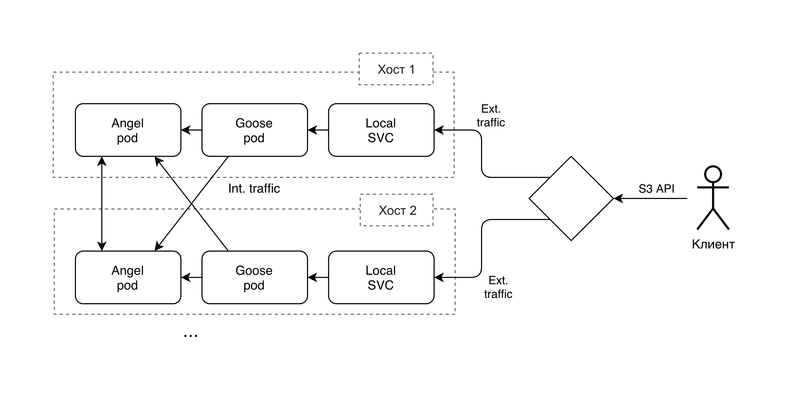

# Сетевая топология и балансировка трафика

Наибольший объем трафика передается между Goose и Angel, а также между подами Angel.

В этой схеме:

* Для каждого пода Goose используется отдельный внешний сервис {{ k8s }}. Он расположен на том же хосте и направляет трафик *только* к локальному Goose.
* Объем трафика внутри кластера превышает объем внешнего:
    * Goose не обязательно читает данные из локального Angel;
    * запись с избыточностью создает дополнительный трафик к соседним хостам: как минимум x2 от внешнего трафика при репликации x3.
* Размещение внешнего LoadBalancer внутри кластера {{ k8s }} ограничивает пропускную способность для внешнего трафика сетевым интерфейсом одного хоста.

По умолчанию с каждого хоста анонсируется по одному виртуальному IP-адресу для S3 API. При отказе хоста его адрес анонсируется с другого хоста в соответствии с настройками MetalLB.

Для высокой пропускной способности рекомендуется:

* Иметь отдельные сетевые интерфейсы для оверлея {{ k8s }} и внешних подключений.
* Обеспечивать балансировку внешних запросов между узлами кластера {{ k8s }}. Это можно организовать:
    * DNS-балансировкой;
    * внешним балансировщиком, направляющим трафик на виртуальные IP-адреса разных узлов;
    * либо с помощью BGP и распределения маршрутов ECMP.
