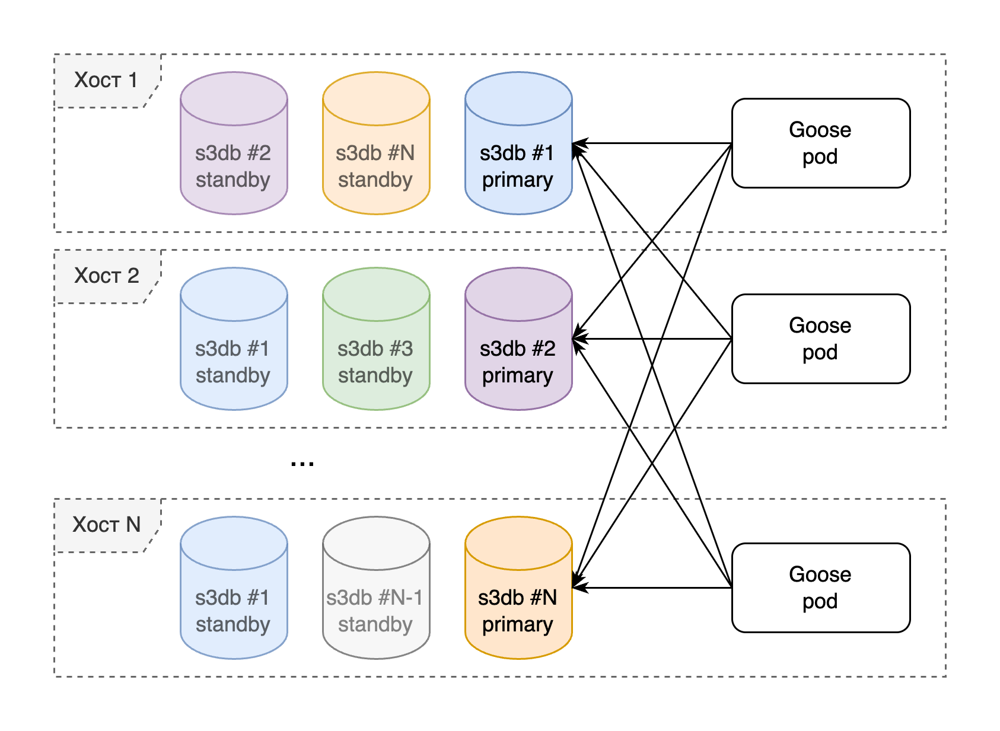

# Работа Goose с {{ PG }}

По умолчанию каждый кластер {{ PG }} состоит из primary и двух реплик. Для подтверждения транзакции primary требует подтверждения от одной из реплик. Вторая реплика может отставать. Такая конфигурация обеспечивает баланс отказоустойчивости и производительности.

Goose сначала читает метаданные объекта с primary. Если запрос завершается ошибкой, он может повторить чтение с реплики. Это возможно не только при отказе primary, но и при перегрузке — например, когда большое число запросов чтения небольших объектов приводит к ошибкам или тайм-аутам обращения к БД.

Серверы primary s3db необходимо размещать по хостам кластера {{ k8s }} — не более одного на хост:

- primary шарда s3db создает значительную нагрузку на CPU, поэтому при размещении двух шардов на одном хосте возникнет нехватка ресурсов CPU;
- при отказе хоста запись в находящийся на нем шард s3db будет временно недоступна. При `N` шардах s3db запись `1/N` ключей в S3 также становится временно недоступной. Если на хосте размещено больше одного primary s3db, отказ затрагивает запись большего числа ключей.

Поэтому шарды s3db располагаются в кластере следующим образом:

При отказе одного из хостов в этой схеме до выполнения фейловера:

* недоступна запись `1/N` ключей в S3;
* возникает разовая задержка чтения `1/N` ключей из-за переключения на чтение из реплики.

После выполнения фейловера чтение и запись доступны.

При отказе двух хостов в этой схеме запись `1/N` ключей будет недоступна, так как в одном из шардов s3db останется только один сервер.



Топология зависит от выбранной зоны отказа.

Например, если в качестве зоны отказа выбран не узел, а стойка или дата-центр, экземпляры s3db будут размещаться по разным стойкам или дата-центрам соответственно.





По умолчанию количество шардов s3db равно количеству хостов.

При необходимости количество шардов можно уменьшить с помощью параметров установки.

Например, это можно сделать, если нагрузка при чтении и записи метаданных ниже средней для заданного объема хранилища. При этом primary по-прежнему необходимо размещать на разных узлах, а экземпляры одного шарда — в разных зонах.


