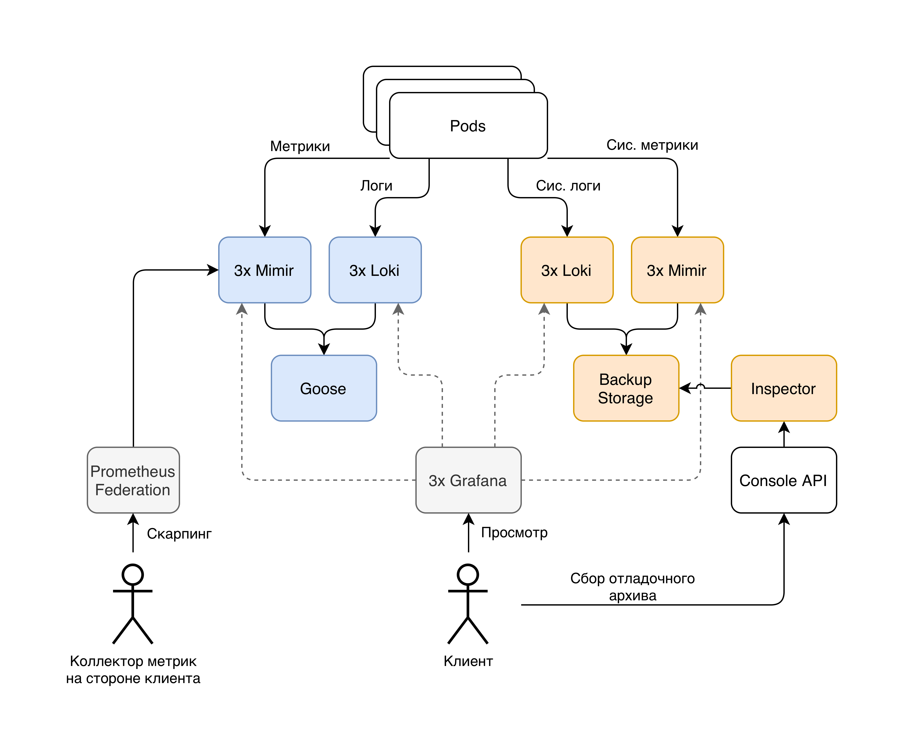

# Observability

Метрики и логи в {{ objstorage-onprem-name }} делятся на две категории:

* Системные метрики и логи, которые необходимы для отладки при инцидентах. Их объем сравнительно невелик, но необходимо обеспечить их высокую доступность даже при отказе большинства компонентов {{ objstorage-onprem-name }}.
* Метрики и логи, которые используются в остальных случаях. Их объем многократно больше, но при инцидентах допустимо снижение их доступности.

Для хранения метрик и логов используются Grafana Mimir и Grafana Loki. Для долгосрочного хранения данных они используют S3. Небольшой объем системных метрик и логов хранится в Backup Storage, все остальные — в служебных бакетах самого {{ objstorage-onprem-name }}.

Схема хранения метрик и логов:

Все кластеры Mimir и Loki по умолчанию устанавливаются в трех копиях. В этой конфигурации запись и чтение недавних данных доступны при отказе одного хоста, а чтение исторических данных зависит от доступности чтения из соответствующего S3.

Также на схеме отмечены:

- Grafana без сохранения состояния, содержащая набор встроенных дашбордов и доступная при отказе до двух хостов;
- эндпоинт формата Prometheus Federation для сбора метрик из кластера — его доступность совпадает с доступностью соответствующего кластера Mimir;
- Inspector — развернут в {{ k8s }} и доступен через Console API. При отказе компонентов {{ objstorage-onprem-name }} может собрать системные метрики и логи напрямую из Backup Storage.
