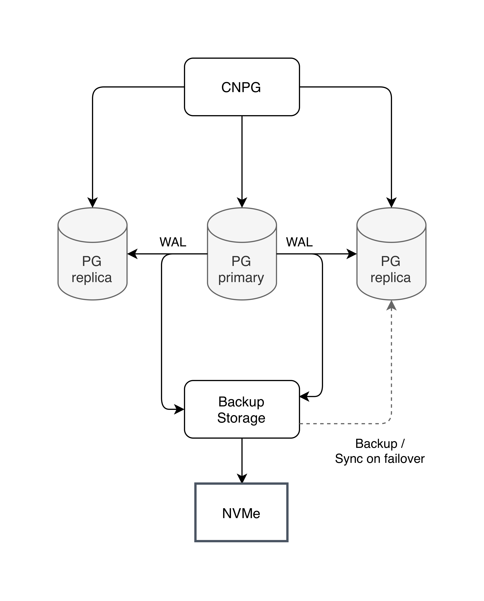

# Кластеры {{ PG }}

Кластеры {{ PG }} используются для [Goose](goose-postgresql.md), Gosper и Zitadel. По умолчанию все кластеры создаются по схеме 1 primary + 2 standby с подтверждением записи от одной реплики.

Схема репликации {{ PG }}:

За создание кластеров и управление ими отвечает оператор CloudNativePG.

{{ PG }} передает изменения репликам с помощью потоковой репликации. Резервные копии и WAL сохраняются отдельно — в S3-совместимом Backup Storage. Они используются для восстановления базы данных, если доступных экземпляров недостаточно.



Восстановление из бэкапа или синхронизация отстающей реплики могут потребоваться при отказе компонентов основного хранилища. В таких ситуациях надежность {{ objstorage-onprem-name }} зависит в том числе от надежности {{ PG }}, поэтому бэкапы и WAL хранятся в отдельном компоненте.



Размещение и избыточность Backup Storage выбирают с учетом тех же зон отказа, что и для основного хранилища. {{ PG }} и Backup Storage рекомендуется размещать на быстрых SSD/NVMe.

В конфигурации с одним primary и двумя репликами отказ хоста с primary обрабатывается следующим образом:

1. CloudNativePG обнаруживает и подтверждает недоступность primary. По умолчанию это занимает около 40 секунд. Запись в кластер {{ PG }} невозможна, чтение возможно с реплик.
1. Выполняет фейловер на реплику, синхронизированную с предыдущим primary. Как минимум одна из реплик находится в таком состоянии.
1. Завершает фейловер. Чтение и запись снова доступны, а оставшаяся реплика синхронизирована с новым primary.

При одновременном отказе двух хостов с primary и репликой возможны два сценария:

* Осталась реплика, которая была синхронизирована с предыдущим primary. Сценарий похож на отказ одного хоста, но запись после фейловера останется недоступна.
* Осталась отстающая реплика. При переключении на нее она попытается загрузить недостающие WAL из Backup Storage. Прерванная запись WAL может помешать реплике стать primary без потери данных. В этом случае завершение фейловера запрещено для обеспечения надежности, но доступность снижается.
