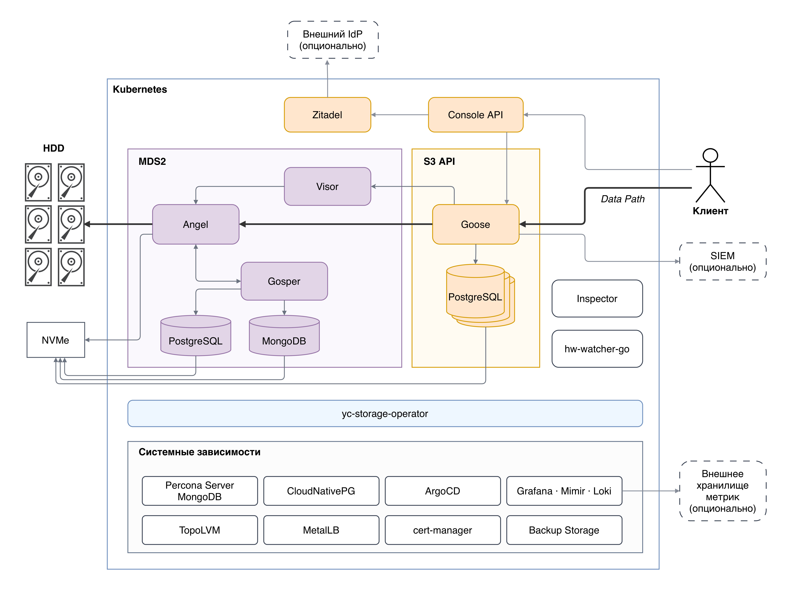

# Общая схема решения

{{ objstorage-onprem-name }} предназначен для установки в кластер {{ k8s }}. Он состоит из:

- набора Helm-чартов и образов, реализующих S3-совместимое хранилище;
- набора системных зависимостей, необходимых для его работы.

Схема взаимодействия основных компонентов:

Хранилище состоит из двух основных частей: слоя хранения MDS2, выделенного на схеме фиолетовым, и интерфейса S3, выделенного оранжевым.

## Слой хранения MDS2 {#storage-layer}

[Слой хранения MDS2](storage-layer.md) — распределенное хранилище бинарных данных по принципу «ключ-значение». В MDS2 входят:

* [Angel](storage-layer.md#angel) — хранит данные на дисках, обрабатывает чтение и запись, поддерживает заданную избыточность.

* [Gosper](storage-layer.md#gosper) — управляет топологией данных в Angel, восстанавливает ее после отказов.

* [Visor](storage-layer.md#visor) — подсистема маршрутизации к Angel: выбирает капл для новых данных и возвращает адреса Angel для чтения существующих.

## Интерфейс S3 {#s3-interface}

Интерфейс S3 состоит из:

* [Goose](goose.md) — реализует S3-совместимый API поверх MDS2. Для хранения метаданных использует шардированный {{ PG }}.
* Console API + Zitadel — подсистема для администрирования кластера S3: управление тенантами, правами доступа, ключами и квотами.

## Внешние интеграции {#integrations}

Опционально доступны [интеграции с внешними системами](integrations.md):

* корпоративным провайдером идентификации IdP через Zitadel — для аутентификации пользователей административной консоли;
* системой SIEM — для получения аудитных логов в формате syslog;
* внешней системой мониторинга — для сбора метрик через эндпоинт Prometheus Federation.

## Хосты кластера {#cluster-hosts}

В кластере {{ k8s }} также работают:

- hw-watcher-go — привилегированный DaemonSet, запущенный на каждом узле хранения. Он собирает сведения о состоянии оборудования и файловых систем, отслеживает ошибки в `dmesg` и SMART и выполняет операции с дисками.
- Inspector — агрегатор отладочной информации, доступный через Console API.

## Установка и обновление {#installation-and-update}

За установку, обновление и конфигурацию компонентов отвечает *yc-storage-operator*, который работает в {{ k8s }}.

## Системные зависимости {#system-dependencies}

Остальные компоненты относятся к системным зависимостям:

* ArgoCD — система непрерывной доставки, через которую yc-storage-operator управляет компонентами.
* CloudNativePG и Percona Server {{ MG }} — операторы для управления базами данных {{ PG }} и {{ MG }}.
* Backup Storage — небольшое S3-совместимое хранилище для WAL и бэкапов баз данных, а также отладочной информации на случай инцидентов.
* Grafana, Mimir и Loki — реализуют подсистему [Observability](observability.md) с хранением метрик и логов в S3.
* TopoLVM — плагин CSI для {{ k8s }}. Создает постоянные тома (PV) для баз данных, кеша Mimir/Loki и Backup Storage.
* MetalLB — создает внешние виртуальные IP-адреса S3 на хостах кластера {{ k8s }}.
* cert-manager — управляет внутренними сертификатами системы.

Подробнее о компонентах — в разделах [Слой хранения MDS2](storage-layer.md) и [Goose](goose.md).

Требования к конфигурации кластера приведены в разделе [Требования к кластеру {{ k8s }}](kubernetes.md).
