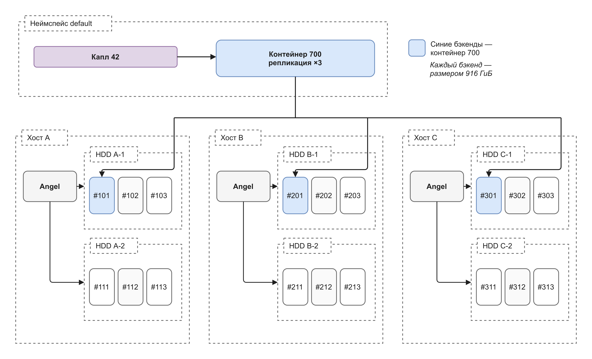
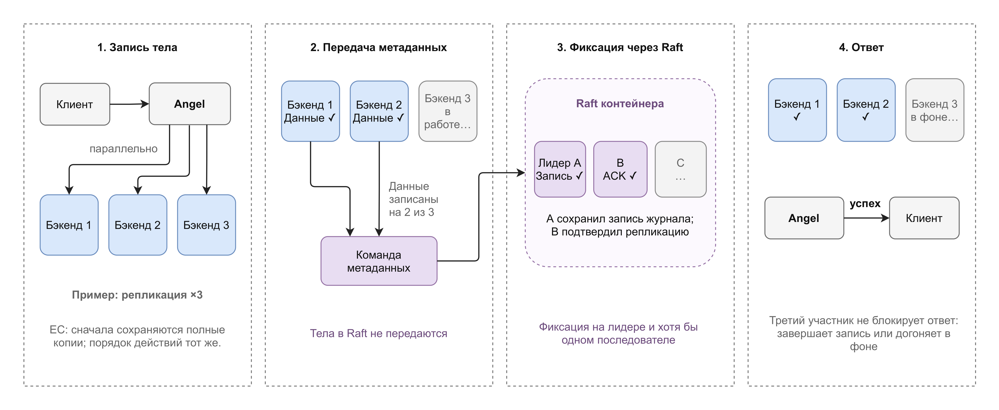
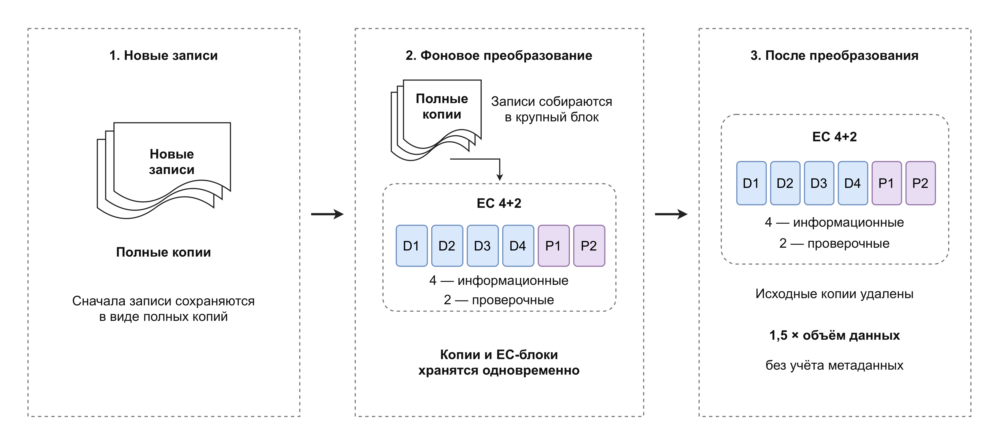
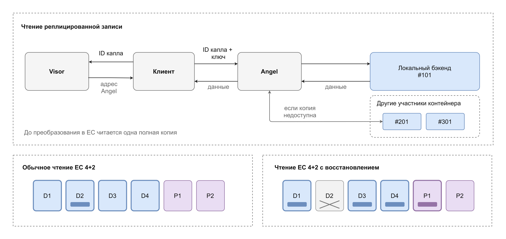

# Слой хранения MDS2

Слой хранения MDS2 — распределенное хранилище бинарных данных, организованное по принципу «ключ-значение». Хранилище рассчитано на работу с большим количеством HDD.

К слою хранения обращается [Goose](goose.md), когда обрабатывает запросы S3 API.

## Организация данных {#data-layout}

Хранилище разделено на *неймспейсы*, которые объединяют данные с общими настройками хранения и записи. Емкость неймспейса распределена между *каплами* — логическими разделами с собственными идентификаторами. Для обращения к данным Goose использует идентификатор капла и ключ записи в MDS2.

Физически данные хранятся в *контейнерах*. Контейнер объединяет части данных, защищенные общей схемой избыточности: полные копии при репликации или части закодированных данных при EC. Один контейнер может обслуживать несколько каплов.

Данные контейнеров на дисках хранятся в *бэкендах* размером 916 ГиБ, которыми управляет Angel. Разделение капла и контейнера позволяет менять физическое размещение данных, сохраняя их логический адрес для Goose.

## Visor {#visor}

Visor собирает сведения о каплах и их состоянии. Для новой записи он помогает выбрать подходящий капл в нужном неймспейсе с учетом доступного места и весов записи. Для существующих данных он возвращает адреса Angel по известному идентификатору капла.

После получения маршрута Goose передает данные непосредственно Angel. Visor не участвует в передаче тела записи.

## Angel {#angel}

Каждый экземпляр Angel обслуживает выделенный ему набор дисков. На каждом из дисков Angel управляет набором бэкендов.

Данные записываются в крупные файлы внутри бэкендов — *блобы*. Angel использует принцип append-only: добавляет новые записи в конец файла. Метаданные позволяют найти запись внутри блоба и проверить ее контрольную сумму.

При удалении Angel сначала фиксирует, что запись удалена. Место на диске освобождается позже, во время фоновой *компакции*: оставшиеся данные переписываются, а ненужные файлы удаляются. Поэтому при удалении объектов место освобождается не сразу.

### Избыточность данных {#data-redundancy}

Схема избыточности задается для контейнера. Доступны две схемы:

* *Репликация x3* предусматривает хранение трех полных копий данных.

* *EC D+P* использует кодирование с избыточностью: данные распределяются между `D` информационными и `P` проверочными частями. Для восстановления закодированных данных достаточно любых `D` исправных частей. Число информационных и проверочных частей настраивается. Например, при EC 4+2 закодированные данные занимают в 1,5 раза больше места, чем исходные, без учета метаданных.

### Согласование операций {#consensus}

У каждого контейнера есть собственная группа Raft. Она согласует порядок записей и удалений, метаданные и изменения состава участников контейнера. Тела записей передаются между Angel отдельно от журнала Raft.

Для согласования новых операций Raft требуется кворум — большинство голосующих участников контейнера. Если кворум недоступен, запись и удаление приостанавливаются.

### Запись данных {#write}

Goose передает запись одному из Angel, обслуживающих выбранный капл. Этот Angel организует запись данных на участников контейнера.

Для контейнера с репликацией x3 и тремя участниками запись проходит следующим образом:

1. Angel передает данные на три бэкенда параллельно.

1. После завершения записи тела на двух из трех бэкендов Angel отправляет команду с метаданными в Raft.

1. Лидер Raft фиксирует операцию, когда соответствующая запись журнала сохранена на большинстве участников с правом голоса. Для трех участников достаточно локальной записи лидера и подтверждения репликации от одного последователя.

1. Angel дожидается применения операции двумя бэкендами и возвращает Goose успешный ответ.

Ожидать третьего участника для подтверждения записи не требуется: он может завершить запись или получить недостающие данные от других участников в фоне.

В EC-контейнере Angel сначала сохраняет новые записи в виде полных копий. Затем он объединяет несколько записей в крупный блок, разделяет его на `D` информационных частей и вычисляет `P` проверочных частей. Информационные части содержат последовательные участки исходных данных. После завершения преобразования и переключения на EC-представление исходные копии удаляются.

В остальном последовательность аналогична: сначала записываются полные копии, затем операция фиксируется через Raft.

При планировании емкости с EC учитывают свободное место для новых записей и фонового преобразования: до его завершения полные копии и EC-части некоторое время хранятся одновременно. Необходимый запас зависит от интенсивности записи и объема данных, ожидающих преобразования.

### Чтение данных {#read}

Goose выбирает один из адресов Angel, полученных от Visor для нужного капла, и отправляет запрос чтения с идентификатором капла и ключом записи. Angel сначала пробует прочитать запись из локального бэкенда. Если подходящая локальная копия недоступна, он обращается к другим участникам контейнера.

При репликации тело записи читается с одного участника. По метаданным Angel находит нужный участок блоба и проверяет контрольные суммы при чтении. Если источник возвращает ошибку, Angel продолжает чтение с другой копии.

В EC-контейнере способ чтения зависит от состояния записи:

- До фонового преобразования Angel читает запись из одной полной копии.
- После преобразования он читает нужный диапазон непосредственно из информационной части EC-блока. Если запись целиком находится в одной части, достаточно чтения с одного Angel. Если она пересекает границы частей, чтение затрагивает несколько участников.
- Если нужная информационная часть недоступна, Angel восстанавливает требуемый диапазон из других частей. Для этого достаточно любых `D` исправных частей; при EC 4+2 — четырех. Данные в сохранившихся информационных частях продолжают читаться напрямую.

Чтение не добавляет новых операций в журнал Raft.

## Gosper {#gosper}

Сведения о локальных бэкендах, параметрах контейнеров и их участниках хранятся в Angel. Состав участников каждого контейнера согласуется через Raft.

Gosper определяет желаемое размещение частей контейнеров. Он получает от Angel сведения о текущем состоянии и планирует изменения с учетом доступной емкости и топологии кластера. Angel выполняет эти изменения и сообщает о результате.

Если часть контейнера становится недоступной, Gosper подбирает для нее новое размещение. Angel на выбранном узле присоединяется к контейнеру, получает необходимые данные от оставшихся участников и синхронизирует свое состояние с состоянием контейнера. Такое же взаимодействие используется при плановом выводе дисков из эксплуатации.

Для восстановления нужны доступные исходные данные и подходящее свободное место. Восстановление выполняется в фоне и занимает время. До его завершения запас избыточности контейнера снижен.



Gosper не участвует в выполнении запросов чтения и записи.

Его временная недоступность сама по себе не останавливает работу существующих контейнеров, пока доступны необходимые участники, кворумы и маршруты к данным.



### Размещение и отказы {#placement-and-failures}

Подробнее — в разделе [Размещение и отказы](system-characteristics.md#placement-and-failures).
